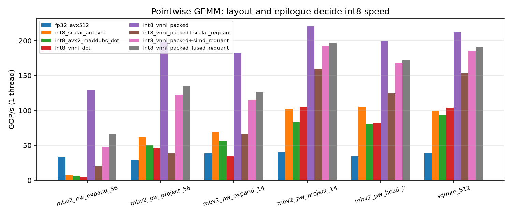
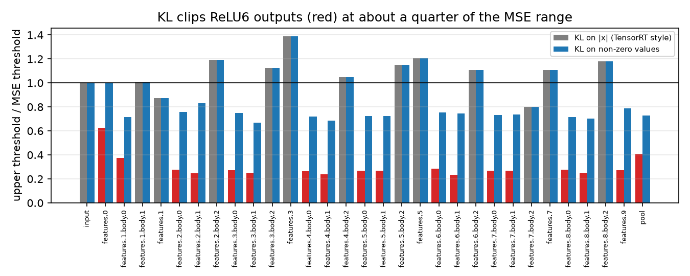
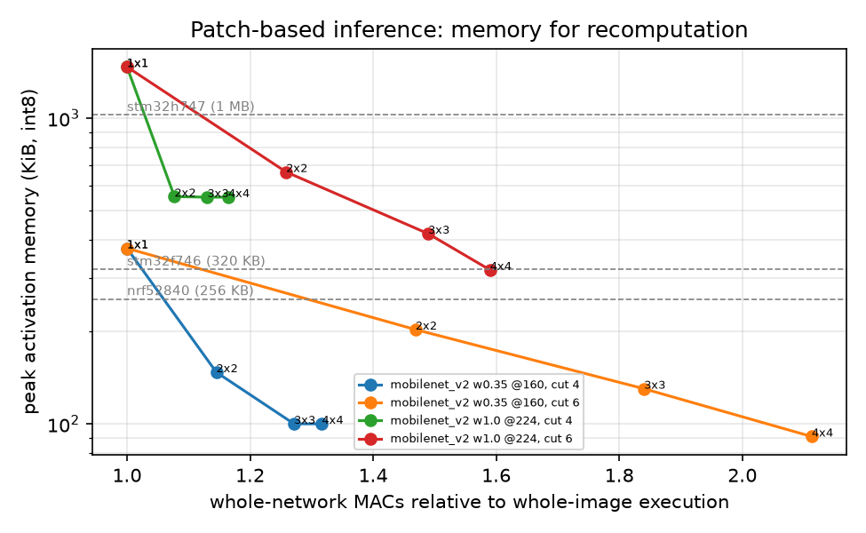

# Kiloscale

**From kernels to kilobytes** — 端侧部署与推理优化。仓库路径仍是 `edge-deploy`，Kiloscale 是项目名：把一张网从 int8 内核一路算到单片机上几百 KB 的 SRAM。

面向端侧推理、模型部署和 NPU 编译岗位的课程仓库。八讲笔记、公式卡和八个实验只为一件事服务：当场把一层卷积或一次解码的账算完，说出误差从哪一层进来，并说明换一种尺度、布局、分块或格式之后数字怎么变。

材料来自 MIT 6.5940 TinyML and Efficient Deep Learning（Song Han，Fall 2024）、Tianqi Chen 的 Machine Learning Compilation，以及 CMSIS-NN、TFLite Micro、ONNX Runtime、PULP Dory、llama.cpp 这些公开实现里反复出现的契约。取舍见 [CURRICULUM.md](CURRICULUM.md)。作者 [ShaneLiu04](https://github.com/ShaneLiu04)，与上述学校、实验室和项目无隶属关系。`solutions/` 是个人实现，正在修这些课的同学不要把它当作作业提交。

八个模块的实验先在一台 4 物理核的 Ice Lake 服务器虚拟机（AVX-512 + VNNI，Windows，g++ 13.2）上完成，不需要 GPU 和开发板。之后把同一份代码搬到 AutoDL 的 2 × Xeon Platinum 8470Q（Sapphire Rapids，多了 AMX）和 RTX 6000D 上重跑，看哪些结论换机器后会翻转；又加了第九个实验，用 llama.cpp 跑完整的 Qwen2.5-7B，检验单层 GEMV 推出的解码预测；第十个实验 runtime-compare 把 lab2 的同一张网交给 PyTorch、ONNX Runtime fp32 / int8、LiteRT、ExecuTorch、TVM 六条路径，在 AutoDL 无卡容器上比精度和 CPU 时间。最后按课程题面把 MIT 6.5940 的 Lab 1–5 和 MLC 作业 1 独立做了一遍（VGG 剪枝与量化、OFA-MCUNet 上的预测器与进化搜索、OPT-1.3B 上的 AWQ、TinyChat 的 W4A8 kernel 与 LLaMA2-7B、TVM 0.27 的 Relax 与 MetaSchedule），并用期末项目把 Lab 3 搜出的子网和 MCUNet 官方 VWW 模型放进同一张表：int8 精度、Flash、峰值 SRAM（含 patch）、按 TinyEngine 公开数字拟合的 MCU 延迟。每个数字都能由 `python scripts/check_claims.py` 对照原始结果复核。

数据中心一侧（GPU、FlashAttention、GPTQ / AWQ、KV cache、分布式训练）在姊妹仓库 [mlsys-infra](https://gitee.com/liu-xingyan04/mlsys-infra)。两边按同一套结构写（16 节笔记、claims、VERIFICATION、作品集），对应关系见 [BRIDGE.md](BRIDGE.md)。

## 三张实测图

int8 GEMM 的速度由布局和尾段决定，不由指令决定。同样用 VNNI，按点积写的内核在 MobileNetV2 的 pw_expand_56（K = 24）上只有 4.2 GOP/s，把 B 预先打包成 VNNI 需要的 4 字节组后是 129 GOP/s（30.8 倍）；
再接一个标量 requant 就掉回 20.2，融合进 SIMD 尾段回到 66.0（3.3 倍）。K 越短，尾段占比越大。



TensorRT 式 KL 校准在 ReLU6 网络上把激活范围裁到 MSE 最优值的四分之一左右（红柱，中位 0.268），W8A8 精度从 88% 掉到 63.68%。原因是 ReLU 输出里大量精确的零被当成要拟合的分布；去掉零之后（蓝柱）回到 88.06%。



按 patch 推理用重算换峰值内存。MobileNetV2-1.0@224 前 4 个 block 切 2×2，int8 激活峰值从 1.44 MiB 降到 554 KiB，整网 MACs 只多 7.7%；切到 6 个 block、4×4 时 MACs 多 59%，才勉强放进 STM32F746 的 320 KB。



## 开口的一句

往下的推导在笔记，可手推的步骤在 [公式卡](interview/FORMULAS.md)（E1–E27），90 秒的讲法在 [作品集](interview/PORTFOLIO.md)，硬件数字统一查 [速查表](interview/HARDWARE-NUMBERS.md)。

| 模块 | 开口 | 笔记 | 证据 |
| --- | --- | --- | --- |
| 端侧 roofline | 先写带宽。本机单线程 DRAM 13.4 GB/s、fp32 峰值 155 GFLOP/s，ridge 11.5；int8 峰值 396 GOP/s，ridge 29.5。depthwise 3×3 只有 4.5 FLOP/B，永远在左边。 | [M01](notes/module-01-edge-roofline.md) | [host-roofline](solutions/edge-runtime/host-roofline/README.md) |
| 整数契约 | `real = s·(q − z)`；累加器单位是 s_w·s_x。gemmlowp 两步定点和 ORT 的浮点 round-half-even 在平局上分道扬镳：构造平局时 1.03% 的输出差 1。 | [M02](notes/module-02-integer-contract.md) | [int8-kernels](solutions/edge-runtime/int8-kernels/README.md) |
| 校准与定位 | 先分开权重与激活，再逐层敏感度，再看 SQNR。W4 逐张量 76.42、逐通道 83.20；按敏感度升 8 层到 W8 只多 9.5 KiB 就回到 87.69，按参数量升 8 层多 78 KiB 只有 83.62。 | [M03](notes/module-03-calibration-localization.md) | [lab2-quantization](solutions/mit6.5940/lab2-quantization/README.md) |
| 静态内存 | 同时存活之和是下界。按大小降序贪心在 11 个配置上全部等于下界，first-fit 多 13.3%；原地 depthwise 再省 6.7%。 | [M04](notes/module-04-static-memory-planning.md) | [tinyengine-memory](solutions/mit6.5940/tinyengine-memory/README.md) |
| 卷积 | im2col 工作区是 9 倍 patch；implicit GEMM 不要工作区，stem 上快 1.8 倍。depthwise 换成 NHWC 才能沿通道向量化（8–9 倍）；Winograd F(2,3) 在 14×14 上 2.15 倍，56×56 上只有 1.16 倍。 | [M05](notes/module-05-convolution-kernels.md) | [conv-kernels](solutions/edge-runtime/conv-kernels/README.md) |
| 调度搜索 | 好调度是寄存器块，不是 L1 块：最内层 2–4 行，16 个 ymm 累加器。进化搜索 84.5 GFLOP/s，教科书分块 35.4；但同一调度复测差 −9%～+5%，前几名不可区分。 | [M06](notes/module-06-schedule-search.md) | [tensor-program-tuning](solutions/mlc/tensor-program-tuning/README.md) |
| 双缓冲 | `T = n·max(m, c) + min(m, c)`，省的是短的一侧。HyperRAM 上的 depthwise 是 DMA 受限，效率 0.257，双缓冲只快 1.24 倍；本机两线程模拟 4 KiB tile 时反而慢（0.61 倍）。 | [M07](notes/module-07-dma-double-buffering.md) | [dma-double-buffer](solutions/edge-runtime/dma-double-buffer/README.md) |
| 端侧 LLM | tok/s ≤ 带宽 / 权重字节。Q4_0 4.5 bit/权重，7B 3.79 GB，Pi 5 上限 4.5 tok/s。本机 Q4 × Q8 VNNI 比 fp32 快 4.6 倍（字节少 7.1 倍），剩下的被每块的解包指令吃掉；GPT-2 Q4_0 困惑度 29.95 → 31.88。 | [M08](notes/module-08-block-quantized-decode.md) | [q4-gemv](solutions/edge-runtime/q4-gemv/README.md) |

一句话答案的全表在 [课程问答](interview/COURSE-QA.md)，带常见错答的题在 [题库](interview/QUESTION-BANK.md)。

## 怎么准备

明天就面试：背 [速查表](interview/HARDWARE-NUMBERS.md) 的本机实测与设备表，默写公式卡的 E1、E4、E10、E15、E25，准备一个 [作品集故事](interview/PORTFOLIO.md)：部署 / 量化岗讲 1（KL 校准失败）和 3（整数逐位对齐），推理引擎岗讲 2（int8 GEMM 布局）和 6（Q4 解码），NPU 编译岗讲 4（内存规划）和 5（调度搜索）。

一个周末：按上表从上到下，每行先讲开口的那句，再打开笔记的「白板估算」和「面试追问链」。手写题在 [CODING.md](interview/CODING.md)，排查顺序在 [ENGINEERING.md](interview/ENGINEERING.md)，设计题在 [SYSTEM-DESIGN.md](interview/SYSTEM-DESIGN.md)。

按岗位的阅读路线在 [READING-ROADMAP](notes/READING-ROADMAP.md)。估算可以用计算器复核：

```bash
python tools/edge_calc.py gemv --n 4096 --k 4096 --dtype int8
python tools/edge_calc.py qblock --params 6.74e9 --dtype q4_0 --bw 17.068e9
python tools/edge_calc.py pipeline --tiles 8 --dma 2 --compute 2
```

## 材料放在哪

| 要找什么 | 打开 |
| --- | --- |
| 课程怎么合并、每个模块对应哪几讲 | [CURRICULUM.md](CURRICULUM.md) |
| 公式、设计题、故事、手写题、错答 | [`interview/`](interview/README.md) |
| 一讲的推导、白板估算和追问链 | [`notes/`](notes/README.md)，从 [M01](notes/module-01-edge-roofline.md) 到 [M08](notes/module-08-block-quantized-decode.md) |
| 某个实验的代码、测试、图和结论 | [按实验查](#实验实现)，总目录在 [`solutions/`](solutions/README.md) |
| 数字从哪来、怎么复核 | [VERIFICATION.md](VERIFICATION.md)、[`claims.json`](claims.json) |
| 官方题面和 starter | [`assignments/`](assignments/README.md)，来源记在 [UPSTREAM.md](UPSTREAM.md) |
| 成文的实验报告（LaTeX / PDF） | [报告与服务器实测](#报告与服务器实测)，每个实验一份 |
| 两台主机的同项对照 | [CROSS-HOST.md](interview/CROSS-HOST.md) |
| 与 mlsys-infra 的对应 | [BRIDGE.md](BRIDGE.md) |
| 论文、运行时、工具索引 | [`resources/`](resources/README.md) |

## 实验实现

每个 README 写明了和原课程的差异，以及这些数字**不能**推出什么。C++ 内核共用 [`edge_harness/include/edgebench.h`](edge_harness/include/edgebench.h)（计时、线程池、JSON 输出），Python 侧共用 [`edge_harness/`](edge_harness/)（编译缓存、结果写入、claims 校验）。

| 实验 | 代码、测试、图、说明 | 能引用的结果 |
| --- | --- | --- |
| host-roofline | [代码](solutions/edge-runtime/host-roofline/cpp/) · [测试](solutions/edge-runtime/host-roofline/tests/) · [图](solutions/edge-runtime/host-roofline/artifacts/figures/) · [说明](solutions/edge-runtime/host-roofline/README.md) | 1 / 4 线程 DRAM 13.4 / 48.4 GB/s，fp32 155 / 597 GFLOP/s，int8 396 / 1493 GOP/s；L1 → DRAM 带宽掉 12 倍 |
| int8-kernels | [代码](solutions/edge-runtime/int8-kernels/cpp/) · [测试](solutions/edge-runtime/int8-kernels/tests/) · [图](solutions/edge-runtime/int8-kernels/artifacts/figures/) · [说明](solutions/edge-runtime/int8-kernels/README.md) | 打包 VNNI 212–221 GOP/s，对点积版 2.0–30.8 倍；融合 requant 3.3 倍；浮点 requant 与 ORT QLinearConv 100% 逐位一致 |
| conv-kernels | [代码](solutions/edge-runtime/conv-kernels/cpp/) · [测试](solutions/edge-runtime/conv-kernels/tests/) · [图](solutions/edge-runtime/conv-kernels/artifacts/figures/) · [说明](solutions/edge-runtime/conv-kernels/README.md) | implicit GEMM 22.4–34.9 GFLOP/s 无工作区；depthwise NHWC 8.2–9.0 倍；Winograd 1.16–2.15 倍，F(4,3) 在 fp16 下误差是直接卷积的 7 倍 |
| lab2-quantization | [代码](solutions/mit6.5940/lab2-quantization/code/) · [测试](solutions/mit6.5940/lab2-quantization/tests/) · [图](solutions/mit6.5940/lab2-quantization/artifacts/figures/) · [说明](solutions/mit6.5940/lab2-quantization/README.md) | fp32 88.16%；W8A8 87.97–88.17%，KL 63.68%；混合精度 +9.5 KiB 回到 87.69%；QAT 87.63%；ORT int8 1.47 倍 |
| tinyengine-memory | [代码](solutions/mit6.5940/tinyengine-memory/code/) · [测试](solutions/mit6.5940/tinyengine-memory/tests/) · [图](solutions/mit6.5940/tinyengine-memory/artifacts/figures/) · [说明](solutions/mit6.5940/tinyengine-memory/README.md) | 贪心等于下界，first-fit +13.3%；原地 depthwise −6.7% / −30.8%；patch 2×2 峰值 −62%，MACs +7.7% |
| tensor-program-tuning | [代码](solutions/mlc/tensor-program-tuning/code/) · [测试](solutions/mlc/tensor-program-tuning/tests/) · [图](solutions/mlc/tensor-program-tuning/artifacts/figures/) · [说明](solutions/mlc/tensor-program-tuning/README.md) | 搜索 2.4 / 1.6 倍于教科书；代价模型 Spearman 0.47 / 0.53；复测噪声 −9%～+5%；512 位 13/16 变慢 |
| dma-double-buffer | [代码](solutions/edge-runtime/dma-double-buffer/code/) · [测试](solutions/edge-runtime/dma-double-buffer/tests/) · [图](solutions/edge-runtime/dma-double-buffer/artifacts/figures/) · [说明](solutions/edge-runtime/dma-double-buffer/README.md) | 模拟与闭式逐点相等；depthwise + HyperRAM 效率 0.257、双缓冲 1.24 倍；本机实测 0.61–1.23 倍 |
| q4-gemv | [代码](solutions/edge-runtime/q4-gemv/cpp/) · [测试](solutions/edge-runtime/q4-gemv/tests/) · [图](solutions/edge-runtime/q4-gemv/artifacts/figures/) · [说明](solutions/edge-runtime/q4-gemv/README.md) | 与 gguf 逐字节一致；Q4 × Q8 单线程 4.6 倍于 fp32；GPT-2 280 窗口 fp32 29.95 / Q8_0 29.95 / Q4_0 31.88 / Q4_1 32.15 |
| llama-cpp-7b | [代码](solutions/edge-runtime/llama-cpp-7b/code/) · [测试](solutions/edge-runtime/llama-cpp-7b/tests/) · [图](solutions/edge-runtime/llama-cpp-7b/artifacts/figures/) · [说明](solutions/edge-runtime/llama-cpp-7b/README.md) | Qwen2.5-7B 11 种 GGUF：GPU 解码达带宽线 93%（F16）→ 64%（Q2_K），CPU 上 K-quant 只到 44–56%；AMX 重排 prefill 2.8 倍；Q4_K_M 的 KLD 是 Q4_0 的 0.55 倍；端到端比 q4-gemv 预测多 0.41–0.47 ms/token |

官方作业（题面见 [assignments/](assignments/README.md)）：

| 作业 | 代码、测试、图、说明 | 能引用的结果 |
| --- | --- | --- |
| 6.5940 Lab 1 剪枝 | [代码](solutions/mit6.5940/lab1-pruning/code/) · [测试](solutions/mit6.5940/lab1-pruning/tests/) · [图](solutions/mit6.5940/lab1-pruning/artifacts/figures/) · [说明](solutions/mit6.5940/lab1-pruning/README.md) | VGG 细粒度剪到 23.6% 尺寸，微调后 92.72%（稠密 92.95%）；通道剪 30%：MACs 0.504 倍、延迟 0.64 倍、92.52% |
| 6.5940 Lab 2 量化 | [代码](solutions/mit6.5940/lab2-vgg/code/) · [测试](solutions/mit6.5940/lab2-vgg/tests/) · [图](solutions/mit6.5940/lab2-vgg/artifacts/figures/) · [说明](solutions/mit6.5940/lab2-vgg/README.md) | k-means 8 / 4 / 2 bit QAT 后 92.82 / 92.84 / 92.18%；整数 int8 VGG 92.94%，int4 PTQ 89.98% |
| 6.5940 Lab 3 NAS | [代码](solutions/mit6.5940/lab3-nas/code/) · [测试](solutions/mit6.5940/lab3-nas/tests/) · [图](solutions/mit6.5940/lab3-nas/artifacts/figures/) · [说明](solutions/mit6.5940/lab3-nas/README.md) | 闭式 MACs / 峰值在 1004 个子网上与课程计数器 0 差异、快 310 倍；预测器 MAE 0.18 pp、Kendall 0.925；Q9 答案 250KB/60M 实测 92.556%，200KB/30M 90.372% |
| 6.5940 期末项目 | [代码](solutions/mit6.5940/project-mcu-e2e/code/) · [测试](solutions/mit6.5940/project-mcu-e2e/tests/) · [图](solutions/mit6.5940/project-mcu-e2e/artifacts/figures/) · [说明](solutions/mit6.5940/project-mcu-e2e/README.md) | Lab 3 子网 int8 92.53%，比 mcunet-vww2 高 1.17 pp、估算延迟相近（223 对 234 ms），patch 后 SRAM 250 → 122 KB；ORT 默认 Entropy 校准与 MinMax 逐字节相同 |
| 6.5940 Lab 4 AWQ | [代码](solutions/mit6.5940/lab4-awq/code/) · [测试](solutions/mit6.5940/lab4-awq/tests/) · [图](solutions/mit6.5940/lab4-awq/artifacts/figures/) · [说明](solutions/mit6.5940/lab4-awq/README.md) | OPT-1.3B W3 g128：RTN 107.97，按激活保留 1% 16.69、按权重 103.41，AWQ 16.87、加截断 16.04（fp16 14.47） |
| 6.5940 Lab 5 TinyChat | [代码](solutions/mit6.5940/lab5-tinychat/code/) · [测试](solutions/mit6.5940/lab5-tinychat/tests/) · [图](solutions/mit6.5940/lab5-tinychat/artifacts/figures/) · [说明](solutions/mit6.5940/lab5-tinychat/README.md) | W4A8 kernel 全部通过；all_techniques 28.2 倍于参考，LLaMA2-7B decode 12.5 倍；`-O3` 下 51.5 倍、191 ms/token |
| MLC 作业 1 | [代码](solutions/mlc/e2e-relax/code/) · [测试](solutions/mlc/e2e-relax/tests/) · [图](solutions/mlc/e2e-relax/artifacts/figures/) · [说明](solutions/mlc/e2e-relax/README.md) | TVM 0.27 Relax 五种写法都是 83.88%；默认 2375 µs（linear0 占 2344）→ 手写调度 157 → MetaSchedule 44，PyTorch 505 |

依赖：`pip install -r requirements.txt`（CPU torch、onnxruntime、numpy）和 PATH 上的 g++。q4-gemv 的 Triton 部分另见 `requirements-gpu.txt`；llama-cpp-7b 还要一份编译好的 llama.cpp，测试只测解析器，不需要它；e2e-relax 要单独一个装 TVM 0.27 的 venv，没有时它的 TVM 测试跳过。每个实验：

```bash
cd solutions/<course>/<lab>
python -m pytest -q tests
python scripts/run_experiments.py
```

全部测试：`./scripts/run-all-tests.ps1`（Linux：`scripts/run-all-tests.sh`；18 套 206 个测试，没装 TVM 时跳过 3 个；`EDGE_MARCH=haswell` 时验证无 AVX-512 的回退路径）。笔记结构：`python notes/check_notes.py`。数字复核：`python scripts/check_claims.py`。仓库结构、链接、报告与密钥检查：`./scripts/check-repo.ps1`。都写进了 [CI 配置](.github/workflows/ci.yml)，每次检查的结果记在 [VERIFICATION.md](VERIFICATION.md)。

## 报告与服务器实测

每个实验一份中文报告（英文术语保留），从「这个实验要回答什么」讲起，逐张解读图，拿实测和模型对照，最后是面试追问、20 秒讲法和不能推出的结论。另有两份跨实验的报告：服务器复测和 llama.cpp 7B。

服务器是 AutoDL 上的 2 × Xeon Platinum 8470Q（绑 NUMA1 的 16 个物理核，cgroup 限 22 核）和 RTX 6000D（84 GB，实测读 1333 GB/s）。两台机器都不开放性能计数器，报告里凡是端口压力、缓存命中都标明是推算。

下表每一行只留一句我最想让人记住的结果，完整数字在 PDF 里。

| 报告 | 页数 | 读完带走这一句 |
| --- | ---: | --- |
| [host-roofline 主机屋顶](reports/host-roofline/host_roofline_report.pdf) | 19 | 单核只读 13.4 GB/s 是在途请求数的上限（Little 定律），不是总线上限；int8 峰值只有 fp32 的 2.56 倍，不是 4 倍 |
| [int8-kernels 整数契约](reports/int8-kernels/int8_kernels_report.pdf) | 18 | 两步定点舍入与 ORT 有 0.03–0.07% 的输出差 1 级；AMX 在 512³ 上是 VNNI 打包的 3.0 倍，K = 24 时只有 0.6 倍 |
| [conv-kernels 卷积](reports/conv-kernels/conv_kernels_report.pdf) | 18 | implicit GEMM 与 im2col 一样快且工作区为 0；Winograd 在 56² 层本机快 16%，换到 Xeon 8470Q 慢 32% |
| [dma-double-buffer 双缓冲](reports/dma-double-buffer/dma_double_buffer_report.pdf) | 17 | 加速比只取决于 c/m；CPU 上用线程模拟 DMA，模型预测最高 1.94 倍，服务器实测全部慢于串行 |
| [tensor-program-tuning 调度搜索](reports/tensor-program-tuning/tensor_program_tuning_report.pdf) | 17 | 64 次实测找到教科书分块 2.4 倍的调度；代价模型 Spearman 只有 0.47，最优调度和 512 位向量换台机器都不成立 |
| [q4-gemv 块量化解码](reports/q4-gemv/q4_gemv_report.pdf) | 21 | 与 gguf 逐字节一致；CPU 上 Q4 GEMV 受指令限，GPU 上 Triton 融合反量化达到 1327 GB/s，只剩搬字节 |
| [llama-cpp-7b 真实 7B](reports/llama-cpp-7b/llama_cpp_7b_report.pdf) | 8 | 只算 Linear 的预测与 llama.cpp 端到端差一个 0.41–0.47 ms/token 的常数；CPU 上 Q8_0 最快，GPU 上 Q4_K_M 最快 |
| [lab2-quantization 量化与 QAT](reports/lab2-quantization/lab2_quantization_report.pdf) | 11 | 五个种子的配对差：TensorRT 式 KL 比 fp32 低 24.55±2.42 个点，W4A8 QAT 只低 0.19±0.16；随种子变化的只有「哪一层最敏感」 |
| [tinyengine-memory 激活规划](reports/tinyengine-memory/tinyengine_memory_report.pdf) | 15 | 按大小降序贪心在 11 个配置上正好等于存活下界；patch 推理把峰值降 3.75 倍，代价是整网 MACs 多 27% |
| [runtime-compare 六条推理路径](reports/runtime-compare/runtime_compare_report.pdf) | 9 | 四条 fp32 导出链与 PyTorch 逐图同答；单线程 ORT int8 127 µs、LiteRT 166、ExecuTorch 192、ORT fp32 202、PyTorch eager 1173、不调优的 TVM 4107 |
| [edge-runtime-server 服务器复测](reports/edge-runtime-server/edge_runtime_server_report.pdf) | 14 | 同一份代码在 Xeon 8470Q 和 RTX 6000D 上重跑，大部分指标只改常数，三条「经验法则」翻转 |
| [mit6.5940-labs 官方 Lab 1–5](reports/mit6.5940-labs/mit65940_labs_report.pdf) | 10 | 显著性来自激活不来自权重（保留 1%：16.69 对 103.41）；NAS 在 0.4 pp 的验证噪声里只能选出“好的一群”，排不出名次 |
| [project-mcu-e2e 期末项目（英文）](reports/project-mcu-e2e/project_mcu_e2e_report.pdf) | 4 | 搜出来的子网在同等估算延迟下比 MCUNet 官方模型高 1.2 个点，但 Flash 多 190 KB；patch 对不同网络的收益差别很大 |
| [mlc-e2e-relax MLC 作业 1](reports/mlc-e2e-relax/mlc_e2e_relax_report.pdf) | 4 | 端到端瓶颈是 linear0 不是卷积；MetaSchedule 的数据库在融合前后对不上时静默退回默认调度 |

同一份代码在两台主机上的 34 项指标对照在 [CROSS-HOST.md](interview/CROSS-HOST.md)：大部分指标快 1.3–2.7 倍，但 Winograd 在 56² 层、512 位向量、两线程双缓冲这三条结论在服务器上翻转。

## 许可

官方材料的版权归原作者，来源记在 [UPSTREAM.md](UPSTREAM.md)。笔记、面试材料、工具、脚本和实验代码使用 [MIT License](LICENSE)。
