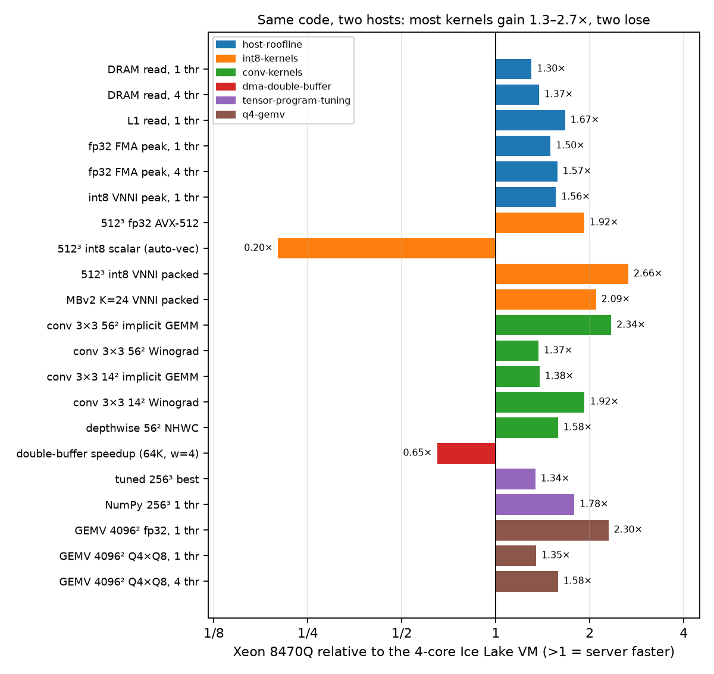

# 同一份代码，两台主机

> 由 `python scripts/compare_hosts.py` 从各 lab 的 `artifacts/raw/summary.json`（本地）与
> `artifacts/raw/xeon8470q/summary.json`（服务器）生成，不要手改。

| 主机 | CPU | 核 / 线程 | ISA | 编译器 | 说明 |
|---|---|---|---|---|---|
| 本地 VM | Xeon Ice Lake-SP（Family 6 Model 106） | 4 / 8 | AVX-512 + VNNI | MinGW GCC 13.2 | Windows Server 2022 |
| 服务器 | Xeon Platinum 8470Q（Sapphire Rapids）×2 | 104 / 208（cgroup 限 22 核） | AVX-512 + VNNI + **AMX-INT8** | GCC 11.4 | Ubuntu 22.04，绑定 NUMA1 的 16 个物理核（60–75） |

比值 = 服务器 / 本地；对 µs 类指标，比值 < 1 表示服务器更快。

| lab | 指标 | 单位 | 本地 VM | Xeon 8470Q | 比值 |
|---|---|---|---:|---:|---:|
| host-roofline | DRAM 读带宽，1 线程 | GB/s | 13.4 | 17.5 | 1.30 |
| host-roofline | DRAM 读带宽，4 线程 | GB/s | 48.4 | 66.6 | 1.37 |
| host-roofline | DRAM 读带宽，16 线程 | GB/s | — | 193 | — |
| host-roofline | L1 读带宽，1 线程 | GB/s | 166 | 277 | 1.67 |
| host-roofline | fp32 FMA 峰值，1 线程 | GFLOP/s | 155 | 232 | 1.50 |
| host-roofline | fp32 FMA 峰值，4 线程 | GFLOP/s | 597 | 939 | 1.57 |
| host-roofline | fp32 FMA 峰值，16 线程 | GFLOP/s | — | 3167 | — |
| host-roofline | int8 VNNI 峰值，1 线程 | GOP/s | 396 | 617 | 1.56 |
| host-roofline | int8 VNNI 峰值，16 线程 | GOP/s | — | 9208 | — |
| host-roofline | fp32 拐点（DRAM，1 线程） | FLOP/B | 11.5 | 13.3 | 1.15 |
| int8-kernels | 512³ fp32 AVX-512 | GOP/s | 39.2 | 75.2 | 1.92 |
| int8-kernels | 512³ int8 标量（靠编译器自动向量化） | GOP/s | 99.8 | 20.0 | 0.20 |
| int8-kernels | 512³ int8 VNNI + 打包 | GOP/s | 212 | 563 | 2.66 |
| int8-kernels | 512³ int8 AMX tile | GOP/s | — | 1704 | — |
| int8-kernels | prefill 256×4096×4096 VNNI | GOP/s | — | 280 | — |
| int8-kernels | prefill 256×4096×4096 AMX | GOP/s | — | 1659 | — |
| int8-kernels | MBv2 expand 56（K=24）VNNI | GOP/s | 129 | 270 | 2.09 |
| int8-kernels | MBv2 expand 56（K=24）AMX | GOP/s | — | 162 | — |
| conv-kernels | 3×3 conv 56² implicit GEMM | GFLOP/s | 34.3 | 80.4 | 2.34 |
| conv-kernels | 3×3 conv 56² Winograd F(2,3) | GFLOP/s | 39.7 | 54.3 | 1.37 |
| conv-kernels | 3×3 conv 14² implicit GEMM | GFLOP/s | 34.9 | 48.2 | 1.38 |
| conv-kernels | 3×3 conv 14² Winograd F(2,3) | GFLOP/s | 75.0 | 144 | 1.92 |
| conv-kernels | depthwise 56² NHWC SIMD | GFLOP/s | 10.8 | 17.0 | 1.58 |
| dma-double-buffer | 双缓冲实测加速（64 KiB tile × 512，work=4） | × | 1.08 | 0.70 | 0.65 |
| dma-double-buffer | 双缓冲模型预测（同上） | × | 1.64 | 1.62 | 0.99 |
| dma-double-buffer | 双缓冲实测加速（1 MiB tile，work=4） | × | 1.08 | 0.85 | 0.78 |
| tensor-program-tuning | 256³ 调度搜索最优 | GFLOP/s | 85.7 | 115 | 1.34 |
| tensor-program-tuning | 256³ NumPy 单线程（OpenBLAS） | GFLOP/s | 90.1 | 161 | 1.78 |
| tensor-program-tuning | 代价模型留出集 Spearman |  | 0.47 | 0.54 | 1.16 |
| q4-gemv | GEMV 4096² fp32，1 线程 | GB/s | 14.1 | 32.3 | 2.30 |
| q4-gemv | GEMV 4096² Q4_0×Q8 VNNI，1 线程 | µs | 1034 | 768 | 0.74 |
| q4-gemv | GEMV 4096² Q4_0×Q8 VNNI，4 线程 | µs | 311 | 197 | 0.63 |
| q4-gemv | GEMV 4096² Q4_0×Q8 VNNI，16 线程 | µs | — | 61.1 | — |
| q4-gemv | GEMV 11008×4096 fp32，16 线程 | GB/s | — | 273 | — |

## 读表要点

1. **单核差距只有 1.3–1.6 倍，多核才拉开。** 1 线程 DRAM 读带宽 13.4 → 17.5 GB/s，单核受限于每核在途缺失数（line fill buffer），而不是内存控制器；16 线程到 193 GB/s，是本地 4 线程（48 GB/s）的 4 倍。面试里“服务器内存带宽几百 GB/s”说的是全插槽，单线程 GEMV 只能拿到其中不到 10%。
2. **AMX 在大 K 上是 VNNI 的 3–6 倍，在小 K 上反而更慢。** 512³ 上 1704 对 563 GOP/s，prefill 形状上 1659 对 280；MBv2 expand（K=24）被补齐到 tile 的 K=64，有效算力只剩 3/8，162 对 270。选 kernel 要看 K 能否填满 tile。
3. **“标量代码”的速度取决于编译器。** 同一份标量 int8 循环，本地 GCC 13 下 100 GOP/s、服务器 GCC 11 下 20 GOP/s——对 `int8.cpp` 用 `-S -march=native` 编出汇编计数：GCC 13 全文件 `vpdpbusd` 78 条、字节扩展 `vpmov[sz]xbw` 14 条；GCC 11 是 60 条与 80 条——多出的 18 条 VNNI 就是标量循环被 GCC 13 识别成点积，GCC 11 只能先扩成 16 位再乘。手写 intrinsics 的版本两边都稳定，这就是手写的理由。
4. **Winograd 的收益依赖主机。** 本地在 56² 上 Winograd 比 implicit GEMM 快 16%，服务器上反而慢 32%（54 对 80）；14² 上本地快 2.1 倍、服务器快 3.0 倍。56² 时变换的额外访存在更快的 GEMM 面前显得更贵。
5. **软件双缓冲在服务器上全部变慢。** 64 KiB × 512 块、work=4 时本地 1.08 倍、服务器 0.70 倍，而模型预测 1.6 倍：拷贝线程与计算线程共享同一插槽的带宽与 cgroup 配额，并不是独立 DMA 引擎。模型只在拷贝真正不占计算资源时成立（MCU 的 DMA、GPU 的 copy engine）。
6. **搜索收敛更快，但代价模型排序能力没有本质提升。** 两边 Spearman 都在 0.47–0.56；服务器上 random 在 13 次试验内到 90%，本地要 20 次；一种解释是 Sapphire Rapids 的 L2 更大（2 MB 对 1.25 MB），好调度的区域更宽，但本实验没有单独验证。
