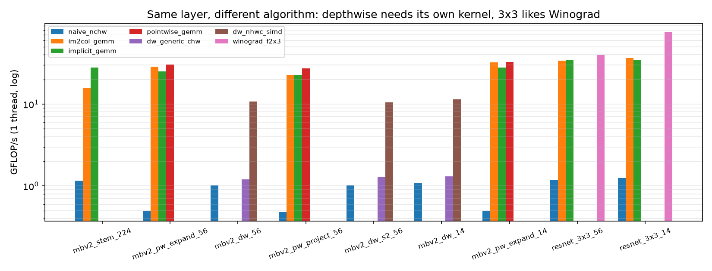
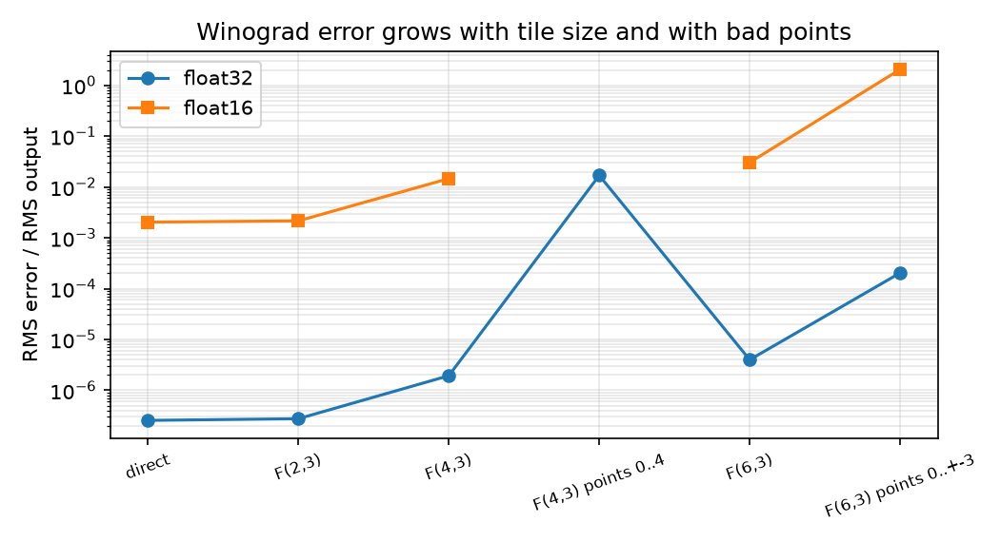

# conv-kernels：im2col、implicit GEMM、depthwise 布局与 Winograd 的数值代价

对应笔记 [M05 卷积 kernel](../../../notes/module-05-convolution-kernels.md)。MIT 6.5940 的 TinyEngine 讲了 im2col 的内存代价与 depthwise 的原地计算，
CS149 讲了分块与 SIMD；这里把两件事放到同一组层上实测：9 个 MobileNetV2 / ResNet 层，单线程 fp32，C++（`cpp/conv.cpp`），
每种实现都和 fp64 参考比对。另有 Winograd F(2,3)/F(4,3)/F(6,3) 的 Toom-Cook 构造（`code/convlab/winograd.py`）与 fp32/fp16 误差实验。
GPU 上的同类对照（tensor core、implicit GEMM）见 mlsys-infra [M07](https://gitee.com/liu-xingyan04/mlsys-infra/blob/main/notes/module-07-matmul-hardware-aware.md) 与 CS149 A4。

平台：Ice Lake 服务器虚拟机，1 线程，AVX-512；15 次计时取中位数。屋顶数字来自 [host-roofline](../host-roofline/README.md)：fp32 154.9 GFLOP/s、DRAM 13.4 GB/s。

## 一句话结论

- **implicit GEMM 与 im2col 速度相当（22.4–34.9 对 15.8–36.6 GFLOP/s），工作区为 0**；ResNet 56×56×64 的 im2col 工作区 7.2 MB，是输入加输出的 4.5 倍。
- **stem（IC = 3）上 implicit GEMM 快 1.8 倍**：展开拷贝压过了只有 27 的 K 维。
- **1×1 卷积不需要 im2col**：直接当 GEMM，56×56 两层快 7–19%，14×14 持平（拷贝只有 75 KB，在缓存里）。
- **depthwise 由布局决定**：NHWC + SIMD 10.4–11.4 GFLOP/s，按通道的 CHW 1.2–1.3，差 8.2–9.0 倍；同一个倒残差块里 depthwise 占 MACs 的 15.8%、占时间的 33.4%。
- **Winograd F(2,3)**：14×14×256 上等效 75.0 GFLOP/s，implicit GEMM 的 2.15 倍（理论 2.25）；56×56×64 上只有 1.16 倍。
- **数值**：fp16 下 F(2,3) 与直接卷积同精度（2.2e-3 对 2.0e-3），F(4,3) 是 7.2 倍，插值点换成 0..4 直接溢出。

## 怎么跑

```bash
cd solutions/edge-runtime/conv-kernels
python -m pytest -q tests                                   # Toom-Cook 构造、1-D/2-D 精确性、C++ 全部实现对参考
python scripts/run_experiments.py --only winograd           # 数值实验，秒级
python scripts/run_experiments.py --only bench              # 计时，约 25 s，机器空闲
```

输出：`artifacts/raw/conv_bench.csv`（每层每实现一行：GFLOP/s、工作区字节、与参考的相对误差、p10/p50/p90）、
`winograd_numerics.csv`、`summary.json`；图在 `artifacts/figures/`。

## 结果

### 9 层 × 5 种实现



| 层 | 形状 | naive NCHW | im2col | implicit | pointwise / dw NHWC / Winograd |
| --- | --- | ---: | ---: | ---: | ---: |
| mbv2_stem_224 | 224², 3→32, 3×3 s2 | 1.2 | 15.8 | **27.8** | |
| mbv2_pw_expand_56 | 56², 24→144, 1×1 | 0.5 | 28.5 | 25.0 | **30.5** |
| mbv2_pw_project_56 | 56², 144→24, 1×1 | 0.5 | 22.8 | 22.4 | **27.2** |
| mbv2_pw_expand_14 | 14², 96→576, 1×1 | 0.5 | 32.4 | 28.1 | **32.9** |
| mbv2_dw_56 | 56², 144, 3×3 dw | 1.0 | | | **10.8**（CHW 1.2） |
| mbv2_dw_s2_56 | 56², 144, 3×3 dw s2 | 1.0 | | | **10.4**（CHW 1.3） |
| mbv2_dw_14 | 14², 576, 3×3 dw | 1.1 | | | **11.4**（CHW 1.3） |
| resnet_3x3_56 | 56², 64→64, 3×3 | 1.2 | 33.9 | 34.3 | **39.7**（F(2,3)） |
| resnet_3x3_14 | 14², 256→256, 3×3 | 1.3 | 36.6 | 34.9 | **75.0**（F(2,3)） |

单位 GFLOP/s（Winograd 按直接卷积的 FLOP 计等效值）。所有实现与 fp64 参考的最大相对误差 1.7e-6。

工作区：im2col 在 stem 上 1.35 MB、ResNet 56×56 上 7.2 MB、14×14 上 1.8 MB；Winograd 的变换域缓冲 56×56 上 6.7 MB、14×14 上 5.8 MB。

**为什么 Winograd 在 56×56×64 上只有 1.16 倍**：两层 MACs 相同（1.16 亿），变换开销 ∝ tile 数 × (IC + OC)，逐点乘 ∝ tile 数 × IC × OC，
变换的相对开销 ∝ 2/C，C = 64 时是 C = 256 时的 4 倍；而且 6.7 MB 的变换域缓冲超出每核 L2。

### Winograd 的数值



64 通道、26×26，相对 fp64 直接卷积的 rms 相对误差：

| 变体 | 乘法减少 | 输入放大 ‖Bᵀ‖∞² | fp32 | fp16 |
| --- | ---: | ---: | ---: | ---: |
| direct | 1 | 1 | 2.6e-7 | 2.0e-3 |
| F(2,3) | 2.25 | 4 | 2.8e-7 | 2.2e-3 |
| F(4,3)，点 {0, ±1, ±2} | 4 | 100 | 1.9e-6 | 1.5e-2 |
| F(6,3)，点 {0, ±1, ±2, ±1/2} | 5.06 | 225 | 4.0e-6 | 3.0e-2 |
| F(4,3)，点 0..4 | 4 | 14,400 | 1.7e-2 | 溢出 |
| F(6,3)，点 0..±3 | 5.06 | 10,000 | 2.0e-4 | 2.06 |

int8 输入经 F(2,3) 变换后最大 4 × 127 = 508（10 bit），F(4,3) 是 15 bit：逐点乘必须 int16，这是 CMSIS-NN / TFLite Micro 不提供 int8 Winograd 的原因。

## 和原课程的差异

- TinyEngine 是 int8 的 MCU kernel；这里是 fp32 的 x86 kernel，讲的是同样的布局与工作区问题，速度数字不能搬到 Cortex-M。
- 教学 GEMM 没有 B 打包和 6×16 寄存器分块，所以 GEMM 类卷积只到 fp32 峰值的 10–24%；[tensor-program-tuning](../../mlc/tensor-program-tuning/README.md) 用搜索把同类 GEMM 推到 84 GFLOP/s。
- 只实现了 F(2,3) 的 C++ kernel；F(4,3)、F(6,3) 只做数值实验。

## 这些数字不能推出什么

- 不能推出 Winograd 在别的 CPU 上的加速：它依赖 L2 容量与通道数，本机 56×56 层的 1.16 倍和 14×14 层的 2.15 倍差了一倍。
- 「depthwise 占时间 33.4%」是这个实现下的比例；1×1 再优化（打包、寄存器分块）后，depthwise 的占比只会更高。
- 单线程结果；多线程下 depthwise 先撞上带宽屋顶。

## 文件

| 路径 | 内容 |
| --- | --- |
| `cpp/conv.cpp` | `naive_nchw`、`im2col_gemm`、`implicit_gemm`、`pointwise_gemm`、`dw_generic_chw`、`dw_nhwc_simd`、`winograd_f2x3`；`--mode=check` 对参考 |
| `code/convlab/winograd.py` | Toom-Cook 构造 `transform(m, r, points)`，1-D/2-D Winograd，输入放大 |
| `scripts/run_experiments.py` | `winograd`（数值）与 `bench`（计时）两步 |
| `tests/test_winograd.py` | F(2,3) 与 Lavin 的矩阵一致；fp64 精确；C++ 各实现（含奇数尺寸、stride 2）对参考 |
