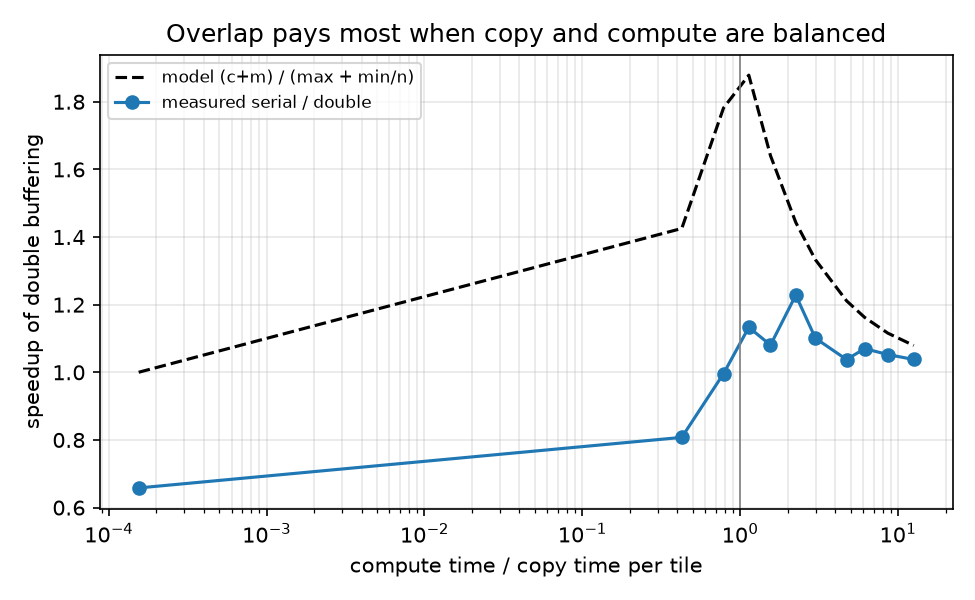
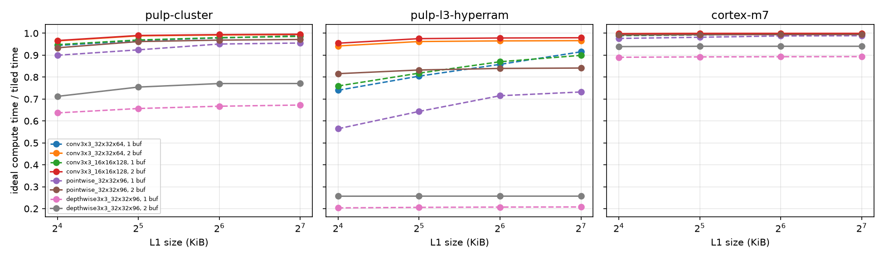
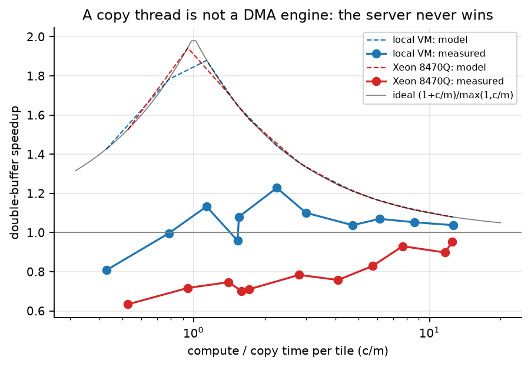

# dma-double-buffer：双缓冲省的是较短的那一侧

对应笔记 [M07 DMA 与双缓冲](../../../notes/module-07-dma-double-buffering.md)。PULP 的 Dory / Deeploy 与 MIT 6.5940 的 TinyEngine 都把一层切成 tile，
用 DMA 把下一块搬进 L1 的同时计算当前块。本实验三件事：

1. 事件模拟（`code/tiling/pipeline.py`）验证双缓冲与三级流水的闭式时间；
2. Dory 式分块搜索（`code/tiling/dory.py`）在三个 MCU / 集群目标、四档 L1 上找最优 tile，看双缓冲在哪类层上值得；
3. 在本机用两个线程模拟「DMA + 计算」（`cpp/dma.cpp`），对照模型。

GPU 上同一思想是 cp.async / TMA 的多级流水，见 mlsys-infra [M07](https://gitee.com/liu-xingyan04/mlsys-infra/blob/main/notes/module-07-matmul-hardware-aware.md)。

## 一句话结论

- **闭式与模拟逐点相等**：单缓冲 n·(m + c)，双缓冲 n·max(m, c) + min(m, c)；DMA 搬入搬出共用一个通道时，三级流水退化成两级。
- **3×3 卷积在三个目标上都是计算受限**：双缓冲只多 0.2%–27%（片上 L2 供数 0.6%–2.2%，HyperRAM 供数 5.6%–27%）。
- **depthwise 从 HyperRAM 供数是 DMA 受限**：效率只有 0.257，双缓冲 1.24 倍，封顶于 (m + c)/m ≈ 1.25。
- **本机两线程**：双缓冲 0.61–1.23 倍，模型预测 1.00–1.88 倍；4 KiB tile 时每块一次跨线程握手（约 0.8 µs）比搬运本身还长，反而慢。

## 怎么跑

```bash
cd solutions/edge-runtime/dma-double-buffer
python -m pytest -q tests
python scripts/run_experiments.py --only model dory   # 纯模型与搜索，秒级
python scripts/run_experiments.py --only measure      # 本机两线程计时，约 10 s，机器空闲
```

## 结果

### 模型：加速比只取决于 c/m



`pipeline_model.csv`：n = 64 块，m = 1。c/m = 1 时双缓冲 65 对单缓冲 128，接近 2 倍；c/m = 0.125 时 64.1 对 72，只快 12%。
三级流水（搬入、计算、搬出）如果搬入搬出共用一个 DMA 通道，DMA 一侧是 m_in + m_out，结果与两级相同（`sim_3stage_shared_dma`）。

### Dory 式搜索



目标参数（`TARGETS`，周期为单位，均为假设值，不是某颗芯片的实测）：

| 目标 | L1 | DMA B/cycle | DMA 启动 | MAC/cycle | 每次调用开销 |
| --- | ---: | ---: | ---: | ---: | ---: |
| pulp-cluster（L2 供数） | 64 KiB | 8 | 30 | 16 | 300 |
| pulp-l3-hyperram | 64 KiB | 1 | 100 | 16 | 300 |
| cortex-m7 | 128 KiB | 4 | 20 | 2 | 100 |

搜索 L1 = 16/32/64/128 KiB 下的最优 (th, tk, tc)，效率 = 理想计算周期 / 总周期：

| 层 | pulp-cluster | pulp-l3-hyperram | cortex-m7 |
| --- | --- | --- | --- |
| conv3x3 32×32×64 | 0.965–0.994，双缓冲 1.006–1.022 | 0.942–0.966，1.056–1.273 | 0.998–0.999，1.002–1.009 |
| conv3x3 16×16×128 | 0.967–0.996，1.010–1.021 | 0.955–0.979，1.089–1.257 | 0.998–0.999，1.003–1.008 |
| pointwise 32×32×96 | 0.934–0.971，1.017–1.041 | 0.816–0.841，1.149–1.445 | 0.992–0.994，1.005–1.017 |
| depthwise 32×32×96 | 0.712–0.771，1.118–1.155 | **0.257**，1.237–1.262 | 0.939–0.941，1.053–1.055 |

读法：Cortex-M7 只有 2 MAC/cycle，任何层都是计算受限，双缓冲几乎无用；HyperRAM 上 depthwise 每 tile 的 DMA 约为计算的 4 倍，
多一块缓冲造不出带宽。L1 变大时 tile 数变少、每次调用开销摊薄，效率上升，但双缓冲的额外收益下降。

### 本机两线程实测

`dma_measured.csv`：一个线程 memcpy 一个 tile 到小缓冲（「DMA」），另一个线程对它做 `work` 轮计算，两个原子标志 ping-pong。

| tile | 块数 | c/m | 模型加速 | 实测加速 |
| --- | ---: | ---: | ---: | ---: |
| 64 KiB | 512 | 0.0（只同步） | 1.00 | 0.66 |
| 64 KiB | 512 | 0.43 | 1.43 | 0.81 |
| 64 KiB | 512 | 1.13 | 1.88 | 1.13 |
| 64 KiB | 512 | 2.25 | 1.44 | 1.23 |
| 64 KiB | 512 | 12.6 | 1.08 | 1.04 |
| 4 KiB | 4096 | 1.15 | 1.87 | 0.61 |
| 1 MiB | 16 | 2.28 | 1.40 | 1.08 |

差距的三个来源：两个线程共享 L2/L3 与 DRAM 带宽（拷贝变慢）；拷贝本身占用核心的 load/store 端口；每块一次跨线程握手（4 KiB 时双缓冲每块 1.18 µs，模型只有 0.34 µs）。
MCU 的 DMA 引擎有独立的总线端口，不抢计算核的端口，更接近模型；但每次 DMA 的启动开销（这里假设 20–100 周期）同样让 tile 不能太小。

### 服务器复现：模型预测加速，实测全部变慢

Xeon 8470Q 上同样的两线程实验（拷贝线程 + 计算线程，64 KiB tile，`artifacts/raw/xeon8470q/dma_measured.csv`）：

| 每字节计算量 work | 0 | 1 | 2 | 3 | 4 | 6 | 8 | 16 | 32 |
| --- | ---: | ---: | ---: | ---: | ---: | ---: | ---: | ---: | ---: |
| 模型预测（服务器测得的 c/m） | 1.00 | 1.53 | 1.94 | 1.71 | 1.62 | 1.36 | 1.24 | 1.13 | 1.08 |
| 服务器实测 | 0.83 | 0.63 | 0.72 | 0.75 | 0.70 | 0.78 | 0.76 | 0.93 | 0.95 |
| 本地实测 | 0.66 | 0.81 | 1.00 | 1.13 | 1.08 | 1.23 | 1.10 | 1.07 | 1.04 |

服务器上没有一个点超过 1。双缓冲模型假设「拷贝」与「计算」使用互不干扰的资源；在 CPU 上二者都是 load/store、共享 L2/L3 与内存控制器，
服务器还有两个额外干扰：两个线程可能落在 mesh 上相距较远的核上（跨核交接 tile 时每条 cache line 都要经过 mesh 搬一次），
以及 cgroup 只给 22 个 CPU 的配额、宿主上还有其他租户。模型只在拷贝由独立硬件完成时成立：MCU 的 DMA 控制器、GPU 的 copy engine / TMA。
这条是面试里「为什么在 CPU 上做软件流水不一定有收益」的实测证据。



图里模型曲线在 c/m ≈ 1（拷贝与计算等长）处到峰，这是双缓冲收益最大的地方；本地实测的峰也大致在这里，只是被压低。
服务器实测曲线整体平移到 1 以下，峰的位置消失了：这说明损失不是「重叠得不够」，而是第二个线程本身带来了固定成本。
如果损失来自重叠不完全，曲线形状应与模型相似、只是更矮。

## 和原课程的差异

- Dory 的真实目标函数还包括 SIMD 宽度对齐、权重常驻、跨层融合；这里只保留决定双缓冲是否有用的两项（搬运、计算）与每次调用开销。
- 目标参数是按量级设的假设值，用来展示「哪一侧受限」，不能当成 GAP8 或 STM32 的实测。

## 这些数字不能推出什么

- 本机的「DMA」是一个 CPU 线程，与真实 DMA 引擎的行为（独立端口、描述符队列、中断）不同；本机实测只验证「固定开销与资源共享会吃掉重叠收益」这一条。
- 搜索结果的绝对周期数依赖假设的目标参数；结论只取相对关系（哪类层计算受限、双缓冲加速上界）。

## 文件

| 路径 | 内容 |
| --- | --- |
| `code/tiling/pipeline.py` | 闭式时间与事件模拟（两级、三级、共享 DMA） |
| `code/tiling/dory.py` | `Conv`、`Target`、`TARGETS`、`search`：L1 约束下的 tile 搜索 |
| `cpp/dma.cpp` | `time_serial`、`time_double`：两线程拷贝 + 计算 |
| `scripts/run_experiments.py` | `model`、`dory`、`measure` 三步 |
| `tests/test_tiling.py` | 模拟与闭式相等；搜索结果满足 L1；双缓冲不慢于单缓冲 |
