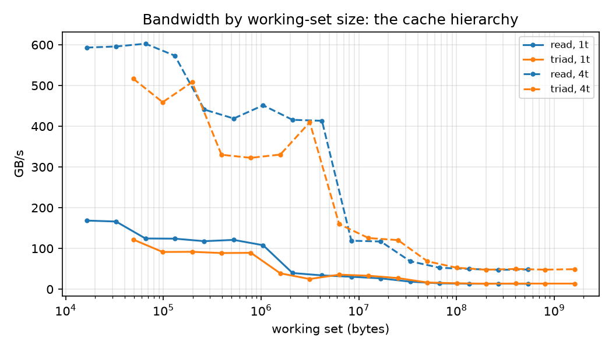
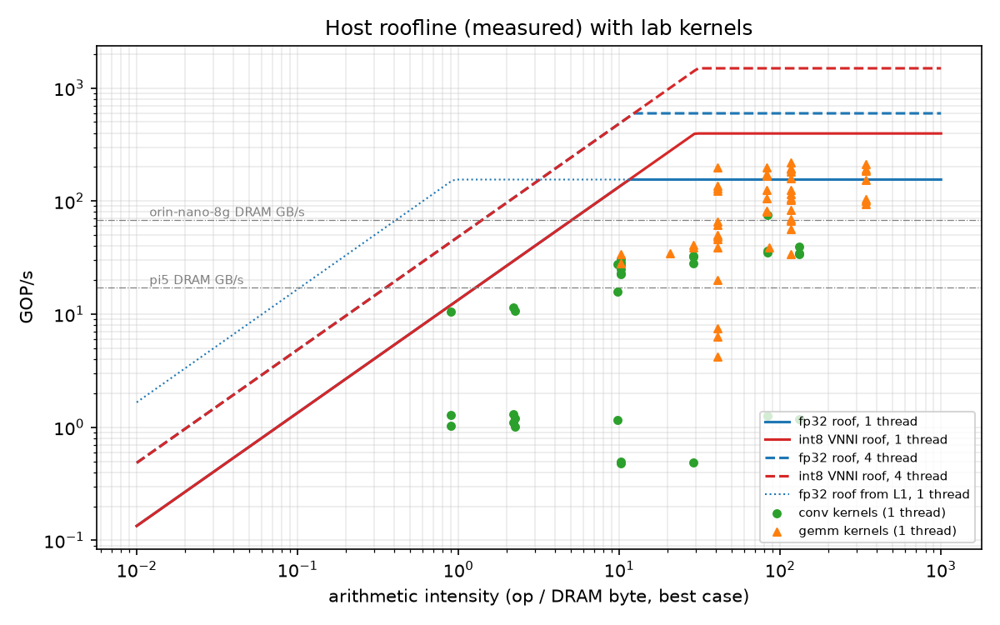

# host-roofline：量出本机的屋顶，再把其他实验的 kernel 放上去

对应笔记 [M01 端侧 roofline](../../../notes/module-01-edge-roofline.md)。MIT 6.5940 和 CS149 都用 roofline 解释「为什么这个 kernel 只有这么快」，
但课上的屋顶来自数据手册。本实验用 C++ 微基准在本机实测带宽阶梯和 fp32 / int8 两个峰值（1 与 4 线程），
再读 [conv-kernels](../conv-kernels/README.md) 和 [int8-kernels](../int8-kernels/README.md) 的原始结果，把每个 kernel 画到实测屋顶下。
mlsys-infra 的 [M01](https://gitee.com/liu-xingyan04/mlsys-infra/blob/main/notes/module-01-performance-models.md) 是同一模型在 H100 上的推导（没有实验），这里是它在 CPU 上的实测版本。

平台：Windows Server 虚拟机，Ice Lake 服务器 CPU 4 物理核 / 8 逻辑核，AVX-512F + VNNI；MinGW g++ -O3 -march=native。

## 一句话结论

- **屋顶**：1 线程 fp32 154.9 GFLOP/s、int8 VNNI 396.1 GOP/s、DRAM 只读 13.4 GB/s，拐点 11.5 FLOP/B（int8 29.5 op/B）。4 线程 596.6 GFLOP/s、1492.7 GOP/s、48.4 GB/s。
- **int8 不是 fp32 的 4 倍**：每条 VNNI 64 个乘加、每条 FMA 16 个，按位宽应为 4 倍，实测 2.56 倍。
- **单核喂不满 DRAM**：1 线程只有 4 线程的 28%；triad 按写分配计 18.4 GB/s，说明单核只读的 13.4 是在途请求数的上限，不是总线上限。
- **带宽阶梯**：1 线程 L1 166、L2 约 120、L3 27–40、DRAM 13.4 GB/s，L1 到 DRAM 差 12 倍。
- **kernel 离屋顶多远**：GEMM 类卷积 16–26%，Winograd 等效 48%，depthwise NHWC 36–87%（带宽屋顶低），朴素 NCHW 不到 1%。
- **测量本身的坑**：每次扫描都派发线程时，4 线程 L1 读只测到约 50 GB/s；改成线程内重复扫描、用自旋线程池后是 596 GB/s。

## 怎么跑

```bash
cd solutions/edge-runtime/host-roofline
python -m pytest -q tests                      # 平台检测、拐点、效率公式；C++ 冒烟测试
python scripts/run_experiments.py              # 约 20 s；要求机器空闲（先看任务管理器）
python scripts/run_experiments.py --plot-only  # conv-kernels / int8-kernels 重跑后只重画
```

输出：`artifacts/raw/roofline.jsonl`（每个工作集大小、每个线程数一行，带 p10/p50/p90 与 git、编译器信息），
`summary.json`（屋顶与拐点），`lab_points.csv`（其他实验的 kernel 的强度与效率），图在 `artifacts/figures/`。

## 结果

### 带宽阶梯



| 工作集 | 1 线程只读 GB/s | 4 线程只读 GB/s | 所在层（推断） |
| --- | ---: | ---: | --- |
| 16–32 KiB | 166–169 | 593–596 | L1（48 KiB/核） |
| 64 KiB–1 MiB | 108–125 | 419–603 | L2（1.25 MiB/核；4 线程时总共 5 MiB） |
| 2–16 MiB | 27–40 | 117–416 | L3（共享；4 线程到 4 MiB 仍在各核 L2 里） |
| 32 MiB | 18.5 | 68.6 | L3 → DRAM 过渡 |
| 128–512 MiB | 13.2–13.8 | 47.5–49.7 | DRAM |

4 线程时 L2 平台延长到 4 MiB，因为每个线程只扫自己的 1/4。triad 在 DRAM 区间 1 线程 13.8 GB/s、4 线程 49.1 GB/s（按 3 个流计）。

### 峰值与拐点

| | 1 线程 | 4 线程 | 比值 |
| --- | ---: | ---: | ---: |
| fp32 FMA（16 链 `vfmadd` zmm） | 154.9 GFLOP/s | 596.6 | 3.85 |
| int8 VNNI（16 链 `vpdpbusd` zmm） | 396.1 GOP/s | 1492.7 | 3.77 |
| DRAM 只读 | 13.4 GB/s | 48.4 | 3.61 |
| fp32 拐点 | 11.5 FLOP/B | 12.3 | |
| int8 拐点 | 29.5 op/B | 30.8 | |

由 fp32 峰值反推频率：154.9 / (2 端口 × 16 lane × 2) = 2.42 GHz；4 线程每核 149.1 GFLOP/s，对应 2.33 GHz（全核 AVX-512 降频）。

### kernel 放上屋顶



强度按「每个张量只从 DRAM 搬一次」的最好情况算（`hostroof.analysis.conv_intensity`），效率 = 实测 / min(峰值, 强度 × 13.4 GB/s)：

| kernel（1 线程 fp32） | 强度 FLOP/B | 实测 GFLOP/s | 效率 |
| --- | ---: | ---: | ---: |
| depthwise 3×3 s2，NHWC SIMD | 0.90 | 10.4 | 0.87 |
| depthwise 3×3 56×56，NHWC SIMD | 2.25 | 10.8 | 0.36 |
| 1×1 expand 56×56，pointwise GEMM | 10.2 | 30.5 | 0.22 |
| ResNet 3×3 56×56，implicit GEMM | 131.9 | 34.3 | 0.22 |
| ResNet 3×3 14×14，Winograd F(2,3)（等效） | 83.8 | 75.0 | 0.48 |
| 同层朴素 NCHW | 83.8 | 1.3 | 0.008 |

int8 GEMM 的点（橙色三角）效率没有算进表：它们的强度按 int8 字节算，屋顶要用 int8 峰值，`lab_points.csv` 中 `eff` 为空。
VNNI 打包 GEMM 最高 221 GOP/s，是 int8 峰值的 56%。

## 测量设计

- **重复扫描放在线程内部**：每个线程对自己的切片扫 reps 遍（总量约 64 MiB）后才返回；每遍后 `clobber()`，防止编译器把不变内存上的重复求和外提。
- **线程池**：`edge_harness/include/edgebench.h` 的 `ThreadPool`，调用者执行第 0 块，其余线程在原子代计数上自旋约 1 ms 后退到 200 µs 睡眠。空派发小于 100 µs（`tools/tests/test_harness.py`）。
- **峰值核**：16 条独立累加链，FMA 4 周期延迟 × 2 端口只需 8 条；`keep()` 防止消除。AVX2 机器（`EDGE_MARCH=haswell`）走 `vpmaddubsw + vpmaddwd` 分支。
- **取值**：DRAM / L1 / triad 取扫描两端各 3 个点的中位数。`plateaus()` 只用来画分级（相邻点降到 65% 以下才分级），它会把 L2→L3 的缓坡并进一级。
- **统计**：每个点 2 次预热、11 次计时取中位数；峰值 7 次。机器上不能有别的负载：建仓时一个遗留的 Python 进程占了一个核 6 天，那段时间的 4 线程数字全部偏低，已全部重测。

## 这些数字不能推出什么

- 不是任何端侧芯片的屋顶。图里的 Pi 5（17.1 GB/s）和 Orin Nano（68 GB/s）横线是数据手册的总线算术，不是实测；它们的单核持续带宽要在板子上量。
- L2/L3 的容量是推断（虚拟机里 `Win32_Processor` 不报 L3），只从阶梯位置读出。
- 「int8 吞吐只有 FMA 的 64%」只是墙钟结论；是端口分配还是频率档位，没有性能计数器无法区分。
- 4 线程的 DRAM 带宽还没饱和（随核数近乎线性），所以这里的拐点不能外推到更多核。

## 文件

| 路径 | 内容 |
| --- | --- |
| `cpp/roofline.cpp` | `--mode=bw`（只读求和、triad）、`--mode=fma`、`--mode=int8` |
| `code/hostroof/analysis.py` | `plateaus`、`ridge`、`attainable`、`conv_intensity`、`efficiency` |
| `scripts/run_experiments.py` | 测量、汇总、读其他实验的 CSV、画两张图 |
| `tests/test_roofline.py` | 平台检测（含噪声）、拐点、效率、C++ 编译运行 |
