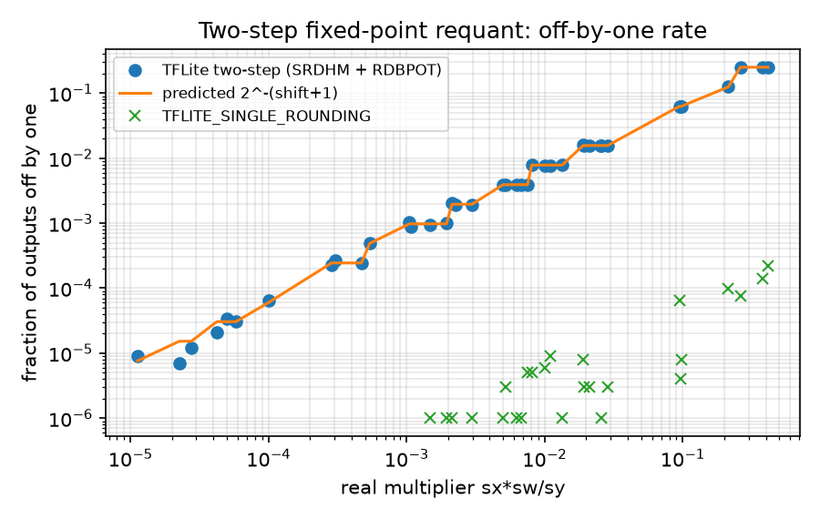
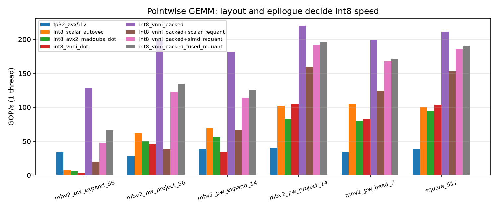

# int8-kernels：整数卷积的契约、requant 的舍入、VNNI 打包与 epilogue 融合

对应笔记 [M02 整数契约](../../../notes/module-02-integer-contract.md)。MIT 6.5940 Lab 2 停在「模拟量化」；端侧 runtime 实际跑的是
int8 × int8 → int32 累加，再用一个定点乘数 requant 回 uint8。本实验把这条链路完整写一遍：Python 参考（`code/int8ref/`）、
C++ kernel（`cpp/int8.cpp`）、ONNX Runtime 的 `QLinearConv` 三方逐元素比对；再在 6 个 GEMM 形状上比较 7 种 int8 实现与 fp32。
服务端的 int8 GEMM 与 LLM.int8 离群值见 mlsys-infra [M17](https://gitee.com/liu-xingyan04/mlsys-infra/blob/main/notes/module-17-compression-quantization.md)。

平台：Ice Lake 服务器虚拟机，AVX-512 + VNNI；GEMM 1 线程 15 次中位数；ONNX Runtime 1.31，1 与 4 线程；g++ 13.2（MinGW）。

## 一句话结论

- **累加是逐位精确的**：6 种层（3×3、1×1、depthwise、stride 2、stem、grouped）的 int32 累加，C++ 与 Python 参考 100% 相等；|acc| 比满幅上界小 5–49 倍。
- **两步舍入会差 1 个量化级**：TFLite 式 SRDHM + rounding shift 与 ORT 在 99.93–99.97% 的输出上一致，构造 .5 平局时 98.97–99.55%；不一致率随 shift 按 2^-(shift+1) 变化。单次舍入（float 乘数或单步定点）与 ORT 一致。
- **`vpmaddubsw` 会饱和**：u8 × s8 两两相加进 int16，|w| ≤ 64 时零错误，|w| = 100 时 99% 的列出错，|w| = 127 时全部出错。
- **布局比指令重要**：VNNI 打包（[N/16][K/4][16][4]）比逐点积 VNNI 快 2.0–30.8 倍；K = 24 时差最大。
- **requant 要融合**：单独的标量 epilogue 把打包 GEMM 从 129 拖到 20 GOP/s，融合进寄存器后 66；融合比标量 epilogue 快 1.2–3.5 倍。
- **ORT int8 对 fp32**：1 线程 1.39–3.08 倍；4 线程 0.76–2.14 倍，depthwise 上 int8 反而更慢。

## 怎么跑

```bash
cd solutions/edge-runtime/int8-kernels
python -m pytest -q tests                                       # 参考 vs C++ vs ORT；requant 性质
python scripts/run_experiments.py --only requant rounding saturate  # 正确性实验，秒级
python scripts/run_experiments.py --only gemm ort               # 计时，约 20 s，机器空闲
```

## 结果

### 三方比对

`artifacts/raw/requant_agreement.csv`，每层随机输入；`ties=True` 时把 acc 构造成落在 .5 上：

| 层 | 输出数 | max\|acc\| / 上界 | 两步定点 vs ORT | 单步定点 vs ORT | float vs ORT |
| --- | ---: | ---: | ---: | ---: | ---: |
| conv3x3_28 | 50,176 | 192,519 / 9,326,880 | 99.97% | 100% | 100% |
| pointwise_28 | 100,352 | 73,160 / 2,072,640 | 99.95% | 100% | 100% |
| depthwise_28 | 75,264 | 56,310 / 291,465 | 99.93% | 100% | 100% |
| stem_s2_56 | 12,544 | 65,498 / 874,395 | 99.94% | 100% | 100% |
| 同上，.5 平局 | | | 98.97–99.55% | 99.49–99.87% | 100% |

不一致永远只差 1（`ort_maxdiff_* = 1`）。

### 两步舍入的不一致率



乘数 m = M0 · 2^-(31+shift)。SRDHM 先舍入一次到 Q31，再右移 shift 位又舍入一次；第二次舍入前的小数恰好在 .5 附近 2^-(shift+1) 宽的区间里时结果翻转。
实测不一致率与预测同一量级（shift 16：9e-6 对 7.6e-6；shift 9：1.0e-3 对 9.8e-4），单步舍入恒为 0。

### `vpmaddubsw` 的饱和

`maddubs_saturation.csv`，K = 256、4096 列：两个 u8 × s8 乘积相加进 int16，最大 2 · 255 · |w|；要 ≤ 32767 则 |w| ≤ 64。

| max\|w\| | 出错列 | 最大绝对误差 |
| ---: | ---: | ---: |
| 63 | 0 | 0 |
| 64 | 0 | 0 |
| 100 | 4053（99.0%） | 43,326 |
| 127 | 4096（100%） | 111,688 |

这是 AVX2 int8 路径要把权重限制在 7 bit（或改用 `vpmaddwd` 的 16 位路径）的原因；VNNI 的 `vpdpbusd` 直接累加到 int32，没有这个问题。

### GEMM：7 种 int8 实现对 fp32



单位 GOP/s，1 线程：

| 形状 (M×K×N) | fp32 | int8 标量 | AVX2 maddubs 点积 | VNNI 点积 | VNNI 打包 | + 标量 requant | + SIMD requant | 融合 requant |
| --- | ---: | ---: | ---: | ---: | ---: | ---: | ---: | ---: |
| pw_expand_56 (3136×24×144) | 33.8 | 7.5 | 6.3 | 4.2 | 129.0 | 20.2 | 48.1 | 66.0 |
| pw_project_56 (3136×144×24) | 28.3 | 61.7 | 50.2 | 46.2 | 198.6 | 38.9 | 122.8 | 135.3 |
| pw_expand_14 (196×96×576) | 38.7 | 68.9 | 56.2 | 34.1 | 182.0 | 66.6 | 114.6 | 125.6 |
| pw_project_14 (196×576×96) | 40.6 | 102.4 | 83.0 | 105.2 | 220.6 | 160.0 | 192.4 | 196.4 |
| pw_head_7 (49×320×1280) | 34.3 | 105.0 | 80.4 | 82.4 | 199.0 | 125.0 | 167.6 | 171.9 |
| square_512 | 39.2 | 99.8 | 94.2 | 104.4 | 211.8 | 153.0 | 185.8 | 190.8 |

所有 int8 实现的输出与参考逐位相等（`gemm_all_exact`）。读法：

- 逐点积的每个输出都要一次水平求和；K = 24 时一次点积只有 24 个乘加，水平求和占满时间，所以 VNNI 点积（4.2）比标量（7.5）还慢。打包后输出沿 N 方向 16 个一组，累加器留在寄存器，没有水平求和。
- requant 的代价与 K 成反比：K = 24 时 epilogue 占比最大（标量 requant 慢 6.4 倍），K = 576 时只慢 1.4 倍。
- 打包 GEMM 最高 221 GOP/s，是 [host-roofline](../host-roofline/README.md) 实测 int8 峰值 396 的 56%。

### ONNX Runtime：int8 QLinearConv 对 fp32 Conv

`ort_int8_vs_fp32.csv`，单位 µs（中位数）：

| 层 | 1 线程 fp32 | 1 线程 int8 | 加速 | 4 线程 fp32 | 4 线程 int8 | 加速 |
| --- | ---: | ---: | ---: | ---: | ---: | ---: |
| pw_expand_56 | 426 | 230 | 1.86 | 333 | 156 | 2.14 |
| pw_project_56 | 453 | 155 | 2.92 | 257 | 151 | 1.70 |
| pw_expand_14 | 219 | 88 | 2.49 | 124 | 100 | 1.24 |
| dw_56 | 599 | 432 | 1.39 | 196 | 256 | 0.76 |
| conv3x3_28 | 457 | 148 | 3.08 | 185 | 97 | 1.91 |

4 线程时每层只有 100–250 µs，线程派发与同步开销占了主导；depthwise 的 int8 kernel 多线程扩展反而比 fp32 差。

## 和原课程的差异

- Lab 2 用 PyTorch 模拟量化；这里是真正的整数 kernel，权重对称逐通道、激活非对称逐张量（ONNX QLinearConv / TFLite 约定）。
- 打包 GEMM 只做到 16 列一组的累加器分块，没有 M 方向的寄存器分块，离 oneDNN / XNNPACK 还差一截。

## 这些数字不能推出什么

- 不能推出 ARM 上的结论：Cortex-A 的 `sdot`/`smmla`、Cortex-M 的 `SMLAD` 吞吐与 VNNI 完全不同，只有「布局与 epilogue 融合比指令重要」这条可以迁移。
- ORT 的加速比依赖 ORT 版本选的 kernel；这里只说明 int8 不保证更快，尤其是多线程和 depthwise。
- 两步舍入的不一致率是随机输入上的；真实模型里如果某层恰好落在平局附近，比例会更高（构造平局时 0.45–1.03%）。

## 文件

| 路径 | 内容 |
| --- | --- |
| `code/int8ref/requant.py` | `quantize_multiplier`、`srdhm`、`rounding_divide_by_pot`、四种 requant |
| `code/int8ref/layer.py` | 随机量化层、int32 累加参考、与 C++ 交换的二进制格式 |
| `code/int8ref/ort.py` | 构造单层 QLinearConv ONNX 模型并运行 |
| `cpp/int8.cpp` | 卷积 + 四种 requant（`--mode=conv`），7 种 GEMM（`--mode=bench`），饱和计数（`--mode=saturate`） |
| `tests/test_requant.py`、`tests/test_cpp_and_ort.py` | SRDHM 边界、乘数分解、三方比对 |
