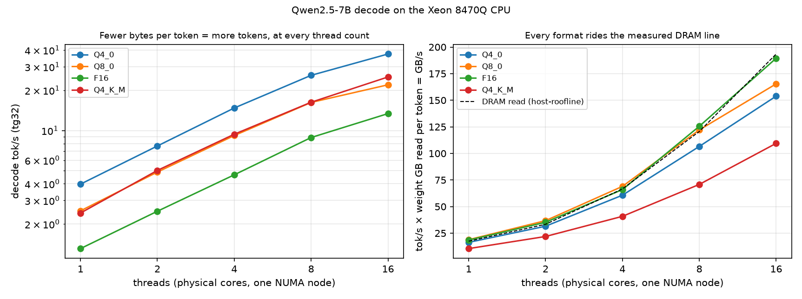
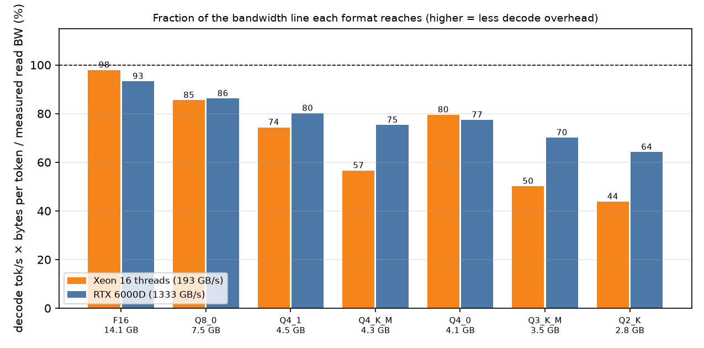
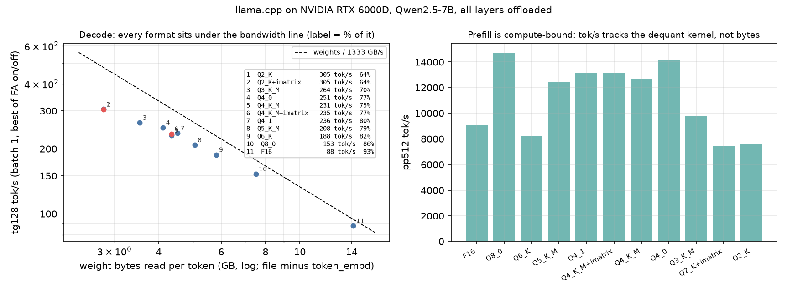
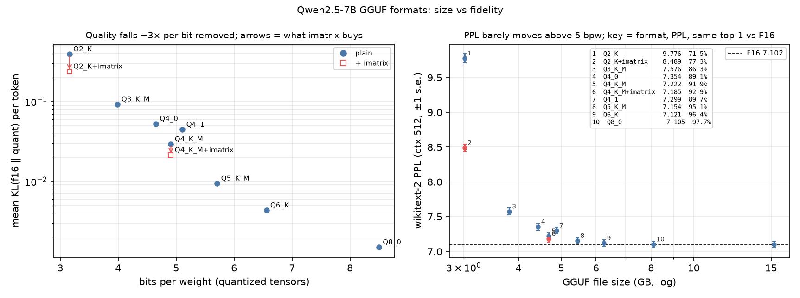
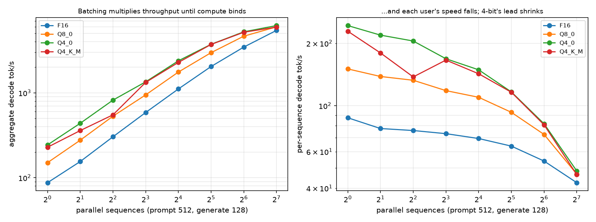

# llama-cpp-7b：真实 7B 模型上的格式、带宽与 AMX

[q4-gemv](../q4-gemv/README.md) 在单层 GEMV 上拆开了块量化的每一项开销，并用「层时间之和」预测了整模型解码；
这个 lab 用 llama.cpp 跑完整的 Qwen2.5-7B，检验那些预测在真实引擎里是否成立，并补上单层实验测不到的两件事：
每种 GGUF 格式的质量代价（困惑度与对 f16 的 KL 散度），以及 batch > 1 时的吞吐。

平台：AutoDL 服务器，CPU 2 × Xeon Platinum 8470Q（绑 NUMA1 的 16 个物理核），GPU RTX 6000D（84 GB，实测读带宽 1333 GB/s）。
llama.cpp `149f564`，CPU 版 `GGML_NATIVE=ON`（含 AMX），CUDA 版 sm_120。

## 一句话结论

- **CPU 解码就是在测内存带宽**：Q4_0 单线程 3.97 tok/s，乘以每 token 读的 4.1 GB 权重是 16.3 GB/s，单核 DRAM 读带宽是 17.5；
  16 线程 37.4 tok/s（154 GB/s），Q8_0 22.0（165 GB/s）、F16 13.4（189 GB/s），16 线程 DRAM 读带宽 193.5。字节少的格式按字节比变快。
- **llama.cpp 的 Q4_0 要靠 AMX 重排才不被指令卡住**：关掉权重重排（`--repack 0`），16 线程解码 26.5 tok/s，只用到 109 GB/s；
  打开后 37.0 tok/s（152 GB/s）。prefill 93.5 → 261.1 tok/s（2.8 倍），与 int8-kernels 里 AMX 对 VNNI 的 3.0 倍同量级。不重排时它和本仓库 q4-gemv 的 Q4 内核是同一个问题。
- **GPU 解码同样贴着带宽线**：F16 87.9 tok/s 是字节上界的 93%，Q8_0 86%，Q4_K_M 75%；格式越小，固定开销（attention、归一化、下发）占比越大。
  q4-gemv 只算 Linear 的预测（fp16 92、Q8 163、Q4 284 tok/s）给出的是上界，端到端 Q4_K_M 实测 231。
- **prefill 不看字节，看反量化内核**：Q8_0 14.7k tok/s，Q6_K 只有 8.2k——K-quant 的超块解包在算力受限的 prefill 里显形。
- **质量**：KL 散度每少 1 bit 约涨 3 倍（Q8_0 0.0015 → Q4_K_M 0.029）；困惑度在 5 bit 以上几乎不动（7.102 → 7.154），
  同 top-1 比例（97.7% → 91.9%）比困惑度更容易读。imatrix 在 Q2_K 上把 KLD 降 39%，在 Q4_K_M 上降 27%。
- **CPU 与 GPU 选格式的结论相反**：CPU 上 K-quant 指令受限，Q2_K（2.8 GB）比 Q4_0（4.1 GB）还慢；GPU 上 K-quant 的解包被藏住。
- **q4-gemv 的「层时间之和」只差一个常数**：三种格式端到端都比只算 Linear 的预测多 0.41–0.47 ms/token。
- **batch 128 时格式差距消失**：Q4_0 对 F16 从 2.8 倍缩到 1.14 倍。

## 怎么跑

```bash
cd solutions/edge-runtime/llama-cpp-7b
python -m pytest -q tests                        # 解析器测试，不需要 llama.cpp
python scripts/run_experiments.py prep           # HF → f16 GGUF、wikitext 文本、Q8_0 / Q4_0
python scripts/run_experiments.py cpu            # llama-bench，1/2/4/8/16 线程
python scripts/run_experiments.py gpu batched    # imatrix、KLD 基准、逐格式 量化 → bench → PPL → KLD；batched-bench
python scripts/run_experiments.py summarize      # 只读 artifacts/raw，任何机器都能跑
```

路径由环境变量给出（`LLAMA_CPP`、`HF_MODEL`、`WIKI_PARQUET`、`GGUF_WORK`、`GGUF_QDIR`、`KLD_BASE`、`CPU_CORES`），默认值是 AutoDL 的布局。
权重与 GGUF 不入库。协议：wikitext-2 raw test，llama-perplexity 默认 ctx 512（每个 chunk 只评后半），PPL 用全部 chunk，KL 用前 80 个 chunk 对 f16 的 logits。

## 结果

### CPU：解码 tok/s 与带宽（`bench_cpu.jsonl`，16 个物理核，tg32 / pp64）



| 线程 | Q4_0 tg | Q8_0 tg | F16 tg | Q4_0 pp | Q8_0 pp | F16 pp | DRAM 读 GB/s |
| ---: | ---: | ---: | ---: | ---: | ---: | ---: | ---: |
| 1 | 3.97 | 2.51 | 1.31 | 19.2 | 21.6 | 5.8 | 17.5 |
| 2 | 7.67 | 4.89 | 2.49 | 39.2 | 39.2 | 11.2 | 33.4 |
| 4 | 14.75 | 9.18 | 4.67 | 77.7 | 63.8 | 15.0 | 66.6 |
| 8 | 25.90 | 16.24 | 8.87 | 142.8 | 123.6 | 21.5 | 120.6 |
| 16 | 37.39 | 22.00 | 13.39 | 249.5 | 241.9 | 28.6 | 193.5 |

右图把 tok/s 乘以每 token 读的权重字节（文件大小减去 token_embd——解码只取嵌入表的一行）：三条线都贴着 DRAM 读带宽（虚线，来自 host-roofline）。
F16 在 16 线程时 189 GB/s，几乎是 DRAM 读的全部；Q4_0 只到 154 GB/s，差的部分是解包指令（见下一节）。
本仓库 q4-gemv 的 Q4 内核单线程只有 9–12 GB/s，llama.cpp 默认配置下单线程 16.3 GB/s：它的内核更省指令，且默认走了 AMX 重排后的布局。
F16 的 prefill 只有 28.6 tok/s（约 435 GFLOP/s，fp32 峰值的 14%）：ggml 的 CPU F16 路径要先转换成 fp32，没有用上 AMX。

### CPU：更少字节不等于更快（`cpu_extra/*.jsonl`，16 线程，tg32）

| 格式 | 每 token 读（GB） | 1 线程 tok/s | 16 线程 tok/s | 16 线程 GB/s | 占 DRAM 读 193.5 |
| --- | ---: | ---: | ---: | ---: | ---: |
| Q8_0 | 7.52 | 2.51 | 22.0 | 165 | 85% |
| Q4_0 | 4.12 | 3.97 | 37.4 | 154 | 79% |
| Q4_1 | 4.52 | 3.15 | 31.8 | 144 | 74% |
| Q4_K_M | 4.34 | 2.42 | 25.2 | 109 | 56% |
| Q3_K_M | 3.53 | 2.65 | 27.4 | 97 | 50% |
| Q2_K | 2.80 | 2.71 | 30.3 | 85 | 44% |



- **CPU 上 K-quant 是指令受限**：Q2_K 读的字节只有 Q4_0 的 68%，解码却慢 19%；Q4_K_M 比 Q4_0 只多 5% 字节，慢 33%。
  K-quant 每 256 个权重有两级 scale（超块 fp16 + 子块 6 bit），解包要多做移位、查 scale、乘子块 scale，这些指令在 CPU 上藏不进访存。
- **简单格式离带宽线最近**：Q8_0 / Q4_0 / Q4_1 每块只有一个 scale（Q4_1 多一个 min），而且能走 AMX 重排（下一节），到 DRAM 读的 74–85%。
- **GPU 上排序相反**（见下面的 GPU 表）：GPU 每字节的 ALU 多，K-quant 的解包被访存延迟藏住，Q4_K_M 仍在带宽线的 75%。
  所以「端侧 CPU 选 Q4_0、GPU 选 Q4_K_M」不是玄学，是两种硬件的每字节算力不同。
- 单线程同样：Q4_K_M 只读到 10.5 GB/s，Q4_0 16.3 GB/s（单核 DRAM 读 17.5）。

### CPU：权重重排（AMX）开与关（`bench_cpu_repack.jsonl`，16 线程，pp512 / tg64）

| 格式 | repack | pp512 tok/s | tg64 tok/s | tg × 每 token 权重 GB（GB/s） |
| --- | --- | ---: | ---: | ---: |
| Q4_0 | 关 | 93.5 | 26.5 | 109 |
| Q4_0 | 开（AMX） | 261.1 | 37.0 | 152 |
| Q8_0 | 关 | 94.6 | 17.0 | 127 |
| Q8_0 | 开（AMX） | 256.3 | 22.0 | 165 |

Q8_0 的 tg 两行来自单独重跑（`bench_cpu_repack_q8_rerun.jsonl`，-r 5，标准差 0.5 / 0.2）。第一次扫描里「关」那一行是 9.8 ± 8.5 tok/s：
同时间并行跑的 lab2 ORT 任务把 cgroup 配额（22 核）挤满，`cpu.stat` 的 `nr_throttled` 在涨。标准差和均值同量级的行要丢掉重跑，不能拿来算加速比。

两种格式重排后的 prefill 都是 2.7–2.8 倍，解码是 1.3–1.4 倍：重排后 Q4_0 和 Q8_0 都落到每 token 152–165 GB/s，离 DRAM 读的 193.5 不远；
不重排时 Q4_0 只有 109 GB/s，比 Q8_0 的 127 还低——不重排的 Q4_0 每字节要做的解包更多，先撞上指令瓶颈。

`-v` 日志里每个 Q4_0 / Q8_0 权重都有一行 `ggml_backend_amx_buffer_set_tensor: amx repack tensor ... of type q4_0`（或 `q8_0`）：
加载时把权重重排成 AMX tile 需要的 VNNI 布局，prefill 走 `_tile_dpbusd`。这与 int8-kernels 的结论一致：
大 M 的 GEMM（prefill）上 AMX 约 3 倍；M = 1 的 GEMV（解码）上 tile 浪费 15/16 的行，但重排后的连续布局仍然让解码从指令受限回到带宽受限。

### GPU：每种格式的速度（`bench_gpu.jsonl`，全部层 offload，FA 开 / 关取较好者）



| 格式 | 每 token 读（GB） | tg128 tok/s | 占 1333 GB/s 线 | pp512 tok/s |
| --- | ---: | ---: | ---: | ---: |
| F16 | 14.15 | 87.9 | 93% | 9103 |
| Q8_0 | 7.52 | 152.8 | 86% | 14714 |
| Q6_K | 5.81 | 187.7 | 82% | 8229 |
| Q5_K_M | 5.06 | 208.2 | 79% | 12408 |
| Q4_1 | 4.53 | 236.0 | 80% | 13135 |
| Q4_K_M | 4.35 | 230.7 | 75% | 12634 |
| Q4_K_M+imatrix | 4.35 | 234.7 | 77% | 13148 |
| Q4_0 | 4.12 | 250.7 | 77% | 14186 |
| Q3_K_M | 3.54 | 264.3 | 70% | 9795 |
| Q2_K | 2.80 | 305.3 | 64% | 7597 |
| Q2_K+imatrix | 2.80 | 304.6 | 64% | 7429 |

- **解码按字节排序，百分比随格式变小而下降**：F16 93% → Q2_K 64%。每 token 有一段不随权重字节变化的时间（attention、RMSNorm、RoPE、采样、下发），
  权重越小它占比越大；下一节把它量出来，约 0.45 ms。
- **GPU 上 K-quant 不吃亏**：Q4_K_M 与 Q4_0 都在 75–77%，与 CPU 上 56% 对 79% 的差距完全不同（上面的 CPU 表）。
- **prefill 是另一回事**：Q8_0 14.7k、Q4_0 14.2k 最快，Q6_K 8.2k、Q2_K 7.6k 最慢——prefill 受算力限，速度取决于每种格式的反量化 + matmul 内核，
  与字节无关。imatrix 不改变存储格式，速度在误差内相同（Q4_K_M 230.7 对 234.7，Q2_K 305.3 对 304.6）。

### 质量：困惑度与 KL 散度（`quality.csv`）



| 格式 | bpw | PPL | 平均 KLD | KLD p99 | 同 top-1 |
| --- | ---: | ---: | ---: | ---: | ---: |
| F16 | 16 | 7.1016 | — | — | — |
| Q8_0 | 8.50 | 7.1052 | 0.0015 | 0.009 | 97.7% |
| Q6_K | 6.56 | 7.1207 | 0.0043 | 0.030 | 96.4% |
| Q5_K_M | 5.71 | 7.1544 | 0.0094 | 0.082 | 95.1% |
| Q4_1 | 5.11 | 7.2990 | 0.0447 | 0.394 | 89.7% |
| Q4_K_M | 4.91 | 7.2222 | 0.0292 | 0.271 | 91.9% |
| Q4_K_M+imatrix | 4.91 | 7.1846 | 0.0214 | 0.221 | 92.9% |
| Q4_0 | 4.65 | 7.3537 | 0.0527 | 0.431 | 89.1% |
| Q3_K_M | 3.99 | 7.5764 | 0.0923 | 0.805 | 86.3% |
| Q2_K | 3.16 | 9.7763 | 0.3925 | 2.483 | 71.5% |
| Q2_K+imatrix | 3.16 | 8.4893 | 0.2378 | 1.810 | 77.3% |

- **同样 4 bit 多，K-quant 好近一倍**：Q4_K_M 比 Q4_0 大 6%，KLD 却只有 0.55 倍（0.029 对 0.053）；Q4_1 更大（5.11 bpw）反而比 Q4_K_M 差。
  K-quant 的超块 + 子块 scale 让每 16–32 个权重有自己的步长，还按张量重要性混用 Q4_K / Q6_K（`_M` 的含义）。
- **imatrix 的收益在低位宽才大**：Q4_K_M 的 KLD 降 27%，Q2_K 降 39%、PPL 从 9.78 拉回 8.49、同 top-1 从 71.5% 回到 77.3%。
  imatrix 是校准集上每个输入通道的激活平方均值，量化时按它加权误差——和 AWQ / GPTQ 同一个思路：误差要按激活加权，不按权重本身。
- **PPL 是迟钝的指标**：Q8_0 → Q5_K_M，PPL 只从 7.105 到 7.154（+0.7%），同 top-1 已经从 97.7% 掉到 95.1%，即每 20 个 token 就有一个与 F16 选得不同。
  KLD p99 比平均值更早报警：Q4_0 的 p99 是 0.43，意味着 1% 的 token 上分布被明显改写。
- 与 CPU 结合起来：端侧 CPU 上 Q4_0 比 Q4_K_M 快 1.48 倍，质量差 1.8 倍 KLD；GPU 上两者速度相差 9%，所以 GPU 上没有理由选 Q4_0。

### batch：聚合吞吐（`batched.jsonl`，prompt 512 + 生成 128，FA 开）



| 并发 | F16 总 tok/s | Q8_0 | Q4_0 | Q4_K_M | Q4_0 每路 |
| ---: | ---: | ---: | ---: | ---: | ---: |
| 1 | 87 | 150 | 244 | 229 | 243.5 |
| 4 | 304 | 531 | 821 | 551 | 205.1 |
| 16 | 1111 | 1756 | 2383 | 2281 | 149.0 |
| 64 | 3459 | 4649 | 5234 | 5175 | 81.8 |
| 128 | 5441 | 5985 | 6198 | 5948 | 48.4 |

- **量化的优势只在小 batch**：1 路时 Q4_0 是 F16 的 2.8 倍；128 路时只有 1.14 倍。batch 大了以后每次读一遍权重被 128 个序列分摊，
  瓶颈从读权重变成算力和 KV cache 读取，四种格式收敛到 5.4–6.2k tok/s。
- **F16 涨得最多**：1 → 128 路聚合吞吐涨 62 倍，Q4_0 只涨 25 倍——F16 在小 batch 时最受带宽限，所以批处理的收益最大。
- **每路速度**：Q4_0 从 243.5 掉到 48.4 tok/s；服务端「每用户 tok/s」与「总吞吐」的取舍从这张表直接读出。
- Q4_K_M 在 2–4 路时比 8 路还慢（每路 179.6、137.6 对 166.0）：llama.cpp 对小 batch 的量化 matmul 按 batch 大小切换内核，
  K-quant 在这一段选的路径不划算。这是观察，没有逐个内核 profile。

## 和 q4-gemv 的预测对照

[q4-gemv](../q4-gemv/README.md) 在同一张 RTX 6000D 上只算 Qwen2.5-7B 的 196 个 Linear（CUDA graph），预测解码上界：

| 格式 | q4-gemv 只算 Linear | llama.cpp 端到端 | 比值 | 每 token 时间差 |
| --- | ---: | ---: | ---: | ---: |
| fp16 / F16 | 91.7 tok/s（10.91 ms） | 87.9（11.38 ms） | 0.96 | 0.47 ms |
| Q8 / Q8_0 | 163 tok/s（6.13 ms） | 152.8（6.54 ms） | 0.94 | 0.41 ms |
| Q4_0 | 283.7 tok/s（3.52 ms） | 250.7（3.99 ms） | 0.88 | 0.46 ms |

**三种格式的差都是 0.41–0.47 ms**：这是 Linear 以外的每 token 固定成本（28 层的 attention、归一化、RoPE、残差、lm_head 之后的采样、llama.cpp 的图调度）。
所以「层时间之和」的模型在结构上是对的，只差一个常数项；权重越小，这个常数占比越大（F16 4%，Q4_0 12%），这也是上面 GPU 表的百分比随格式下降的原因。
要让 Q4 解码再快，下一步优化的是这 0.45 ms，而不是 GEMV 内核本身。

## 这些数字不能推出什么

- CPU 数字来自 cgroup 限 22 核、宿主上有其他租户的容器；16 线程的个别点可能被限流。
- 「每 token 读的字节」按文件大小减去 token_embd 估算，没有扣除 KV cache 的读取，也没有区分 output.weight 与其他张量的类型；百分比是近似值。
- 困惑度协议是 llama-perplexity 的 ctx 512，与 mlsys-infra compiler-compression 的 HF 协议（ctx 1024）不同，两边的数字不能直接比较。
- KL 只用前 80 个 chunk；同 top-1 比例的标准误约 0.1–0.2 个百分点。
- Q2_K+imatrix 的量化日志没有落盘（预取脚本等磁盘空间时由主流程自己量化），`quant_sizes.csv` 里它的 bpw 取自 Q2_K：
  imatrix 只改变选哪个量化值，不改变存储布局（两个文件只差 224 字节的元数据，Q4_K_M 那一对也一样）。
- 「CPU 上 K-quant 是指令受限」是由字节与速度的反常推出的，没有用性能计数器确认；容器里没有 perf 权限。
- q4-gemv 的预测与 llama.cpp 的差按「每 token 固定成本」解释，没有用 nsys 把 0.45 ms 拆到具体算子。

## 文件

| 路径 | 内容 |
| --- | --- |
| `code/lcpp/parse.py` | 解析 llama-bench jsonl、llama-perplexity 的最终 PPL 与 KLD 统计、llama-quantize 的大小 |
| `scripts/run_experiments.py` | `prep`、`cpu`、`gpu`、`batched`、`summarize` 五步；作图 |
| `tests/test_parse.py` | 用真实输出片段测解析器 |
| `artifacts/raw/` | `bench_cpu.jsonl`、`bench_cpu_repack.jsonl`、`bench_gpu.jsonl`、`quality.csv`、`quant_sizes.csv`、`batched.jsonl`、`logs/` |
