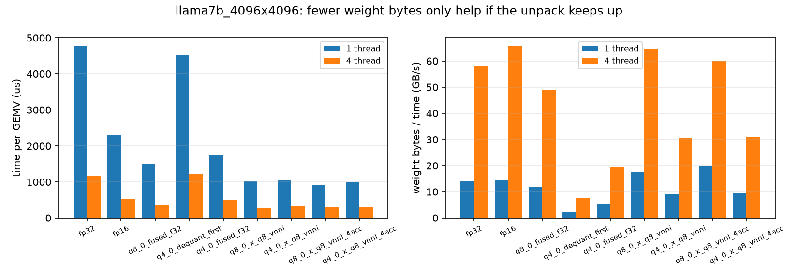
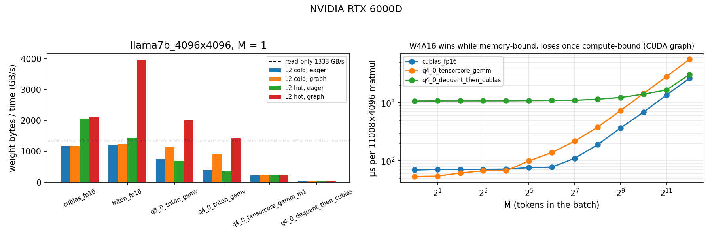
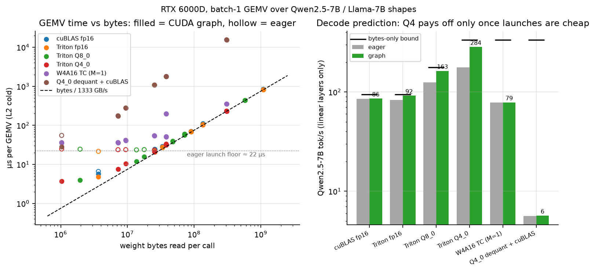

# q4-gemv：llama.cpp 块量化的 GEMV 与 GPT-2 困惑度

对应笔记 [M08 块量化解码](../../../notes/module-08-block-quantized-decode.md)。端侧 LLM 解码每个 token 都要把权重读一遍，batch 1 的 GEMV 被带宽限住；
llama.cpp 的 Q8_0 / Q4_0 / Q4_1 把每 32 个权重和一个 fp16 scale 打成一块来减字节。本实验：

1. 用 NumPy 实现三种块格式，与 gguf 参考逐字节一致（`code/blockq/pack.py`）；
2. 用 C++ 写 9 种 GEMV（fp32、fp16、Q8 / Q4 的浮点融合、先反量化、VNNI 整数点积及其 4 累加器版），在 4 个 LLM 层形状上测 1 / 4 线程；
3. 不依赖 transformers 实现 GPT-2 前向（`code/blockq/gpt2.py`），在 wikitext-2 全部 280 个窗口上测困惑度，协议与 mlsys-infra 相同。

数据中心一侧的权重量化（GPTQ、AWQ、SmoothQuant，同一 GPT-2 协议）见 mlsys-infra [compiler-compression](https://gitee.com/liu-xingyan04/mlsys-infra/blob/main/solutions/cmu15849/compiler-compression/README.md) 与 [M17](https://gitee.com/liu-xingyan04/mlsys-infra/blob/main/notes/module-17-compression-quantization.md)。

## 一句话结论

- **Q4 × Q8 VNNI 单线程比 fp32 快 4.6 倍，字节少 7.1 倍**：7B 形状 4096² 上 4763 → 1034 µs，实际只有 9.1 GB/s，被每块的解包指令限住。
- **先反量化再点积没有收益**：4541 µs，与 fp32 的 4763 差不多。
- **Q8 单线程与 Q4 持平，4 线程反超**：1009 vs 1034 µs，275 vs 311 µs；但 Q8 测到 64.7 GB/s，超过 DRAM 流式 48.4 GB/s，有 L3 命中，整模型流式读时结论很可能反转。
- **多累加器不是答案**：4 个独立累加器让 Q4 只快 4%、Q8 快 11%（4 线程时 Q8 反而慢 8%），Q4 的瓶颈是每块的指令吞吐，不是 FMA 依赖链。
- **GPT-2 124M 困惑度**：fp32 29.951、Q8_0 29.953、Q4_0 31.88、Q4_1 32.15；Q4_1 的层平均 SQNR 更高（21.96 vs 21.03 dB）困惑度却更差。mlsys-infra 同协议 W4 g128：RTN 33.27，GPTQ 31.20。
- **服务器 16 线程下 Q4 仍然追不上 Q8**（Xeon 8470Q，11008×4096）：Q4 × Q8 158 µs、Q8 × Q8 154 µs，Q4 的字节优势被解包指令吃掉；105 MB 的 L3 装得下整个量化层，测的是 L3 而不是 DRAM。
- **GPU 上融合反量化 GEMV 打满带宽**（RTX 6000D，CUDA graph，L2 冷）：Qwen2.5-7B 的 lm_head 上 Triton Q4_0 231 µs、1327 GB/s（实测读带宽的 99.5%），比 cuBLAS fp16 快 3.6 倍，恰好是 16 / 4.5 的字节比；
  只算 Linear 的解码预测 fp16 92、Q8_0 163、**Q4_0 284 tok/s**（带宽上界的 97% / 92% / 85%）。先反量化再调 cuBLAS 只有 5.7 tok/s。
- **launch 开销决定小层**：eager 模式下 Triton 每次调用约 22 µs 的下发地板，Q4 解码只有 176 tok/s；CUDA graph 把 KV 投影从 24.8 µs 压到 3.7 µs。
- **batch 一大就换 kernel**：W4A16 tensor core GEMM 在 M ≤ 16 时比 cuBLAS fp16 快（54 vs 70 µs），M ≥ 32 起 cuBLAS 赢，M ≥ 1024 时连「先反量化再 cuBLAS」都比它快。

## 怎么跑

```bash
cd solutions/edge-runtime/q4-gemv
python -m pytest -q tests
python scripts/run_experiments.py --only bench   # 计时，机器空闲，约 2 分钟
python scripts/run_experiments.py --only gpt2    # 需要 .data/hf/models/gpt2 与 wikitext-2，4 种格式约 18 分钟
python scripts/run_experiments.py --only         # 只用已有原始结果重建 summary.json 与 decode_bound.csv
EDGE_THREADS=1,2,4,8,16 python scripts/run_experiments.py --only bench   # 多核服务器上的线程扫描

# GPU（需要 CUDA + Triton；约 7 分钟，结果在 artifacts/raw/gpu/）
python gpu/bench_gpu.py check               # Triton kernel 对 fp32 参考的相对误差
python gpu/bench_gpu.py all                 # bandwidth / gemv / sweep / decode / plot
```

GPT-2 权重和 wikitext-2 通过 hf-mirror 下载到 `<repo>/.data/hf/`，不入库。`--windows N` 可只评测 N 个随机窗口（默认 0 = 全部 280 个）。

## 结果

### GEMV（`gemv_bench.csv`，15 次重复中位数）



Llama-7B 形状 4096×4096，权重字节按格式计（fp32 67 MB、fp16 33.5 MB、Q8_0 17.8 MB、Q4_0 9.4 MB）：

| 方法 | 1 线程 µs | GB/s | 4 线程 µs | GB/s |
| --- | ---: | ---: | ---: | ---: |
| fp32 | 4763 | 14.1 | 1156 | 58.1 |
| fp16 | 2312 | 14.5 | 511 | 65.6 |
| Q8_0 浮点融合 | 1494 | 11.9 | 364 | 48.9 |
| Q4_0 先反量化 | 4541 | 2.1 | 1214 | 7.8 |
| Q4_0 浮点融合 | 1743 | 5.4 | 489 | 19.3 |
| Q8_0 × Q8 VNNI | 1009 | 17.7 | 275 | 64.7 |
| Q4_0 × Q8 VNNI | 1034 | 9.1 | 311 | 30.3 |
| Q8_0 × Q8 VNNI，4 累加器 | 903 | 19.8 | 297 | 60.0 |
| Q4_0 × Q8 VNNI，4 累加器 | 990 | 9.5 | 303 | 31.1 |

其他三个形状（GPT-2 MLP 3072×768、Llama-1B 2048² 与 8192×2048）见 `summary.json`；小矩阵全部在缓存里，GB/s 可以到 115。
4 线程加速比：fp32 4.12、Q8 × Q8 3.66、Q4 × Q8 3.32；Q4 的扩展最差，因为它的瓶颈是每核的指令吞吐而不是共享的带宽。

两次空闲运行之间的波动：上一次 bench 里 fp32 4447、Q8 × Q8 1235、Q4 × Q8 1005 µs，这一次 4763、1009、1034。Q8 差 18%，Q4 只差 3%：带宽和缓存状态敏感的内核会漂，指令受限的内核不动。表里只用这一次运行，所有方法在同一次运行里计时。

### 解码上界（`decode_bound.csv`）

tok/s ≤ 带宽 / 权重字节，只算 Linear 权重，不含 KV cache 与激活：

| 模型 | 格式 | 权重 GB | Pi 5（17.1 GB/s） | Orin Nano（68 GB/s） | 本机 4 线程（按实测 GB/s） |
| --- | --- | ---: | ---: | ---: | ---: |
| Llama-7B | fp16 | 13.48 | 1.3 | 5.0 | 4.9 |
| Llama-7B | Q8_0 | 7.16 | 2.4 | 9.5 | 9.0 |
| Llama-7B | Q4_0 | 3.79 | 4.5 | 17.9 | 8.0 |
| Llama-1B | Q4_0 | 0.70 | 24.5 | 97.5 | 43.4 |
| GPT-2 124M | Q4_0 | 0.070 | 244.7 | 974.9 | 434.5 |

最后一列用的是 4096² 矩阵上测到的 GB/s，其中 fp16 和 Q8 含 L3 命中，对 GB 级的整模型偏乐观；按 DRAM 流式 48.4 GB/s 封顶，7B Q8_0 是 6.8 tok/s，低于 Q4_0 的 8.0。

### GPT-2 困惑度（`gpt2_ppl.csv`、`gpt2_layer_sqnr.csv`）

wikitext-2 raw test，空行连接，280 个不重叠的 1024 token 窗口（286,440 个预测 token）；量化全部 48 个 Linear（c_attn、c_proj、c_fc、mlp.c_proj），lm_head 与 wte 共享、保持 fp32。

| 格式 | bit/权重 | 困惑度 | 相对 fp32 | 层平均 SQNR dB |
| --- | ---: | ---: | ---: | ---: |
| fp32 | 32 | 29.951 | — | — |
| Q8_0 | 8.5 | 29.953 | +0.007% | 45.08 |
| Q4_1 | 5.0 | 32.15 | +7.3% | 21.96 |
| Q4_0 | 4.5 | 31.88 | +6.4% | 21.03 |

fp32 的 29.95 与 mlsys-infra 的 fp16 29.96 一致，说明两边的前向与评测协议对齐。Q8_0 与 Q4_0 的 SQNR 差 24.04 dB，接近每 4 bit 6.02 × 4 = 24.1 dB。

### 服务器 CPU：Xeon 8470Q，1–16 线程（`artifacts/raw/xeon8470q/`）

为了让 fp32 的工作集超过 105 MB 的 L3，新增了 Llama-7B MLP 形状 11008×4096（fp32 180 MB、fp16 90 MB、Q8_0 48 MB、Q4_0 25 MB）。绑 NUMA1 的物理核，单位 µs：

| 方法 | 1 线程 | 4 线程 | 16 线程 | 16 线程 GB/s |
| --- | ---: | ---: | ---: | ---: |
| fp32 | 9580 | 2545 | 660 | 273 |
| fp16 | 4978 | 1035 | 297 | 304 |
| Q8_0 浮点融合 | 2400 | 648 | 198 | 242 |
| Q4_0 先反量化 | 7315 | 1852 | 523 | 48 |
| Q4_0 浮点融合 | 3545 | 903 | 281 | 90 |
| Q8_0 × Q8 VNNI | 1947 | 525 | 154 | 311 |
| Q4_0 × Q8 VNNI | 2057 | 523 | 158 | 161 |
| Q8_0 × Q8 VNNI，4 累加器 | 2036 | 516 | 144 | 332 |

- **Q4 在 CPU 上是指令受限的，加线程也不改变。** 1、4、16 线程下 Q4 × Q8 与 Q8 × Q8 都相差不到 6%，Q4 只读一半字节却没有更快；16 线程 161 GB/s，离 L3 带宽还远。
- **fp32 的 273 GB/s 超过了 16 线程 DRAM 只读的 193 GB/s**，说明 180 MB 里仍有一大块留在 105 MB 的 L3（逐次调用间不被冲掉）。整模型解码要看 [llama-cpp-7b](../llama-cpp-7b/README.md) 的端到端结果。
- 单线程服务器只比本地 VM 快 1.3–2.3 倍（4096²：fp32 4763 → 2075 µs，Q4 × Q8 1034 → 768 µs），差距主要来自更大的 L2/L3，而不是单核算力。

### GPU：RTX 6000D 上的 Triton 融合反量化 GEMV（`artifacts/raw/gpu/`）

`gpu/triton_gemv.py` 把 `blockq.pack` 的 AoS 块（`[d fp16][qs]`）转成 SoA（`qs` 与 `d` 各一个连续张量，合并访存），实现三个 Triton kernel：
fp16 GEMV、Q8_0 GEMV、Q4_0 GEMV（每个 program 处理 `BN` 行 × `NB` 个 32 元素块，低/高半字节分开解包、在寄存器里乘 scale）；
外加一个 W4A16 tensor core GEMM（`tl.dot`，A 的列按 Q4_0 的半字节顺序预先置换，避免在 kernel 里交错）。与 fp32 参考的相对误差约 3 × 10⁻⁴。

计时方法：每个形状做足够多份权重拷贝、轮换调用，使总工作集 ≥ 4 GB（远超 112 MB L2），这是「冷」数字；「热」是同一份权重反复调用。
eager 与 CUDA graph 两种下发各测一次。平台：RTX 6000D（sm_120，156 SM，84 GB GDDR7 448 bit，112 MB L2），
4 GB 顺序读 1333 GB/s、拷贝 1280 GB/s（理论 1398）。单位 µs，L2 冷，CUDA graph：

| 形状（N×K） | cuBLAS fp16 | Triton fp16 | Triton Q8_0 | Triton Q4_0 | Q4_0（eager） | Q4_0 反量化 + cuBLAS | W4A16 TC（M=1） |
| --- | ---: | ---: | ---: | ---: | ---: | ---: | ---: |
| Llama 4096×4096 | 28.5 | 26.8 | 15.7 | 10.3 | 23.8 | 276 | 41.0 |
| Llama 11008×4096 | 69.7 | 68.5 | 38.5 | 20.7 | 23.3 | 1076 | 53.9 |
| Qwen q/o 3584×3584 | 24.2 | 20.7 | 11.8 | 7.5 | 23.8 | 172 | 36.1 |
| Qwen k/v 512×3584 | 5.7 | 4.8 | 4.0 | 3.7 | 24.8 | 28.3 | 35.9 |
| Qwen gate/up 18944×3584 | 110.0 | 103.2 | 56.7 | 31.4 | 32.0 | 1774 | 50.5 |
| Qwen down 3584×18944 | 106.9 | 103.4 | 58.6 | 32.4 | 33.1 | 1786 | 196.8 |
| Qwen lm_head 152064×3584 | 838 | 811 | 433 | 231 | 232 | 15489 | 351 |



- **大矩阵上三种格式都到 1.2–1.34 TB/s**（lm_head：fp16 1344、Q8 1337、Q4 1327 GB/s），时间严格按字节缩放：838 / 231 = 3.63，16 bit / 4.5 bit = 3.56。GPU 有足够的 ALU 隐藏解包，这与 CPU 上 Q4 被指令吞吐卡住正好相反。
- **小矩阵由下发开销决定**：eager 模式每次 Triton 调用约 22–25 µs，与形状无关（k/v 只有 1.8 MB 也要 24.8 µs）；CUDA graph 后 3.7 µs。真实推理引擎必须用 graph 或 persistent kernel。
- **不融合的代价是 15–70 倍**：「先反量化成 fp16 再 cuBLAS」每次都把 fp16 权重写出再读回，比 fp16 GEMV 还慢一个数量级。
- **热 L2 的数字不能用来预测解码**：4096² fp16 热时 3975 GB/s，是 L2 带宽；7B 整模型 4–14 GB，每个 token 都从 DRAM 读。

**解码预测**（`decode_pred.csv`）：Qwen2.5-7B 每层 q/o ×2、k/v ×2、gate/up ×2、down ×1，28 层 + lm_head，只算 Linear：

| 方法 | 权重 GB | eager tok/s | graph tok/s | graph 占读带宽上界 |
| --- | ---: | ---: | ---: | ---: |
| cuBLAS fp16 | 14.14 | 85.1 | 85.8 | 91% |
| Triton fp16 | 14.14 | 83.3 | 91.7 | 97% |
| Triton Q8_0 | 7.51 | 124.9 | 163.0 | 92% |
| Triton Q4_0 | 3.98 | 176.4 | 283.7 | 85% |
| W4A16 TC（M=1） | 3.98 | 78.1 | 78.6 | 23% |
| Q4_0 反量化 + cuBLAS | 3.98 | 5.6 | 5.7 | 2% |

Q4 的收益只在 graph 模式下兑现：eager 时 196 个小层每个都吃 22 µs 地板，Q4 只比 fp16 快 2.1 倍；graph 后 3.1 倍。



左图把每次 GEMV 的时间画在「读了多少字节」上，虚线是 `bytes / 1333 GB/s`。一个点离虚线越近，越接近只受带宽限制：

- 30 MB 以上，各方法的实心点（graph）都落在虚线上，与格式无关：只要融合，GPU 上的量化 GEMV 就只剩搬字节一件事。
- 10 MB 以下，空心点（eager）贴着 22 µs 的水平线，这条线就是 Python + Triton 的下发开销。Q4 把字节压到 1/3.6，
  却把更多层推到了这条线下面，所以 eager 模式下量化越狠、收益越少。
- 棕色点（反量化 + cuBLAS）比虚线高一个半数量级，W4A16 tensor core（紫色）在大 K 时也离线很远：M = 1 时 `tl.dot` 的 16 行 tile 有 15 行是空的。

右图把左图换算成整模型解码速度，横线是只算字节的上界。Q4 在 graph 下达到上界的 85%，是唯一一个「eager 与 graph 差距大」的方法。

**batch 扫描**（`batch_sweep.csv`，11008×4096，µs）：

| M | cuBLAS fp16 | W4A16 TC | Q4 反量化 + cuBLAS |
| ---: | ---: | ---: | ---: |
| 1 | 69.5 | 53.9 | 1077 |
| 16 | 72.1 | 67.4 | 1088 |
| 32 | 76.4 | 99.9 | 1093 |
| 128 | 111.2 | 219.2 | 1108 |
| 1024 | 693.4 | 1450.1 | 1416 |
| 4096 | 2645.5 | 5630.6 | 3083 |

M ≤ 16 时权重读取主导，4 bit 权重占优；M ≥ 32 进入算力区，我们的 W4A16 kernel 只到约 65 TFLOP/s（cuBLAS 135），反量化在内层循环里的开销显形。
这正是 vLLM 等引擎对 decode 用 Marlin 类 W4A16、对 prefill 先反量化或直接用 fp16/fp8 GEMM 的原因（mlsys-infra [compiler-compression](https://gitee.com/liu-xingyan04/mlsys-infra/blob/main/solutions/cmu15849/compiler-compression/README.md) 有 GPTQ/AWQ 的端到端测量）。

## 和原课程的差异

- llama.cpp 的 x86 内核还有 AVX2 / AVX-512 多块并行、K-quants（Q4_K 等超块格式）、imatrix；这里只实现最基础的 Q4_0 / Q8_0 / Q4_1，目的是把每一项开销拆开测。
- GPT-2 前向只保留困惑度需要的部分（因果注意力、tanh GELU、pre-LN），不做 KV cache 和采样。

## 这些数字不能推出什么

- GEMV 测的是单层、重复调用；4096² 的矩阵会部分留在 L3，不代表整模型每 token 都从 DRAM 读的情况。
- 解码上界只算权重字节，不含 KV cache、lm_head（GPT-2 里 38.6M 参数）、调度和采样开销。
- Q4_0 与 Q4_1 的困惑度差 0.27，没有做置信区间；「最大幅值元素精确」能否解释它只是假设。
- Pi 5 与 Orin Nano 两列是用设备表带宽算出的上界，不是实测。
- GPU 解码预测只把单层 GEMV 时间相加：没有 attention、RMSNorm、RoPE、采样，也没有层间融合；端到端数字见 llama-cpp-7b 的 GPU 部分。
- 主机没有性能计数器权限（`ncu` 报 `ERR_NVGPUCTRPERM`），GPU 上「受带宽限制」的判断只来自墙钟时间 ÷ 字节数，没有 DRAM 事务计数佐证。

## 文件

| 路径 | 内容 |
| --- | --- |
| `code/blockq/pack.py` | Q8_0 / Q4_0 / Q4_1 打包、反量化、SQNR |
| `code/blockq/gpt2.py` | 从 `model.safetensors` 直接构建 GPT-2，`Conv1D` 布局与 HF 一致 |
| `cpp/gemv.cpp` | 打包、9 种 GEMV、`--mode=bench / check / pack` |
| `scripts/run_experiments.py` | `bench`、`gpt2`、`decode_bound`、`summarize` |
| `gpu/triton_gemv.py` | SoA 打包、Triton fp16 / Q8_0 / Q4_0 GEMV、W4A16 tensor core GEMM |
| `gpu/bench_gpu.py` | 带宽探针、L2 冷/热 × eager/graph 计时、batch 扫描、Qwen2.5-7B 解码预测、绘图 |
| `artifacts/raw/gpu/` | RTX 6000D 结果：`bandwidth.json`、`gemv_gpu.csv/jsonl`、`batch_sweep.csv`、`decode_pred.csv` |
| `artifacts/raw/xeon8470q/` | Xeon 8470Q 1–16 线程的 `gemv_bench` 与 `decode_bound` |
| `tests/test_blockq.py` | 块大小、Q4_0 最大元素精确、与 gguf 逐字节一致、C++ 打包一致、内核误差、4 累加器与原版一致、GPT-2 因果性 |
