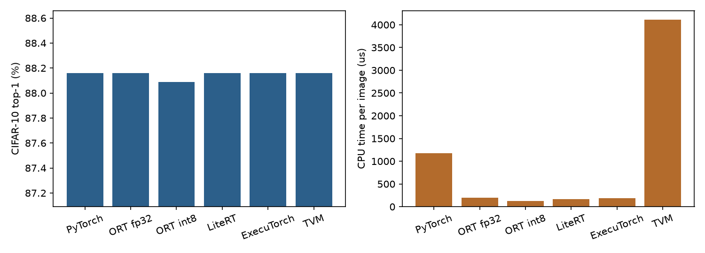

# runtime-compare：同一张网，六条 CPU 推理路径

对应笔记 [M03 校准定位](../../../notes/module-03-calibration-localization.md) 与 [M06 调度搜索](../../../notes/module-06-schedule-search.md)。
lab2 的 micronet（MicroMobileNetV2，CIFAR-10，BN 折叠后的 fp32）原样交给 PyTorch eager、ONNX Runtime fp32、ONNX Runtime int8（lab2 部署用的 QDQ + MinMax）、
LiteRT（litert-torch 转出的 `.tflite`）、ExecuTorch（XNNPACK 委托）和 Apache TVM（Relax + LLVM，不调优）。
每条路径 1 个线程，跑完整个测试集（10,000 张，batch 1），比精度、和 PyTorch 的 logit 差、每张图的 CPU 时间。

平台：AutoDL 无卡容器，2026-11-12。看得见 208 个逻辑核（2 × Xeon Platinum 8470Q，Sapphire Rapids），cgroup `cpu.max` 是 `50000 100000`（0.5 核），
`memory.max` 是 2 GB。墙钟时间量的是配额，表里的时间都是 `time.process_time()`。

## 一句话结论

- **四个 fp32 运行时和 PyTorch 逐图同答**：ORT、LiteRT、ExecuTorch、TVM 的 top-1 都是 88.16%，10,000 张图的 argmax 和 PyTorch 全部相同，最大 logit 差 5.7e-6。
- **ORT int8 最快，也是唯一掉点的**：88.09%（就是 lab2 发布的数），和 fp32 有 99.05% 的图同答；每张图 127 µs，是 ORT fp32 的 1/1.60；模型 326,171 字节，是 fp32 的 1/2.59。
- **三个部署运行时排序稳定**：LiteRT 166 µs < ExecuTorch 192 µs < ORT fp32 202 µs。同一次运行 3 轮新进程的范围互不重叠，下午三批运行的排序也相同。
- **PyTorch eager 是 ORT fp32 的 5.8 倍**（1173 µs）：网很小（32×32 输入），每个算子的派发开销占了大头。
- **不调优的 TVM 最慢**：4107 µs，是 PyTorch 的 3.5 倍。默认编译没有给 CPU 上的 conv2d 做调度，补这一步就是 MLC 作业 2–4 的内容。MetaSchedule 在 0.5 核上调不完（见下文）。

## 怎么跑

```bash
# 仓库根目录，Linux。需要 lab2 的 checkpoints/micronet.pt 与 .data/cifar10.npz
python solutions/edge-runtime/runtime-compare/scripts/run_experiments.py              # 6 个后端 × 3 轮，各一个进程
python solutions/edge-runtime/runtime-compare/scripts/run_experiments.py --only tvm 0 # 单跑一个
python solutions/edge-runtime/runtime-compare/scripts/run_experiments.py --merge      # 汇总 part-*.json
bash solutions/edge-runtime/runtime-compare/scripts/run_autodl.sh                     # 本次运行的完整设置（三个 venv）
```

每个后端可以用 `RTCMP_PY_<NAME>` 指定解释器。三个运行时对 torch 版本的要求互相冲突，本次用了三个虚拟环境：

| 环境 | 内容 | 原因 |
| --- | --- | --- |
| 系统 Python 3.12 | torch 2.8.0、onnxruntime 1.31.1 | PyTorch、ORT fp32、ORT int8 |
| `rtvenv` | torch 2.14.1+cpu、litert-torch 0.10.0、ai-edge-litert 2.3.0 | litert-torch 要求 torch < 2.15 |
| `etvenv` | torch 2.15.0+cpu、executorch 1.6.0 | executorch 1.6 钉死 torch == 2.15.0 |
| `tvmvenv` | apache-tvm 0.27.0.post1、apache-tvm-ffi 0.1.14.post0，加一个屏蔽 torch 的 `sitecustomize.py` | 见下文第 4、5 条 |

两个 torch 都从 `https://download.pytorch.org/whl/cpu` 装。PyPI 上的 torch 2.15 是 CUDA 13 的轮子，无卡模式缺 `libcudart.so.13` 和 nvshmem，导入不了。

## 结果



CPU 时间是整个 10,000 张精度循环摊下来的每张图耗时（`cpu_us_eval`），取 3 个新进程的中位数，括号里是最小到最大。

| 运行时 | top-1 | 和 PyTorch 的 argmax 一致 | 最大 logit 差 | CPU 时间 / 图 | 模型文件 | 峰值 RSS |
| --- | ---: | ---: | ---: | ---: | ---: | ---: |
| PyTorch 2.8 eager | 88.16% | 1 | 0 | 1173 µs（1144–1224） | — | 660 MB |
| ORT 1.31 fp32 | 88.16% | 1 | 5.7e-6 | 202 µs（201–213） | 843,513 B | 709 MB |
| ORT 1.31 int8 QDQ | 88.09% | 0.9905 | 1.74 | 127 µs（125–134） | 326,171 B | 997 MB |
| LiteRT 2.3 | 88.16% | 1 | 5.7e-6 | 166 µs（161–175） | 855,844 B | 914 MB |
| ExecuTorch 1.6 XNNPACK | 88.16% | 1 | 5.7e-6 | 192 µs（185–195） | 843,816 B | 626 MB |
| TVM 0.27 LLVM（不调优） | 88.16% | 1 | 5.7e-6 | 4107 µs（3979–4217） | — | 563 MB |

- 峰值 RSS 是整个进程的，包括加载 CIFAR-10 和 PyTorch 模型的开销，不是运行时本身的占用。ORT int8 这一行还包括校准。
- 另有一个时间 `cpu_us`：同一张图重复 200 次。多数运行时比 `cpu_us_eval` 小 0.4–17%（ExecuTorch 160 对 192，LiteRT 148 对 166），ORT int8 反而大 5%（133 对 127）。两种口径的排序相同。
- TVM 编译（`tvm.compile`，不调优）墙钟 2.4 s。
- 原始数据：`artifacts/raw/part-<运行时>-t<轮>.json`（每个进程一个）、`summary.json`（中位数与 claims 用到的扁平字段）、`runs.jsonl`。

## 这台机器上踩到的坑

无卡容器只有 0.5 核和 2 GB。下面 8 条是这次运行中实际碰到的，每条都在脚本里有对应的处理：

1. **墙钟量的是配额。** 2 秒的 Python 自增循环，本地 Ice Lake 虚拟机跑 12,542,873 次，这里 9,850,970 次，相当于半个更快的核。对比只用 `process_time`。
2. **页缓存算在 2 GB 里；进程被 SIGKILL 时，`oom_kill` 计数是 0。** 一次带 TVM 调优的完整运行里，调优进程被杀之后，第 3 轮的 ORT fp32、ORT int8、LiteRT、ExecuTorch 都以 -9 退出；那次运行结束、没有任何实验进程时，cgroup 里仍记着 1.48 GB，其中匿名内存 321 MB、页缓存 1059 MB。
   `/proc/sys/vm/drop_caches` 和 `memory.reclaim` 都写不了，[`evict_page_cache.py`](scripts/evict_page_cache.py) 对每个文件调 `posix_fadvise(DONTNEED)`，一次把 cgroup 从 1486 MiB 降到 551 MiB。
   最终运行在每个进程启动前回收一次，18 个进程都没有被杀。是谁发的 SIGKILL（内核看不到的上层 cgroup，还是 AutoDL 的进程）这里无法确认，只能确认回收页缓存之后不再发生。
3. **ORT 的校准器会按物理核数开线程。** `quantize_static` 内部建的会话不受调用方的线程设置约束，进程里有 105 个线程；batch 1 校准跑了 7 分钟、用掉 3.5 分钟 CPU 还没做完。按 lab2 的做法改成动态 batch、每批 64 张，再把校准会话钉到 1 个线程，本地冒烟测试 1.6 s CPU 时间就能做完。
4. **只要 torch 能导入，TVM 就会现编一个 C++ 扩展。** `tvm/relax/base_py_module.py` 无条件调用 `load_torch_c_dlpack_extension()`，`TVM_FFI_DISABLE_TORCH_C_DLPACK=1` 管不到这一处。编译时 TVM 进程 700 MB、构建用的 Python 530 MB、`cc1plus` 620 MB，合计超过 2 GB，`import tvm` 以 137 退出。TVM 那一行不需要 torch，`tvmvenv` 里放一个 `sitecustomize.py` 设 `sys.modules["torch"] = None` 之后，导入只占 207 MB。
5. **apache-tvm-ffi 0.1.15 和 0.1.16 搭配 TVM 0.27.0.post1 时，任何 `save_json` 都段错误**（`tvm::ffi::ToJSONGraph`），连序列化一个 `IntImm` 也一样。TVM 的元数据写的是 `apache-tvm-ffi>=0.1.14.post0`，pip 会装最新版。钉在 0.1.14.post0 后正常。只编译、不序列化的话 0.1.16 也能跑出同样的数，所以这个问题只在调优时暴露。
6. **TVM 0.27 不再接受字符串形式的目标。** `"llvm -mcpu=sapphirerapids -num-cores 1"` 直接报错，要写成 `{"kind": "llvm", "mcpu": "sapphirerapids", "num-cores": 1}`。
7. **ExecuTorch 和 litert-torch 的 torch 版本要求互斥。** 前者钉死 2.15.0，后者要求 < 2.15。它们只能各用一个环境，计时脚本每个后端起一个子进程，正好允许每个后端用不同的解释器。
8. **MetaSchedule 在 0.5 核上调不完。** micronet 拆出 24 个调优任务；MetaSchedule 的 builder 默认按 208 个逻辑核开进程池，要改成 1 个。即便这样，调度器给第一个任务（`mean`）发的第一批 62 个候选，跑了 15 分钟到超时被杀，runner 这一步还没量完。按每个任务 32 次试验算，全部要 768 次，这台机器上要几个小时，所以表里只有不调优的 TVM。

## 这些数字不能推出什么

- **不能推出这台 8470Q 空闲时的延迟。** 0.5 核配额下，CPU 时间接近单线程工作量，但频率、缓存都和独占的核不一样。同一天中午的第一次运行里，ORT fp32 重复 20 次是 307 µs；下午 8 个进程的 `cpu_us_eval` 在 201–244 µs 之间。同一批内部的排序可靠，跨批的绝对值能差一半。
- **不能和 lab2 的 1.47 倍直接比。** lab2 的 ORT int8 加速是在 4 核 Ice Lake 虚拟机上、1 线程、墙钟时间测的（372.4 → 253.9 µs）。这里是 Sapphire Rapids、1 线程、CPU 时间，1.60 倍。方向一致，数不能放进同一张表。
- **不能推出 TVM 慢。** 4107 µs 是不调优的结果。调优能把它降多少，这台机器回答不了；同样的调度搜索在 [tensor-program-tuning](../../mlc/tensor-program-tuning/README.md) 里用自写的搜索器做过：256³ 矩阵乘上，搜到的最好调度在本地是单线程 NumPy 的 0.94 倍，在 Xeon 8470Q 上是 0.71 倍。
- **不能推出 PyTorch eager 在大网络上也慢 5.8 倍。** 这张网每层的计算量很小，派发开销是常数；输入越大，这个比例越接近 1。这一条是推断，本实验只测了 32×32 输入。
- **ORT int8 的最大 logit 差 1.74 不是错误。** 它是量化误差本身；该看的是 argmax 一致率 99.05% 与 top-1 只掉 0.07 个点。

## 和原课程的差异

MLC 作业 1 用 TVM Relax 把一个小 CNN 搬进 IRModule，再把部分算子换成外部库。这里不装 `mlc-ai`，改成让 5 个生产运行时跑同一份权重，比精度和 CPU 时间；TVM 只占其中一行。
作业 2–4 的调优在这台机器上做不了（第 8 条），对应内容在 tensor-program-tuning。无卡模式没有 CUDA 设备，所以也没有 GPU 委托这一条线。

## 文件

| 路径 | 内容 |
| --- | --- |
| `code/rtcmp/measure.py` | `cpu_quota_cores`（解析 `cpu.max`）、`time_call`（墙钟与 CPU 时间）、`agreement`（logit 差与 argmax 一致率）、`combine`（多轮取中位数） |
| `scripts/run_experiments.py` | 6 个后端；`--only NAME [TRIAL]` 跑一个，`--merge` 汇总，不带参数则 3 轮 × 6 个后端 |
| `scripts/evict_page_cache.py` | 逐文件丢弃页缓存（第 2 条） |
| `scripts/run_autodl.sh` | 本次运行的环境变量与三个 venv |
| `tests/test_measure.py` | 配额解析、两种时钟、一致率、取中位数 |
| `artifacts/work/` | ONNX / tflite / pte 模型与 PyTorch 参考 logits（gitignore） |
