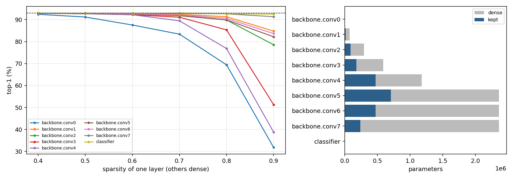
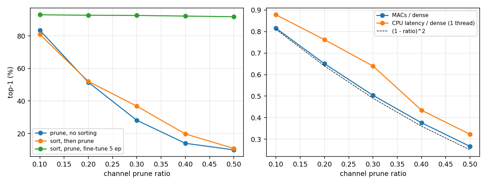

# lab1-pruning：MIT 6.5940 Lab 1，VGG 细粒度剪枝与通道剪枝

对应 6.5940 Fall 2024 Lab 1 的全部 9 道题，用课程给的 VGG 预训练权重（`vgg.cifar.pretrained.pth`，CIFAR-10 92.95%）。
实现是自己写的（`code/prune/`），不拷贝 notebook；数据流程与课程一致：只做 `ToTensor`、不做归一化，训练增强是 RandomCrop(32, pad 4) + 水平翻转。

## 一句话结论

- **细粒度剪枝达标**：按敏感度曲线为 9 层各选一个稀疏度，模型只剩稠密的 **23.6%**（35.2 → 8.30 MiB），剪完 78.39%，SGD 微调 5 轮回到 **92.72%**（要求：≤ 25% 尺寸且 ≥ 92.5%）。
- **细粒度稀疏不会自动变快**：稠密 kernel 照样算所有零，1 线程 9.25 → 9.18 ms（Xeon 8470Q），本地 24.1 → 23.2 ms。
- **通道剪枝直接减 MACs**：剪 30% 通道，MACs 降到 0.504×（≈ (1−0.3)²），1 线程延迟 0.64×，微调后 92.52%；剪 50% 时 MACs 0.266×、延迟 0.32×、微调后 91.74%。
- **按 Frobenius 范数排序在剪得多时才有用**：剪 30% 时不微调的准确率 28.15% → 36.81%；剪 10% 时排序反而低 2.5 个点（83.40% vs 80.88%），说明「输入通道范数」只是重要性的粗略代理。

## 怎么跑

```bash
cd solutions/mit6.5940/lab1-pruning
python -m pytest -q tests
# 需要课程权重：https://hanlab18.mit.edu/files/course/labs/vgg.cifar.pretrained.pth → artifacts/work/
python scripts/run_experiments.py              # GPU 上约 5 分钟（RTX 6000D）
LAB1_HOST_TAG=myhost python scripts/run_experiments.py --latency   # 只在本机 CPU 上重测延迟
```

## 结果

### Q1–Q3：权重分布与细粒度剪枝

`fine_grained_prune` 用 `kthvalue` 求第 \(k\) 小的 \(|w|\) 作为阈值，保留严格大于阈值的元素，所以重复值不会让稀疏度超标；稀疏度 0 与 1 单独处理。
Q3 的 5×5 例子（±1…25，目标 10 个非零）：稀疏度 15/25 = 0.6，剪完正好 10 个非零（`summary.json` 中的 `q3_*`）。

### Q4–Q6：敏感度扫描与稀疏度选择



逐层把一层剪到 0.4…0.9、其余保持稠密，记录准确率（`sensitivity.csv`）。conv0 最敏感（剪到 0.9 只剩 31.7%），classifier 与 conv7 最不敏感。
选法（`choose_sparsities`）：容许每层比稠密低 \(d\) 个点，取「准确率第一次掉到容许线以下之前」的最大稀疏度；\(d\) 从 0 起每次加 0.1，取第一个让总尺寸 ≤ 25% 的 \(d\)。这里 \(d = 2.4\)：

| 层 | conv0 | conv1 | conv2 | conv3 | conv4 | conv5 | conv6 | conv7 | classifier |
| --- | --- | --- | --- | --- | --- | --- | --- | --- | --- |
| 稀疏度 | 0.5 | 0.8 | 0.7 | 0.7 | 0.6 | 0.7 | 0.8 | 0.9 | 0.9 |

参数量大的 conv5–conv7 决定了总尺寸，它们恰好也不敏感，这是 25% 能做到的原因。

### Q7：微调

| 阶段 | 准确率 | 尺寸 |
| --- | ---: | ---: |
| 稠密 | 92.95% | 35.20 MiB |
| 剪枝后、微调前 | 78.39% | 8.30 MiB（23.6%） |
| 微调 5 轮（最后一轮 / 最好一轮） | 92.72% / 92.84% | 8.30 MiB |

微调时每个 optimizer step 后重新乘掩码（`FineGrainedPruner.apply`），实测各层稀疏度与目标一致（`fg_layer_sparsity_measured`）。

### Q8–Q9：通道剪枝



| 剪通道比例 | 不排序 | 排序后 | 排序 + 微调 5 轮 | MACs | 延迟 1 线程（8470Q） | 延迟 1 线程（本地） |
| ---: | ---: | ---: | ---: | ---: | ---: | ---: |
| 0.1 | 83.40% | 80.88% | 92.94% | 0.815× | 0.88× | 0.86× |
| 0.2 | 51.48% | 52.03% | 92.65% | 0.650× | 0.76× | 0.76× |
| 0.3 | 28.15% | 36.81% | 92.52% | 0.504× | 0.64× | 0.62× |
| 0.4 | 14.03% | 19.78% | 92.14% | 0.376× | 0.43× | 0.42× |
| 0.5 | 10.00% | 10.90% | 91.74% | 0.266× | 0.32× | 0.32× |

`channel_prune` 保留每层前 \(\mathrm{round}(c(1-r))\) 个输出通道（最后一层 conv 不剪，classifier 输入维度不变），同步裁 BN 与下一层输入。
`apply_channel_sorting` 按下一层权重对每个输入通道的 Frobenius 范数降序重排本层输出通道、BN 与下一层输入，函数不变（`sorting_preserves_acc` = 92.95%）。
延迟比 MACs 比下降得慢：卷积变窄后访存与调用开销所占比例上升；两台 CPU 的比值几乎相同。

## 和原课程的差异

- 选稀疏度用的是可复现的规则（统一容许线），没有手调每层；结果 23.6% 尺寸、92.72%，满足要求。
- 微调用的是课程配方（SGD momentum 0.9、lr 0.01、cosine、5 轮），数据增强在 GPU 上逐样本完成（`augment`），不经过 DataLoader。
- 延迟在两台 CPU 上测（服务器 Xeon 8470Q、本地 Ice Lake），batch 1，`time_calls` 取 p50。

## 这些数字不能推出什么

- 细粒度剪枝的 8.30 MiB 是「只存非零值」的理论尺寸，没算稀疏索引；真实 CSR 等格式会更大。
- 延迟只代表 PyTorch eager + oneDNN 在这两台 CPU 上的表现，不代表 MCU 或专用稀疏硬件。

## 文件

| 路径 | 内容 |
| --- | --- |
| `code/prune/vgg.py` | 课程 VGG 结构与权重加载 |
| `code/prune/fine.py` | `fine_grained_prune`、`FineGrainedPruner`、尺寸与稀疏度、`sensitivity_scan`、`choose_sparsities` |
| `code/prune/channel.py` | `channel_prune`、`get_input_channel_importance`、`apply_channel_sorting`、`count_macs` |
| `code/prune/train.py` | GPU 上的增强、评估、微调（可在每步后回调掩码） |
| `scripts/run_experiments.py` | 全部 9 题与延迟测量 |
| `artifacts/raw/` | `summary.json`、`sensitivity.csv`、`channel.csv`、`runs.jsonl`、`latency_laptop_icelake.json` |
