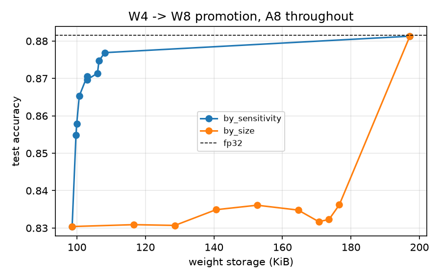
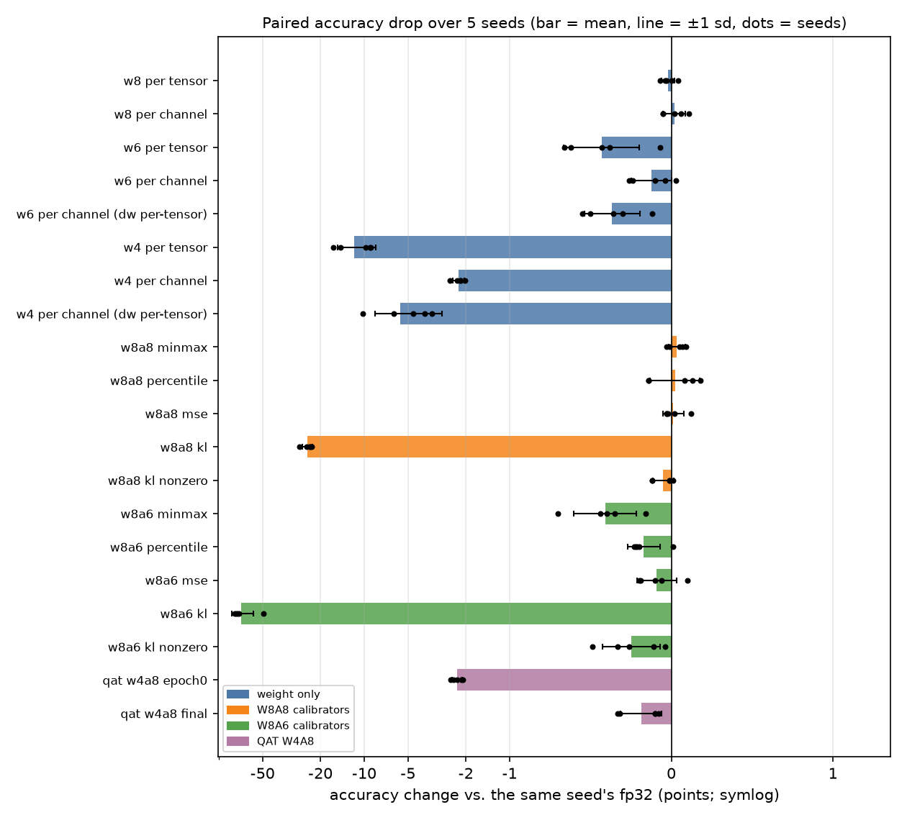
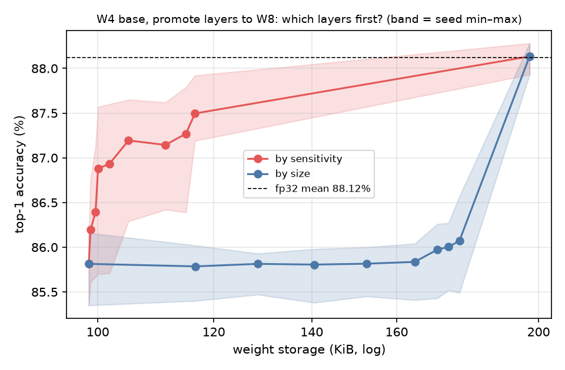

# lab2-quantization：校准、误差定位、混合精度与 QAT

对应笔记 [M03 校准与误差定位](../../../notes/module-03-calibration-localization.md)；整数执行语义见 [M02](../../../notes/module-02-integer-contract.md)。
MIT 6.5940 Lab 2 用 VGG 做 k-means 与线性量化；这里换成 CIFAR-10 上 20.9 万参数、857 万 MAC 的 MobileNetV2 式网络（`code/edgequant/model.py`），
因为 depthwise + 线性瓶颈 + 残差才是端侧量化真正难的结构。全部在 4 核 CPU 上完成。

LLM 侧同一套问题（逐组 scale、敏感层、GPTQ/AWQ）见 mlsys-infra [M17](https://gitee.com/liu-xingyan04/mlsys-infra/blob/main/notes/module-17-compression-quantization.md)。

## 一句话结论

- **BN 折叠无损**：fp32 88.16%，折叠后 88.16%，logits 最大差 4.9e-6。
- **粒度的代价随位宽放大**：W8 逐张量 88.15 / 逐通道 88.16；W4 逐张量 76.42 / 逐通道 83.20。
- **校准器在 A8 上差距 < 0.2 个点**，唯一的例外是 TensorRT 式 KL：63.68%（A6 时 16.30%），因为 ReLU 输出里大量精确零把阈值拉低；去掉精确零后 88.06%。
- **混合精度按敏感度而不是按大小**：W4 基线 83.04%（98.6 KiB）；按敏感度升 8 层到 W8 → 87.69%（108.1 KiB），按参数量升 8 层 → 83.62%（176.6 KiB）。
- **QAT 3 个 epoch** 把 W4A8 从 83.04 拉回 87.63%，每个 epoch 约 110 s。
- **五个种子复现**：KL 崩溃（−24.6 ± 2.4 个点）、按敏感度混合精度（−0.63 对按大小 −2.05）、QAT（−0.19）都在 95% 置信区间里成立；最敏感的层随种子变化。
- **ONNX Runtime 1.31**：int8 QDQ 88.09%，单线程延迟 372.4 → 253.9 µs（1.47 倍），文件 824 → 319 KiB；Entropy 默认参数与 MinMax 结果相同，改成 2048 bin 后掉到 87.17%。

## 怎么跑

```bash
cd solutions/mit6.5940/lab2-quantization
python -m pytest -q tests                      # 不需要数据集
python scripts/train.py                        # 30 epoch，4 线程约 43 分钟 → checkpoints/micronet.pt
python scripts/run_experiments.py              # 全部 11 步，约 30 分钟（mixed、calib_size 各约 8 分钟）
python scripts/run_experiments.py --only calib sensitivity mixed
```

CIFAR-10 首次运行时从 Hugging Face 镜像（`uoft-cs/cifar10`）下载到 `<repo>/.data`，不入库；`EDGE_DATA_DIR` 可改位置。

## 结果

### 权重粒度（只量化权重）

| 位宽 | 逐通道 | 逐张量 | 逐通道，但 depthwise 逐张量 |
| --- | ---: | ---: | ---: |
| W8 | 88.16 | 88.15 | 88.13 |
| W6 | 88.02 | 87.20 | 87.68 |
| W4 | 83.20 | 76.42 | 82.06 |


depthwise 层每个输出通道只有 9 个权重，通道间范围差异最大，逐张量时损失主要来自它们。

### 激活校准器（权重 W8 逐通道，512 张校准图）

| 校准器 | A8 | A6 | 耗时 |
| --- | ---: | ---: | ---: |
| minmax | 87.97 | 87.62 | 7 s |
| percentile 99.99 | 88.17 | 88.00 | 7 s |
| MSE | 88.13 | 87.94 | 25 s |
| KL（TensorRT 式） | **63.68** | **16.30** | 15 s |
| KL（去掉精确零） | 88.06 | 87.97 | 15 s |


`kl_points.csv`：在 ReLU 后的激活点上，KL 阈值与 MSE 最优阈值之比中位数 0.268，去掉零之后 0.733；单独把一个点换成 KL 阈值，最坏掉 6.96 个点。
`calib_size.csv`：校准集从 8 张增到 2048 张，A6 精度的波动不到 0.12 个点（minmax 87.74–87.85，MSE 87.87–87.98，各 3 次重复），几十张就够。

### 定位与混合精度


`sensitivity.csv`：逐层单独 W4，最敏感的是 `features.2.body.2.0`（掉 0.71 个点）；26 层单独掉点之和 4.23，全部同时 W4 掉 4.96，不可加。
`localize.csv`：沿深度看每个激活点的 SQNR，W8A8 在 26.1–42.9 dB；W4A8 时 depthwise 17.3 dB、project 11.8 dB、残差相加 20.6 dB，误差在线性瓶颈处进入。



| 升到 W8 的层数 | 按敏感度 | 按参数量 |
| ---: | --- | --- |
| 0 | 83.04%，98.6 KiB | 83.04%，98.6 KiB |
| 4 | 87.05%，102.9 KiB | 83.61%，152.6 KiB |
| 8 | 87.69%，108.1 KiB | 83.62%，176.6 KiB |
| 26（全 W8） | 88.13%，197.2 KiB | 88.13%，197.2 KiB |

最大的几层是后面的 pointwise，参数多但不敏感；敏感层是前面的小层。

### QAT（W4A8）

`qat_w4a8.csv`：起点 83.04%，三个 epoch 后 87.49 → 87.50 → 87.63%，每个 epoch 106–114 s。STE 只在裁剪区间内传梯度（`test_ste_gradient_masks_clipped_values`）。

### ONNX Runtime 部署（batch 1，1 线程）

| 模型 | 精度 | 延迟 µs | 文件 KiB |
| --- | ---: | ---: | ---: |
| fp32 折叠 | 88.16 | 372.4 | 823.7 |
| int8 QDQ MinMax | 88.09 | 253.9 | 318.5 |
| int8 QDQ Entropy（默认） | 88.09 | 270.7 | 318.5 |
| int8 QDQ Entropy 2048 bin | 87.17 | 262.3 | 318.5 |
| int8 QDQ Percentile | 88.06 | 264.0 | 318.5 |

ORT 的 QDQ 模型经过图融合后变成 QLinearConv；它的 requant 语义（浮点乘、四舍六入五成双）在 [int8-kernels](../../edge-runtime/int8-kernels/README.md) 里逐位验证过。

**五个种子上的 ORT**（服务器 CPU，每个种子绑 4 个核、ORT 1 线程，`artifacts/seeds/s*/raw/ort_ptq.csv`）：

| 模型 | 配对差（点） | 95% CI |
| --- | ---: | ---: |
| int8 QDQ MinMax | +0.01 | ±0.07 |
| int8 QDQ Entropy（默认） | +0.01 | ±0.07 |
| int8 QDQ Entropy 2048 bin | −0.82 | ±0.10 |
| int8 QDQ Percentile | +0.04 | ±0.06 |

- **ORT 默认的 Entropy 就是 MinMax**：5 个种子里两者的精度逐位相同。看 `onnxruntime/quantization/calibrate.py`：`EntropyCalibrater` 默认
  `num_bins=128, num_quantized_bins=128`，阈值搜索 `for i in range(num_quantized_bins // 2, num_bins // 2 + 1)` 只有一个候选——全范围。
  「用了 KL 校准、没掉点」的结论在 ORT 默认参数下什么也没验证；要真的做 KL 搜索得把 `num_bins` 调大。
- **调到 2048 bin 才是 TensorRT 式搜索，掉 0.82 个点，远小于本仓库实现的 24.6**：ORT 的直方图覆盖 [−max, max]，零点在正中间的 bin，
  候选区间以它为中心对称扩展，ReLU6 的零峰永远在切片内部，不会像 [0, max] 直方图那样成为第一个 bin、在合并时主导 KL。
  剩下 0.82 个点来自哪几层没有逐层定位。
- **延迟不可比**：int8 的单次测量在 120 µs 和 175 µs 两档之间跳（fp32 稳定在 201–204 µs），5 个种子同时在跑、cgroup 配额被挤满。
  快的一档相对 fp32 是 1.65 倍，和本机单线程的 1.47 倍同量级；延迟结论以本机安静环境的表为准。

### 五个种子：哪些结论经得起重训

单次训练里 0.1 个点的差距落在评测噪声里。为了区分「方法差异」和「这一次训练的运气」，在 RTX 6000D 上用同样的超参数重训 5 个种子
（`train.py --device cuda --seed s`，每个 156 s），再在服务器 CPU 上对每个模型并行跑一遍全部实验（每个种子 4 线程；ORT 部分单独重跑，结果见上一节）。
fp32 精度 88.32 / 88.28 / 88.16 / 87.99 / 87.91%，均值 88.12 ± 0.18%。

每个量化方法都报告**配对差** acc(方法) − acc(同一种子的 fp32)：种子之间约 0.2 个点的 fp32 波动在配对差里抵消，
所以比 0.2 个点更小的方法差异也能分辨。`artifacts/raw/seeds/seed_summary.csv`，95% 置信区间用 t 分布（n = 5，t = 2.776）：

| 方法 | 精度均值 | 配对差（点） | 95% CI |
| --- | ---: | ---: | ---: |
| W8A8 minmax | 88.16 | +0.03 | ±0.06 |
| W8A8 MSE | 88.13 | +0.01 | ±0.08 |
| **W8A8 KL（TensorRT 式）** | **63.57** | **−24.55** | ±2.42 |
| W8A8 KL 去零 bin | 88.07 | −0.05 | ±0.08 |
| W8A6 KL | 18.26 | −69.86 | ±14.6 |
| W8A6 KL 去零 bin | 87.88 | −0.25 | ±0.22 |
| W4 逐张量（只量化权重） | 76.36 | −11.76 | ±4.26 |
| W4 逐通道 | 85.86 | −2.26 | ±0.26 |
| W4 逐通道但 depthwise 逐张量 | 82.46 | −5.66 | ±3.41 |
| 混合精度：按敏感度升 8 层 | 87.50 | −0.63 | ±0.29 |
| 混合精度：按参数量升 8 层 | 86.07 | −2.05 | ±0.54 |
| QAT W4A8，3 epoch | 87.94 | −0.19 | ±0.16 |



- **KL 的崩溃是结构性的**：5 个种子全部掉到 60.4–65.3%，KL 阈值中位数是 MSE 阈值的 0.267 ± 0.002 倍，几乎不随种子变化——它由 ReLU6 后的精确零决定，不由训练的随机性决定。
  去掉零 bin 后所有种子都回到 fp32 的 0.1 个点以内。
- **逐张量 W4 的方差大得多**（±4.3 对逐通道 ±0.3）：逐张量的 scale 由全层最大的通道决定，哪个通道最大取决于这次训练；depthwise 层单独逐张量也一样（±3.4）。
  粒度不只影响均值，也影响「换一次训练还能不能复现」。
- **混合精度按敏感度的优势稳定**：同样升 8 层，按敏感度 −0.63 ± 0.29，按大小 −2.05 ± 0.54，区间不重叠，且按敏感度用的存储少 60 KiB（116.5 对 176.6 KiB）。
  但**最敏感的那一层并不固定**：5 个种子里分别是 stem（2 次）、第一个 depthwise（1 次）、第二个块的 depthwise（2 次）。
  敏感度排序必须对每个训练出来的模型重新测，不能从别的模型抄。
- **QAT 的收益可复现**：W4A8 从 −2.31 拉回 −0.19 ± 0.16。



```bash
python scripts/train.py --device cuda --seed 3 --ckpt checkpoints/seeds/micronet_s3.pt --log artifacts/raw/seeds/train_log_s3.jsonl
python scripts/run_experiments.py --threads 4 --ckpt checkpoints/seeds/micronet_s3.pt --out artifacts/seeds/s3 \
    --only baseline ranges weight_only calib kl_points calib_size sensitivity localize mixed qat
python scripts/run_experiments.py --threads 1 --ckpt checkpoints/seeds/micronet_s3.pt --out artifacts/seeds/s3 --only ort
python scripts/seed_summary.py      # 汇总 artifacts/seeds/s*/raw → artifacts/raw/seeds/seed_summary.csv 与两张图
```

## 和原课程的差异

- 原课程 Lab 2 在 VGG 上做 k-means 量化和线性量化；这里没有 k-means，换成部署链路实际会遇到的四件事：粒度、校准器、逐层定位、ORT 落地。
- 量化模拟（`code/edgequant/qsim.py`）按执行顺序在每个激活点插入 fake-quant，与整数图的量化点一一对应（`test_points_follow_execution_order`）。

## 这些数字不能推出什么

- 上面各节的单次数字来自一次训练（CPU，seed 0）；88% 左右 0.1 个点的差距在单次评测的噪声里（1 万张图，标准误约 0.3 个点）。
  五种子一节把主要结论放进了置信区间，但仍然只有一个模型结构、一个数据集；GPU 训练的 5 个模型与 CPU 训练的 seed 0 不是同一个模型。
- KL 的失败依赖于「ReLU 后大量精确零」这一分布特征；没有这个特征的网络里 KL 可能正常。
- ORT 延迟是本机 x86 + VNNI 的单线程数，不代表 ARM 或 MCU 上的 int8 加速比。

## 文件

| 路径 | 内容 |
| --- | --- |
| `code/edgequant/model.py` | MobileNetV2 式网络（倒残差、ReLU6、线性瓶颈） |
| `code/edgequant/fold.py` | BN 折叠、逐通道误差 |
| `code/edgequant/quant.py` | 仿射量化、四种校准器、KL、STE |
| `code/edgequant/qsim.py` | 按执行顺序插入量化点的模拟器 |
| `code/edgequant/data.py` | CIFAR-10 下载与缓存 |
| `scripts/train.py` | fp32 训练 |
| `scripts/run_experiments.py` | `baseline` … `ort` 共 11 步，`--only` 选择 |
| `tests/` | 折叠、量化误差界、KL 零尖峰、STE、量化点顺序 |
