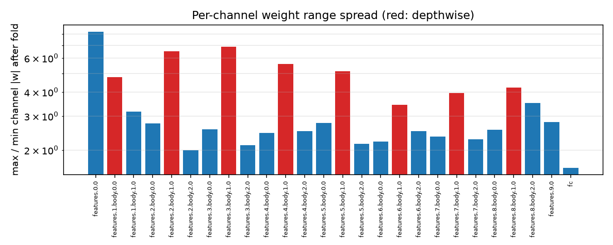
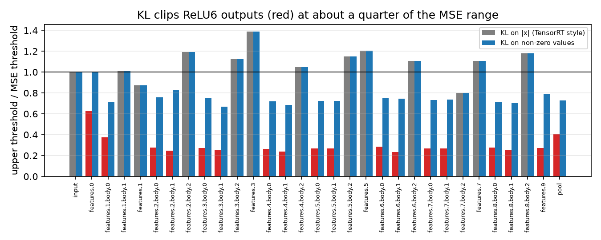
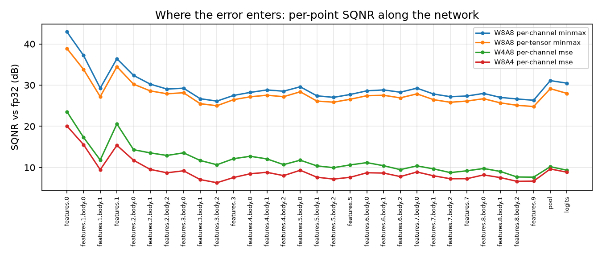

# lab2-quantization：校准、误差定位、混合精度与 QAT

对应笔记 [M03 校准与误差定位](../../../notes/module-03-calibration-localization.md)；整数执行语义见 [M02](../../../notes/module-02-integer-contract.md)。
MIT 6.5940 Lab 2 用 VGG 做 k-means 与线性量化；这里换成 CIFAR-10 上 20.9 万参数、857 万 MAC 的 MobileNetV2 式网络（`code/edgequant/model.py`），
因为 depthwise + 线性瓶颈 + 残差才是端侧量化真正难的结构。全部在 4 核 CPU 上完成。

LLM 侧同一套问题（逐组 scale、敏感层、GPTQ/AWQ）见 mlsys-infra [M17](https://gitee.com/liu-xingyan04/mlsys-infra/blob/main/notes/module-17-compression-quantization.md)。

## 一句话结论

- **BN 折叠无损**：fp32 88.16%，折叠后 88.16%，logits 最大差 4.9e-6。
- **粒度的代价随位宽放大**：W8 逐张量 88.15 / 逐通道 88.16；W4 逐张量 76.42 / 逐通道 83.20。
- **校准器在 A8 上差距 < 0.2 个点**，唯一的例外是 TensorRT 式 KL：63.68%（A6 时 16.30%），因为 ReLU 输出里大量精确零把阈值拉低；去掉精确零后 88.06%。
- **混合精度按敏感度而不是按大小**：W4 基线 83.04%（98.6 KiB）；按敏感度升 8 层到 W8 → 87.69%（108.1 KiB），按参数量升 8 层 → 83.62%（176.6 KiB）。
- **QAT 3 个 epoch** 把 W4A8 从 83.04 拉回 87.63%，每个 epoch 约 110 s。
- **ONNX Runtime 1.31**：int8 QDQ 88.09%，单线程延迟 372.4 → 253.9 µs（1.47 倍），文件 824 → 319 KiB；Entropy 默认参数与 MinMax 结果相同，改成 2048 bin 后掉到 87.17%。

## 怎么跑

```bash
cd solutions/mit6.5940/lab2-quantization
python -m pytest -q tests                      # 不需要数据集
python scripts/train.py                        # 30 epoch，4 线程约 43 分钟 → checkpoints/micronet.pt
python scripts/run_experiments.py              # 全部 11 步，约 30 分钟（mixed、calib_size 各约 8 分钟）
python scripts/run_experiments.py --only calib sensitivity mixed
```

CIFAR-10 首次运行时从 Hugging Face 镜像（`uoft-cs/cifar10`）下载到 `<repo>/.data`，不入库；`EDGE_DATA_DIR` 可改位置。

## 结果

### 权重粒度（只量化权重）

| 位宽 | 逐通道 | 逐张量 | 逐通道，但 depthwise 逐张量 |
| --- | ---: | ---: | ---: |
| W8 | 88.16 | 88.15 | 88.13 |
| W6 | 88.02 | 87.20 | 87.68 |
| W4 | 83.20 | 76.42 | 82.06 |



depthwise 层每个输出通道只有 9 个权重，通道间范围差异最大，逐张量时损失主要来自它们。

### 激活校准器（权重 W8 逐通道，512 张校准图）

| 校准器 | A8 | A6 | 耗时 |
| --- | ---: | ---: | ---: |
| minmax | 87.97 | 87.62 | 7 s |
| percentile 99.99 | 88.17 | 88.00 | 7 s |
| MSE | 88.13 | 87.94 | 25 s |
| KL（TensorRT 式） | **63.68** | **16.30** | 15 s |
| KL（去掉精确零） | 88.06 | 87.97 | 15 s |



`kl_points.csv`：在 ReLU 后的激活点上，KL 阈值与 MSE 最优阈值之比中位数 0.268，去掉零之后 0.733；单独把一个点换成 KL 阈值，最坏掉 6.96 个点。
`calib_size.csv`：校准集从 8 张增到 2048 张，A6 精度的波动不到 0.12 个点（minmax 87.74–87.85，MSE 87.87–87.98，各 3 次重复），几十张就够。

### 定位与混合精度



`sensitivity.csv`：逐层单独 W4，最敏感的是 `features.2.body.2.0`（掉 0.71 个点）；26 层单独掉点之和 4.23，全部同时 W4 掉 4.96，不可加。
`localize.csv`：沿深度看每个激活点的 SQNR，W8A8 在 26.1–42.9 dB；W4A8 时 depthwise 17.3 dB、project 11.8 dB、残差相加 20.6 dB，误差在线性瓶颈处进入。


| 升到 W8 的层数 | 按敏感度 | 按参数量 |
| ---: | --- | --- |
| 0 | 83.04%，98.6 KiB | 83.04%，98.6 KiB |
| 4 | 87.05%，102.9 KiB | 83.61%，152.6 KiB |
| 8 | 87.69%，108.1 KiB | 83.62%，176.6 KiB |
| 26（全 W8） | 88.13%，197.2 KiB | 88.13%，197.2 KiB |

最大的几层是后面的 pointwise，参数多但不敏感；敏感层是前面的小层。

### QAT（W4A8）

`qat_w4a8.csv`：起点 83.04%，三个 epoch 后 87.49 → 87.50 → 87.63%，每个 epoch 106–114 s。STE 只在裁剪区间内传梯度（`test_ste_gradient_masks_clipped_values`）。

### ONNX Runtime 部署（batch 1，1 线程）

| 模型 | 精度 | 延迟 µs | 文件 KiB |
| --- | ---: | ---: | ---: |
| fp32 折叠 | 88.16 | 372.4 | 823.7 |
| int8 QDQ MinMax | 88.09 | 253.9 | 318.5 |
| int8 QDQ Entropy（默认） | 88.09 | 270.7 | 318.5 |
| int8 QDQ Entropy 2048 bin | 87.17 | 262.3 | 318.5 |
| int8 QDQ Percentile | 88.06 | 264.0 | 318.5 |

ORT 的 QDQ 模型经过图融合后变成 QLinearConv；它的 requant 语义（浮点乘、四舍六入五成双）在 [int8-kernels](../../edge-runtime/int8-kernels/README.md) 里逐位验证过。

## 和原课程的差异

- 原课程 Lab 2 在 VGG 上做 k-means 量化和线性量化；这里没有 k-means，换成部署链路实际会遇到的四件事：粒度、校准器、逐层定位、ORT 落地。
- 量化模拟（`code/edgequant/qsim.py`）按执行顺序在每个激活点插入 fake-quant，与整数图的量化点一一对应（`test_points_follow_execution_order`）。

## 这些数字不能推出什么

- 只有一个模型、一个数据集、一次训练（seed 0）；88% 左右的差距 0.1 个点在单次评测的噪声里（1 万张图，标准误约 0.3 个点）。
- KL 的失败依赖于「ReLU 后大量精确零」这一分布特征；没有这个特征的网络里 KL 可能正常。
- ORT 延迟是本机 x86 + VNNI 的单线程数，不代表 ARM 或 MCU 上的 int8 加速比。

## 文件

| 路径 | 内容 |
| --- | --- |
| `code/edgequant/model.py` | MobileNetV2 式网络（倒残差、ReLU6、线性瓶颈） |
| `code/edgequant/fold.py` | BN 折叠、逐通道误差 |
| `code/edgequant/quant.py` | 仿射量化、四种校准器、KL、STE |
| `code/edgequant/qsim.py` | 按执行顺序插入量化点的模拟器 |
| `code/edgequant/data.py` | CIFAR-10 下载与缓存 |
| `scripts/train.py` | fp32 训练 |
| `scripts/run_experiments.py` | `baseline` … `ort` 共 11 步，`--only` 选择 |
| `tests/` | 折叠、量化误差界、KL 零尖峰、STE、量化点顺序 |
