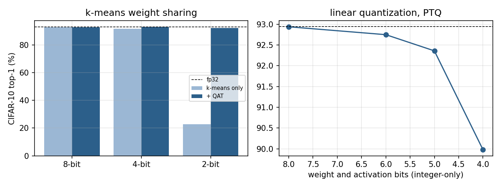

# lab2-vgg：MIT 6.5940 Lab 2 官方题，VGG 上的 k-means 量化与整数线性量化

同一份课程 VGG（CIFAR-10 92.95%，与 [lab1-pruning](../lab1-pruning/) 共用模型与训练代码）。
Part 1 是 Deep Compression 式的 k-means 权重共享与 QAT，Part 2 是 BN 融合后的整数推理：层与层之间全是 int8，累加器是 int32，只在最后读出 logits。
[lab2-quantization](../lab2-quantization/) 是另一份在本仓库 micronet 上的量化实验（PTQ/QAT/ORT）；这里补齐课程原题。

## 一句话结论

- **k-means 8 bit 免微调**：92.82%（−0.13 点），8.83 MiB（稠密的 25.1%）。
- **4 bit 一轮 QAT 就够**：91.61% → 92.84%，4.42 MiB。
- **2 bit 必须 QAT**：直接量化只剩 22.73%，5 轮 QAT 回到 92.18%，2.22 MiB（稠密的 6.3%）；仍比稠密低 0.77 点，没进 0.5 点容许线。
- **整数 int8 VGG 与浮点几乎相同**：92.94% vs 92.95%，8.82 MiB；位宽降到 6 / 5 / 4 bit 时为 92.75% / 92.36% / 89.98%（只做 PTQ，无 QAT）。

## 怎么跑

```bash
cd solutions/mit6.5940/lab2-vgg
python -m pytest -q tests
python scripts/run_experiments.py     # 需要 lab1 的 VGG 权重；GPU 上约 2 分钟
```

## Part 1：k-means 量化

每个 conv / linear 权重单独聚类成 \(2^b\) 个中心（`kmeans_1d`：分位数初始化，Lloyd 迭代；一维下按相邻中心的中点 `bucketize` 就是精确的最近中心分配）。
QAT 时标签固定，每个 optimizer step 后把中心移到「当前分到它的权重的均值」，再把权重写回中心值（`KMeansQuantizer.apply(update=True)`），即课程的 centroid = 均值的更新规则。
只有准确率比稠密低超过 0.5 点才微调，最多 5 轮，lr 0.01 按轮 cosine 衰减。

| 位宽 | 直接量化 | QAT 后 | QAT 轮数 | 尺寸 |
| ---: | ---: | ---: | ---: | ---: |
| 32（稠密） | 92.95% | — | — | 35.20 MiB |
| 8 | 92.82% | 92.82% | 0 | 8.83 MiB |
| 4 | 91.61% | 92.84% | 1 | 4.42 MiB |
| 2 | 22.73% | 92.18% | 5 | 2.22 MiB |

尺寸 = 标签 \(b\) bit + 每层 \(2^b\) 个 fp32 中心 + BN / bias 按 fp32。2 bit 的 5 轮 QAT 曲线（91.97 → 92.20 → 92.16 → 92.15 → 92.18）在第 2 轮后就平了。



## Part 2：线性量化与整数推理

- \(r = S(q - Z)\)。权重按输出通道对称（\(Z = 0\)，\(S = \max|w| / 127\)）；激活按张量非对称，用 512 张训练图的 min/max 标定；bias 量化到 int32，尺度 \(S_\text{in} S_w\)、零点 0。
- 输入预处理是课程的 \(q = 255x - 128\)（\(S = 1/255, Z = -128\)），对 8 bit 图片是精确的。
- BN 先融合进 conv（`fuse_conv_bn`），融合后 92.95%，与原模型一致。
- **ReLU 被吸收**：conv 输出在 ReLU 之后标定，min = 0，所以输出零点就是 −128，requantize 的 clamp 下限就是 ReLU（标定范围见 `calib_ranges`，每层 min 都是 0）。
- 整数 conv：\(\text{acc} = \sum (q_x - Z_x) q_w + q_b\)，再乘 \(S_x S_w / S_y\)、四舍五入、加 \(Z_y\)、clamp；padding 填的是输入零点（真实值 0）。累加用 float64 计算：|acc| < \(2^{28}\)，远小于 \(2^{53}\)，结果与 int32 累加逐位相同。
- 全局平均池化在 int8 域做（同一尺度与零点下取均值再取整），classifier 输出 int8 logits，直接 argmax。

| 位宽（权重 = 激活） | 准确率 | 尺寸 |
| ---: | ---: | ---: |
| 8 | 92.94% | 8.82 MiB |
| 6 | 92.75% | 6.62 MiB |
| 5 | 92.36% | 5.52 MiB |
| 4 | 89.98% | 4.42 MiB |

## 和原课程的差异

- k-means 用自己的一维 Lloyd（确定性分位数初始化），没有用 `fast_pytorch_kmeans` 的随机初始化。
- 整数算子用 float64 张量在 GPU 上模拟 int32 累加（CUDA 没有 int8 conv）；位级等价由上面的范围论证保证，`tests/test_vggquant.py` 检查数值与浮点模型一致。
- 6 / 5 / 4 bit 扫描是课程之外加的，只做 PTQ。

## 这些数字不能推出什么

- k-means 的尺寸是存储尺寸；推理时仍要查表解码成浮点，不减少计算。
- 整数推理的准确率是 GPU 模拟的，不代表任何特定 int8 kernel 的速度。

## 文件

| 路径 | 内容 |
| --- | --- |
| `code/vggquant/kmeans.py` | `kmeans_1d`、`update_centroids`、`KMeansQuantizer`、`kmeans_model_size_bits` |
| `code/vggquant/linear.py` | 量化原语、`quantized_linear` / `quantized_conv2d`、`fuse_vgg`、`calibrate`、`QuantizedVGG` |
| `scripts/run_experiments.py` | Part 1 与 Part 2，写 `summary.json`、`runs.jsonl`、`lab2_vgg.png` |
| `tests/test_vggquant.py` | k-means 恢复聚类、QAT 后仍只有 \(2^b\) 个值、零点映射、输入约定、整数线性层、融合与整数 VGG |
