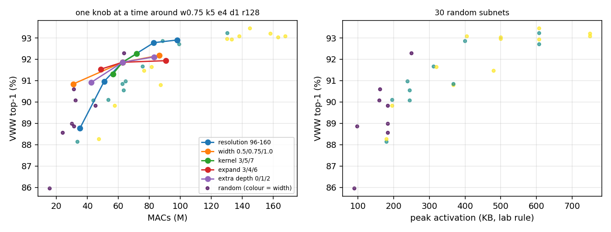
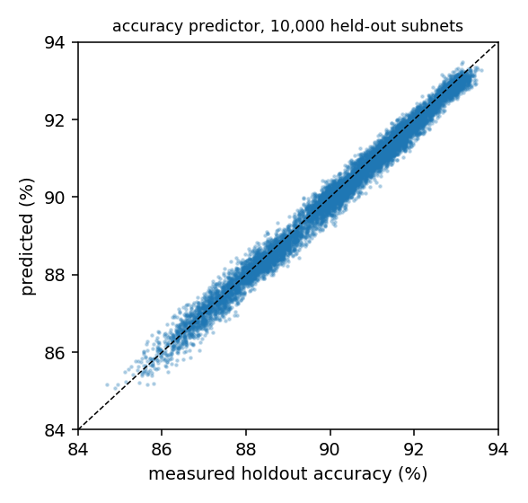
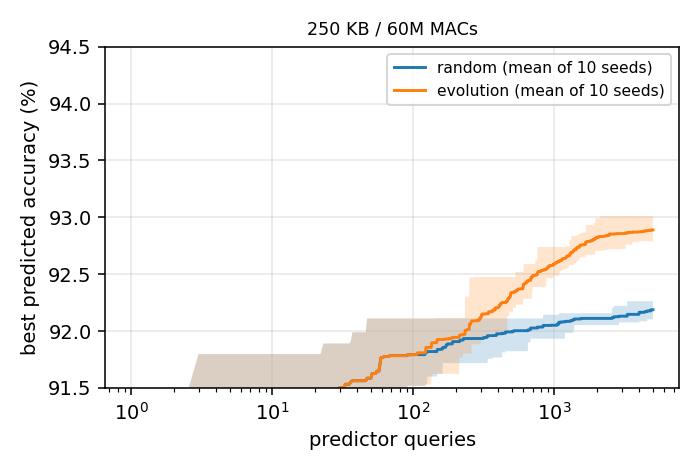
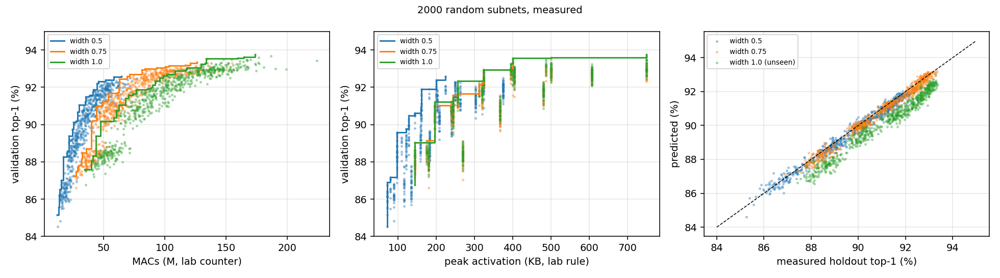

# lab3-nas：MIT 6.5940 Lab 3，OFA-MCUNet 上的效率预测、精度预测与约束搜索

对应 6.5940 Fall 2024 Lab 3 的 Q1–Q10，用课程包里的 VWW 超网（`vww_supernet.pth`，`base_stage_width="mcunet384"`）和 5 万条子网精度数据集（`acc_datasets/acc.dict`）。资源来源见 [assignments/mit6.5940-lab3-资源记录.md](../../../assignments/mit6.5940-lab3-资源记录.md)。
实现是自己写的（`code/nas/`），不拷贝 notebook；评估流程与课程一致：`ImageFolder(vww-s256/val)` → `Resize((r, r))` → `Normalize(0.5, 0.5)`，偶数位（split 0，4,030 张）是验证集，奇数位（split 1，4,029 张）是 holdout，BN 在 holdout 上按 `set_running_statistics` 的语义重估。

## 一句话结论

- **效率预测器不建网络也逐个对上库**：闭式公式在 1,004 个子网（含宽度 1.0）上 MACs、峰值激活、参数量与 `count_net_flops` / `count_peak_activation_size` / 模块参数 **0 处不一致**，每个子网 0.21 ms，库要 66 ms（约 310 倍）。
- **课程的 MACs 比真实卷积多 9–15%**：`count_net_flops` 注释说"去掉 BN"，但 thop 的钩子仍给每个 BN 输出元素记 4 次运算；最小子网真实卷积 7.24M、库报 8.30M。约束（50M、60M……）按库的口径执行，两种数都报。
- **精度预测器**：3×400 MLP、L1、10 轮，验证 MAE **0.18 个点**（常数基线 1.53），Kendall τ 0.925；5 个种子平均后 MAE 0.145、τ 0.934。但在新测的子网上，对验证集的 MAE 是 0.40，对数据集里没有的宽度 1.0 整体**低估 1.06 个点**。
- **Q9 两道题都过线，但余量在测量噪声以内**：按课程流程（预测器排第一的子网再实测）得到 250 KB / 60M 下 **92.556%**（≥ 92.5），200 KB / 30M 下 **90.372%**（≥ 90）。验证集只有 4,030 张，92.5% 处的标准误是 0.41 个点；在前列候选里 holdout 与验证集的 Kendall τ 只有 0.05，所以"按 holdout 挑最好的"只是在挑 holdout 的噪声（92.333%，没过线）。
- **Q10**：最小子网 8.30M MACs、72 KB，所以 256 KB / 15M 可行、64 KB 不可行；但这是整图推理的结论，按 patch 推理（期末项目）最小子网的峰值能降到 64 KB 以下。

## 怎么跑

```bash
cd solutions/mit6.5940/lab3-nas
python -m pytest -q tests                       # CPU，约 7 秒，不需要课程包
export MCUNET_ROOT=/path/to/mcunetv2-dev-main   # 超网代码、vww_supernet.pth、acc_datasets/
export VWW_ROOT=/path/to/data/vww-s256/val
python scripts/run_experiments.py               # 全部阶段，RTX 6000D 上约 1 小时
python scripts/run_experiments.py --stage effcheck ablate   # 只跑 CPU 侧，可与 GPU 阶段并行
```

阶段：`effcheck`（效率预测器对库）、`reproduce`（重测 100 条数据集标签）、`q1`、`predictor`（Q3–Q4）、`ablate`（预测器设计消融）、`search`（Q5–Q10）、`q9plus`（加大预算的 Q9）、`final`（按课程流程定 Q9 答案并导出子网）、`pareto`（2,000 个随机子网实测）。

## 结果

### 复现评估流程

重测数据集里随机 100 条：holdout 精度与标签平均差 0.16 个点（最大 0.74），验证集比标签平均高 0.17、Pearson 0.970。标签的 BN 重估用的抽样与这里不同，差在这个量级。2,000 个随机子网上验证集比 holdout 平均高 0.127 个点，两者 Pearson 0.978、Kendall τ 0.868。

### Q1：一次只动一个维度



以宽度 0.75、k5、e4、d1、r128 为中心，每次只换一个维度（验证集精度）：

| 维度 | 取值 | 精度范围 | MACs（库口径） |
| --- | --- | ---: | ---: |
| 分辨率 | 96 → 160 | 88.78 → 92.90（4.12 个点） | 35.3 → 97.9M |
| 宽度 | 0.5 / 0.75 / 1.0 | 90.84 / 91.86 / 92.18 | 30.9 / 62.7 / 86.5M |
| 卷积核 | 3 / 5 / 7 | 91.32 / 91.86 / 92.26 | 56.6 / 62.7 / 71.9M |
| 扩张比 | 3 / 4 / 6 | 91.54 / 91.86 / 91.94 | 48.8 / 62.7 / 90.7M |
| 额外深度 | 0 / 1 / 2 | 90.92 / 91.86 / 92.11 | 42.5 / 62.7 / 83.0M |

分辨率是最划算的旋钮；扩张比从 4 到 6 多花 45% 的 MACs 只换 0.07 个点。峰值内存只随分辨率、扩张比和宽度 0.5 → 0.75 变：核大小与深度不改变最大的那一层，宽度 0.75 和 1.0 的第一块都是 16 通道（`make_divisible(16w, 8)`），峰值同为 320 KB。两端：最小子网 82.85%，宽度 0.5 / 0.75 / 1.0 的最大子网 92.83 / 93.62 / 94.02%。

### Q2：效率预测器

`code/nas/efficiency.py` 按超网的构造直接列出每一层的输入、输出元素数和 MACs：stem 3×3 s2、融合的第一块（只有 1×1 投影）、6 个 stage 的倒残差块（SE 在 stage 1–4，SE 中间宽度 `cin // 4`）、1×1 混合到 384 通道、2 类分类头。

| 对照（1,004 个子网，宽度 0.5 / 0.75 / 1.0） | 不一致 |
| --- | ---: |
| MACs vs `count_net_flops`（含 BN 的 4 ops/元素） | 0 |
| 峰值 vs `count_peak_activation_size` | 0 |
| 参数 vs 模块 conv + linear 参数 | 0 |

库的峰值规则：每层取输入 + 输出；带 shortcut 的块只在 depthwise 那一步加上块输入，投影那一步不加（源码里有 TODO）。我另算了"投影时也保留块输入"的规则：在 104 个抽查子网和全部实测子网上两者相同，峰值没有落在投影那一步。用 tinyengine-memory 的规划器对照 104 个子网：贪心 arena 平均是库规则的 1.012 倍（最多 1.075），原地 depthwise 后是 0.944 倍。

### Q3–Q4：精度预测器



编码与课程 `MCUNetArchEncoder` 一致（r 5 + w 3 + 每块 k 3 + e 3 = 128 维，跳过的块全零），2,000 条逐位相同。数据集只有宽度 0.5 / 0.75（超网的采样器从 `range(len(widths) - 1)` 抽宽度），精度 84.54–93.60%，均值 90.26%。

| 训练条数 | MAE（个点） | Kendall τ | 前 1% 重合 |
| ---: | ---: | ---: | ---: |
| 500 | 0.987 | 0.617 | 0.13 |
| 2,000 | 0.363 | 0.852 | 0.29 |
| 10,000 | 0.240 | 0.905 | 0.29 |
| 40,000（3 个种子） | 0.181 | 0.925 | 0.41–0.45 |

消融（各 3 个种子，40k 训练）：1×400 的 MAE 0.232、τ 0.907，明显更差；5×400 0.168 / 0.928，3×1000 0.166 / 0.926，3×100 0.177 / 0.926，MSE 损失 0.182 / 0.922，30 轮 0.175 / 0.923，batch 1024 0.195 / 0.919。比改结构更有用的是平均：同一划分上 1 / 3 / 5 个模型平均，MAE 0.167 / 0.152 / 0.145，τ 0.927 / 0.933 / 0.934。前 1% 重合只有四成左右：MAE 0.18 个点和前列子网之间的差距同一量级，预测器能把好子网放进前列，但排不准前列内部。

### Q5–Q6：随机搜索

各 300 个满足约束的样本，取预测最高者再实测：

| 约束 | 验证集精度 | MACs | 峰值 |
| --- | ---: | ---: | ---: |
| MACs ≤ 50M | 92.08% | 49.3M | 325 KB |
| MACs ≤ 100M | 92.63% | 99.6M | 750 KB |
| 峰值 ≤ 256 KB | 91.89% | 52.2M | 250 KB |
| 峰值 ≤ 512 KB | 92.90% | 126.8M | 487.5 KB |

notebook 的随机搜索格把 MACs 键拼成 `millonMACs`，`satisfy_constraint` 跳过不认识的键，于是"MACs ≤ 50M"变成无约束，同一种子下返回 126.8M MACs 的子网（`q6_typo_*`）。

### Q7–Q8：进化搜索与参数



250 KB / 60M 下，同样的预测器查询次数（10 个种子）：

| 查询次数 | 100 | 300 | 1,000 | 2,000 | 5,000 |
| --- | ---: | ---: | ---: | ---: | ---: |
| 随机 | 91.79 | 91.93 | 92.05 | 92.11 | 92.19 |
| 进化 | 91.79 | 92.11 | 92.59 | 92.82 | 92.89 |

（预测精度均值；进化第一代就是随机样本，所以 100 次时相同。）种群 × 代数扫描（5 个种子）：10×10 92.07，50×30 92.71，100×30 92.84，100×60 92.92；同样约 2,300 次查询，50×60 得 92.75、100×30 得 92.84，种群大一些更好。

### Q9：两道复合约束

| | 250 KB / 60M（要 ≥ 92.5） | 200 KB / 30M（要 ≥ 90） |
| --- | ---: | ---: |
| 5 个种子、取 holdout 最好（`search`） | 92.481% | 90.447% |
| 20 次进化 × 前 10 名 + 实测进化，共实测 210 个 | — | — |
| ↳ 按课程流程：预测最高者（**答案**） | **92.556%**（预测 93.03） | **90.372%**（预测 91.20） |
| ↳ 按 holdout 最高者 | 92.333%（holdout 92.83） | 90.422%（holdout 91.34） |
| ↳ 验证集最高者（不能用来选，只是上限） | 92.829% | 90.868% |
| 210 个里达标的个数 | 67 | 208 |
| 2,000 个随机子网里满足约束的最好验证精度 | 92.407%（256 KB / 60M） | 90.248%（192 KB / 30M） |
| 答案子网 | 59.38M（卷积 53.14M），250 KB，r160 | 29.30M（卷积 26.05M），160 KB，r128 |

92.5% 处验证集的标准误是 0.41 个点，所以 92.556 和 92.333 在统计上分不开；表里每一种选法都列出来，没有按验证集挑。按实测 holdout 精度打分的进化（种群 48、20 代，实测 622 / 504 个子网，10.7 / 6.2 分钟）也只到 92.333 / 90.695：在这个噪声下，搜得越多，按 holdout 选出来的越像是 holdout 的离群点。导出的子网（`artifacts/work/subnet_*_pred.pt`）是期末项目的输入。

### Q10：可行性

所有 MACs 与峰值项都随每个旋钮单调增，全最小子网同时给出两者的下界：8.30M MACs（卷积 7.24M），72 KB，峰值在 stage 0 第一块（stem 63 KB、第一块 54 KB）。

- 256 KB / 15M：可行（最小子网就满足；2,000 个随机子网里 15M 以内只有 13 个，最好 86.53%）。
- 64 KB：整图推理不可行。期末项目用 patch 推理把这个子网的峰值降到 23.7 KB（MACs 多 21%），所以"64 KB 不可行"只在逐层整图执行时成立。

### 2,000 个随机子网实测



宽度 0.5 / 0.75 / 1.0 各约 650 个（`pareto.csv`）。预测器在新子网上（训练时就是这个 holdout 口径）MAE 0.21 / 0.20 个点，对验证集 0.40 / 0.41；宽度 1.0 不在训练数据里，MAE 0.93（holdout）/ 1.06（验证），几乎全是偏差（−0.93 / −1.06），排序还在（τ 0.88 / 0.85）。所以把宽度 1.0 放进预测器驱动的搜索，它会被系统性地低估；`search` 阶段末尾改用实测精度打分的小规模进化（种群 16、8 代）在 250 KB / 60M 下，带不带宽度 1.0 都选了宽度 0.5（92.33 / 92.13%）。

按 MACs 分档看验证集精度的前沿：60M 以下宽度 0.5 最高（45–60M 档 92.56%，宽度 0.75 / 1.0 为 91.69 / 90.37%），60–80M 宽度 0.75 略胜（92.71 对 0.5 的 92.58），120M 以上才轮到宽度 1.0（93.75%）。在 MCU 的 MACs 预算里，把预算花在分辨率和深度上比花在宽度上划算。

## 和原课程的差异

- 效率预测器是闭式的，不实例化子网；库函数只用来逐个核对。
- 评估把每个分辨率的 uint8 像素解码一次常驻 GPU，归一化在 GPU 上做，与课程 DataLoader 给出相同张量；BN 重估是 `set_running_statistics` 的语义（每批自己的均值与有偏方差，按样本数加权平均）。
- 加了课程没有的四件事：预测器消融、等预算的搜索曲线、加大预算的 Q9 与选择偏差、2,000 个子网的实测前沿。

## 这些数字不能推出什么

- 验证集 4,030 张，0.4 个点以内的差别不显著；"92.556% 过线"应读作"与 92.5% 不可区分，且按预先定好的流程得到"。
- 精度只在课程的 VWW 验证集上，没有在 COCO 原始划分上评估；MACs 与峰值是 int8 元素数，不是任何设备上的实测。
- 峰值是库的"每层输入 + 输出"规则，不是真实运行时的 arena；arena 的数字见 tinyengine-memory 与期末项目。

## 文件

| 路径 | 内容 |
| --- | --- |
| `code/nas/space.py` | 设计空间、采样、变异、交叉、128 维编码 |
| `code/nas/efficiency.py` | 逐层闭式 MACs（两种口径）、峰值（两种规则）、参数 |
| `code/nas/predictor.py` | MLP 精度预测器、训练、Pearson / Spearman / Kendall / 前 k 重合 |
| `code/nas/search.py` | 约束、随机搜索、进化搜索（计查询次数、返回最终种群） |
| `code/nas/vww.py` | VWW 像素缓存、BN 重估、评估 |
| `scripts/run_experiments.py` | 全部阶段 |
| `artifacts/raw/` | `summary.json`、各阶段 CSV、`runs_*.jsonl`、导出子网的配置 `subnet_*.json` |
