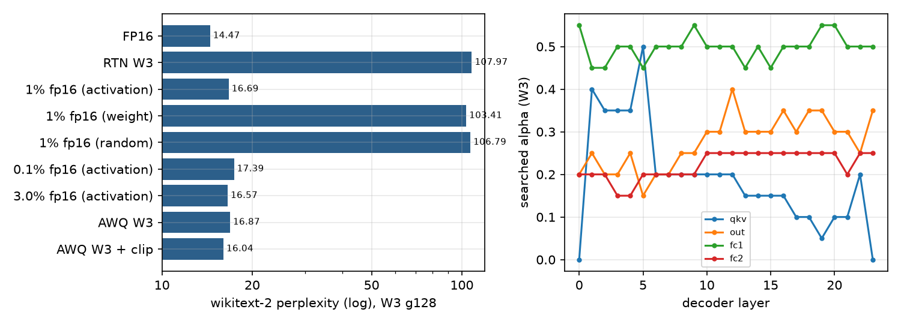

# lab4-awq：MIT 6.5940 Lab 4，OPT-1.3B 上的 AWQ

课程 Lab 4 的三步：W3 g128 的 RTN 伪量化、保留 1% 显著通道为 fp16、按激活幅度搜索缩放（AWQ），外加 bonus 的截断搜索。
模型 `facebook/opt-1.3b`（fp16），困惑度按课程协议：wikitext-2-raw test，前 40 × 2048 个 token；校准用 pile-val 前 128 条长度 ≤ 512 token 的文本（拼接后 59 个 512 token 块，30,208 token）。
实现是自己写的（`code/awqlab/`），只依赖 `transformers` 的模型定义。

## 一句话结论

- **3 bit RTN 崩了**：困惑度 14.47 → 107.97；4 bit 只到 15.08。
- **显著性来自激活，不来自权重**：按激活幅度保留 1% 输入通道为 fp16，困惑度 16.69；按权重幅度保留 1% 是 103.41，随机 1% 是 106.79，和不保留几乎一样。
- **AWQ 不保留任何 fp16 通道也做到同一水平**：W3 16.87，加截断搜索 16.04，比「1% fp16」还好，而尺寸与 RTN 相同（659.0 MiB，1% fp16 为 677.5 MiB）。
- **4 bit 下截断不再有用**：AWQ W4 14.78，加截断 14.80。

## 怎么跑

```bash
cd solutions/mit6.5940/lab4-awq
python -m pytest -q tests          # 纯张量测试，不需要模型
AWQ_MODEL=.../opt-1.3b AWQ_PILE=.../val.jsonl.zst AWQ_WIKI=.../test.parquet python scripts/run_experiments.py
```

RTX 6000D 上整份脚本约 6 分钟；每次困惑度评测 1.8 s，W3 的缩放搜索 16.7 s，加截断 27.8 s。

## 结果（W3 / W4，group 128）

| 方法 | 位宽 | 困惑度 | 尺寸 |
| --- | ---: | ---: | ---: |
| FP16 | 16 | 14.47 | 2509.6 MiB |
| RTN | 3 | 107.97 | 659.0 MiB |
| 1% fp16，按激活 | 3 | 16.69 | 677.5 MiB |
| 1% fp16，按权重 | 3 | 103.41 | 677.5 MiB |
| 1% fp16，随机 | 3 | 106.79 | 677.5 MiB |
| 0.1% fp16，按激活 | 3 | 17.39 | 660.8 MiB |
| 3% fp16，按激活 | 3 | 16.57 | 714.5 MiB |
| AWQ | 3 | 16.87 | 659.0 MiB |
| AWQ + 截断 | 3 | **16.04** | 659.0 MiB |
| RTN | 4 | 15.08 | 804.1 MiB |
| AWQ | 4 | **14.78** | 804.1 MiB |
| AWQ + 截断 | 4 | 14.80 | 804.1 MiB |

尺寸按「decoder 里的 linear 是 \(b\) bit，每 128 个权重一个 fp16 scale 和一个 \(b\) bit zero，其余参数 fp16」计；fp16 通道按比例按 16 bit 计。



## 做法

- **伪量化**（`pseudo_quantize`）：每 128 个输入维一组，按组 min/max 非对称，\(S = (\max - \min)/(2^b - 1)\)，\(Z = -\mathrm{round}(\min / S)\)。
- **Q1 显著通道**（`quantize_keep_salient`）：先整体量化，再把重要性最高的 \(k\) 个输入列写回原值。重要性按激活是 \(\overline{|x_j|}\)（每个 linear 在校准集上的输入），按权重是 \(\overline{|W_{:,j}|}\)。
- **Q2 缩放搜索**（`search_scale`）：\(s = s_x^{\alpha}\)，\(\alpha \in \{0, 0.05, \dots, 0.95\}\)，最小化 \(\| Q(W\,\mathrm{diag}(s))\,(x / s) - W x \|^2\)；\(\alpha = 0\) 就是 RTN（测试里核对）。
  \(1/s\) 折进上游：q/k/v 共享一组 \(s\)，折进 `self_attn_layer_norm`；out_proj 折进 v_proj 的输出行；fc1 折进 `final_layer_norm`；fc2 折进 fc1 的输出行（ReLU 正齐次，\(\mathrm{ReLU}(x/s) = \mathrm{ReLU}(x)/s\)）。
- **截断搜索**（`search_clip`）：每组的截断阈值取 \(\max|w| \cdot r\)，\(r \in \{1, 0.95, \dots, 0.55\}\)，按该组对输出的误差选；q/k 不截断（与 llm-awq 一致）。

搜到的 \(\alpha\)：fc1 稳定在 0.45–0.55，fc2 在 0.15–0.25，out_proj 随层加深从 0.2 升到 0.35，qkv 从 0.35–0.5 降到 0.05–0.2。

## 和原课程的差异

- 缩放的目标函数用「这一组 linear 自己的输出误差」，qkv 是三者输出拼起来的误差；课程与 llm-awq 对 qkv 看的是整个 self-attention 的输出。少了 softmax 与注意力掩码的依赖，代价是忽略了 q/k 误差经 softmax 的放大。
- 课程 Q2 只要求 qkv 与 fc1 两组；这里还做了 out_proj 和 fc2 两组，以及 bonus 的截断。
- 搜索在 16,384 个校准 token 上做（从 30,208 个中等距取），截断在 4,096 个 token 上做。

## 这些数字不能推出什么

- 全部是伪量化：权重写回 fp16 计算，困惑度反映精度，不反映 3 / 4 bit kernel 的速度。部署这一半在 [lab5-tinychat](../lab5-tinychat/) 和 [llama-cpp-7b](../../edge-runtime/llama-cpp-7b/)。
- 困惑度只在 wikitext-2 的前 81,920 个 token 上算，只能和同协议的数字比。

## 文件

| 路径 | 内容 |
| --- | --- |
| `code/awqlab/quant.py` | `pseudo_quantize`、`quantize_keep_salient`、`search_scale`、`search_clip` |
| `code/awqlab/opt.py` | 数据、困惑度、激活采集、`apply_rtn` / `apply_salient` / `apply_awq`、尺寸 |
| `scripts/run_experiments.py` | 12 个配置，写 `summary.json`、`runs.jsonl`、`awq_opt1.3b.png` |
| `tests/test_awq.py` | 量化级数与误差界、显著列恢复、\(\alpha = 0\) 等于 RTN、截断不放大误差 |
