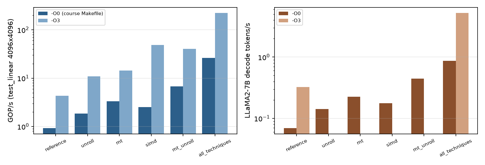

# lab5-tinychat：MIT 6.5940 Lab 5，W4A8 GEMM kernel 与 LLaMA2-7B 端到端

课程 Lab 5：在 [tinychat-tutorial](https://github.com/mit-han-lab/tinychat-tutorial)（commit `f241215`）里补完五个 W4A8 矩阵乘 kernel——循环展开、多线程、SIMD、多线程 + 展开、全部技巧，然后用它们跑 LLaMA2-7B-chat（AWQ int4，`QM_x86` 布局）。
改动只在 `kernels/starter_code/` 的五个文件里，以 `patch/x86.patch` 交付（110 行新增，x86 AVX2 与 ARM NEON 两条分支都补了）；`code/w4a8_model.py` 是同一套位运算的 NumPy 模型，测试拿它核对打包顺序与符号技巧。

## 一句话结论

- **五个 kernel 全部通过官方正确性检查**；`all_techniques` 26.09 GOP/s，是参考实现（0.93）的 28.2 倍。
- **端到端加速比跟着 kernel 走，直到 kernel 不再是瓶颈**：前四个 kernel 端到端的加速比（2.1–6.4 倍）与 test_linear 的（2.0–7.3 倍）基本一致；`all_techniques` kernel 快 28.2 倍，端到端只快 12.5 倍（14,427 → 1,150 ms/token），剩下的时间在注意力、RMSNorm 这些没改过的算子上。
- **`-O0` 低估了手写 SIMD**：课程 Makefile 是 `-O0`。换 `-O3` 后五个 kernel 仍全部通过，参考实现从 0.93 升到 4.33 GOP/s，`all_techniques` 从 26.1 升到 222.7 GOP/s，差距从 28.2 倍拉大到 51.5 倍；端到端 3,085 → 191 ms/token（16.1 倍，5.2 token/s）。
- **SIMD 的符号技巧有一个前提**：`_mm256_maddubs_epi16(|w|, sign(a, w))` 在激活为 −128 且权重为负时算错号（−(−128) 在 int8 里仍是 −128）；引擎的激活量化用 amax/127，激活落在 [−127, 127]，所以不触发。测试把 16 × 256 个组合全部枚举了一遍。

## 怎么跑

```bash
cd solutions/mit6.5940/lab5-tinychat
python -m pytest -q tests                      # NumPy 位运算模型 + patch 范围，不需要编译
bash scripts/run_lab5.sh /path/to/workdir 8-15 16-21   # Linux x86 + AVX2；克隆、打 patch、evaluate.sh、端到端
O3=1 bash scripts/run_lab5.sh /path/to/workdir         # 另外用 -O3 再测一遍
```

`run_lab5.sh` 用 `taskset` 把 kernel 基准放在 8 个核、端到端放在另外 6 个核上，两者不抢 CPU；最后调 `scripts/run_experiments.py` 把两个日志解析成 `summary.json` 和图。

## 结果

主机 Intel Xeon Platinum 8470Q（AutoDL），g++ 11.4，课程 Makefile 原样：`-O0 -mavx2 -mfma`。

| kernel | 线程 | test_linear GOP/s | 相对参考 | 端到端 ms/token | 相对参考 |
| --- | ---: | ---: | ---: | ---: | ---: |
| reference | 1 | 0.925 | 1.0× | 14427.0 | 1.0× |
| loop_unrolling | 1 | 1.865 | 2.0× | 6998.0 | 2.1× |
| multithreading | 4 | 3.337 | 3.6× | 4416.7 | 3.3× |
| simd_programming | 1 | 2.534 | 2.7× | 5653.8 | 2.6× |
| multithreading_loop_unrolling | 4 | 6.775 | 7.3× | 2252.1 | 6.4× |
| all_techniques | 8 | **26.085** | **28.2×** | **1149.9** | **12.5×** |

test_linear 是官方 `evaluate.sh`：1 × 4096 × 4096 的 GEMV 重复 10 次；端到端是 `chat` 对同一个提示 decode 32 个 token，取第 2–32 个 token 的平均（31 个）。

同样的代码，只把 Makefile 的 `-O0` 换成 `-O3`（`test_linear_O3.log`、`e2e_O3.log`；端到端只测了首尾两个）：

| kernel | test_linear GOP/s | 相对参考 | 端到端 ms/token |
| --- | ---: | ---: | ---: |
| reference | 4.326 | 1.0× | 3085.0 |
| loop_unrolling | 10.851 | 2.5× | — |
| multithreading | 14.494 | 3.4× | — |
| simd_programming | 48.899 | 11.3× | — |
| multithreading_loop_unrolling | 40.459 | 9.4× | — |
| all_techniques | **222.703** | **51.5×** | **191.2** |

`-O3` 下单线程 SIMD（48.9）反超 4 线程展开（40.5）：编译器把标量循环也优化了，但做不出 `maddubs` 这种跨 lane 的成对乘加。



## 做法

`QM_x86` 布局：每 32 字节存 64 个 4 bit 权重，字节 \(j\) 的低 4 位是权重 \(j\)、高 4 位是权重 \(j + 32\)，都以 \(w + 8\) 存；每 32 个权重一个 fp32 scale，激活每 32 个一个 scale。

- **展开**：一次解码 4 个字节（8 个权重），累加器拆成两路，去掉循环内的分支。
- **多线程**：按输出列 \(n\) 切成 `num_thread` 段，pthread create / join；`multithreading_loop_unrolling` 的段长取 4 的倍数，保证每段都能整块展开。
- **SIMD（AVX2）**：`and 0x0F` 与 `srli 4` 拆出低高半字节，`sub 8` 回到有符号；`_mm256_sign_epi8` 把权重的符号挪到激活上，`maddubs` 做 u8 × s8 → s16 的成对乘加，`madd_epi16` 再加到 s32，最后乘两个 scale 累进 fp32。NEON 分支用 `vandq` / `vshrq` / `vsubq` 加 `vdotq_s32`。
- **全部技巧**：SIMD 内核每次处理两个 32 字节块（128 个权重），8 线程。

## 和原课程的差异

- 课程默认在 Apple M 系列或带 AVX2 的笔记本上跑；这里是 52 核服务器 CPU，基准用 `taskset` 限在 8 个核上，绝对数字和课程截图不能直接比。
- 端到端用的是 `chat` 的一份副本：`n_predict` 从环境变量 `N_PREDICT` 读、stdin 读到 EOF 退出，这两处 `sed` 修改写在 `run_lab5.sh` 里，不在 patch 里。

## 这些数字不能推出什么

- 主表在 `-O0` 下，和课程一致；`-O3` 表只是同一份代码换编译选项，没有为 `-O3` 重新调过展开因子和线程数。
- 线程数用课程的默认值（4 / 8），没有按这台机器的核数扫。
- test_linear 只测一个形状（4096 × 4096、batch 1）；LLaMA2-7B 里还有 4096 × 11008 和 11008 × 4096 两种，端到端数字已经把它们包含进去。

## 文件

| 路径 | 内容 |
| --- | --- |
| `patch/x86.patch` | 对 `f241215` 的 diff，只动 `kernels/starter_code/` 的五个文件 |
| `code/w4a8_model.py` | `pack_qm_x86` / `unpack_qm_x86`、`sign_epi8`、`maddubs_epi16`、`block_dot_avx2`、`w4a8_matvec` |
| `scripts/run_lab5.sh` | 克隆、打 patch、`evaluate.sh`、端到端 decode |
| `scripts/run_experiments.py` | 解析 `test_linear.log` 与 `e2e.log`，写 `summary.json` 与 `lab5_kernels.png` |
| `tests/test_w4a8.py` | 打包往返、符号技巧在 [−127, 127] 上精确、−128 的反例、块点积、GEMV、patch 范围 |
