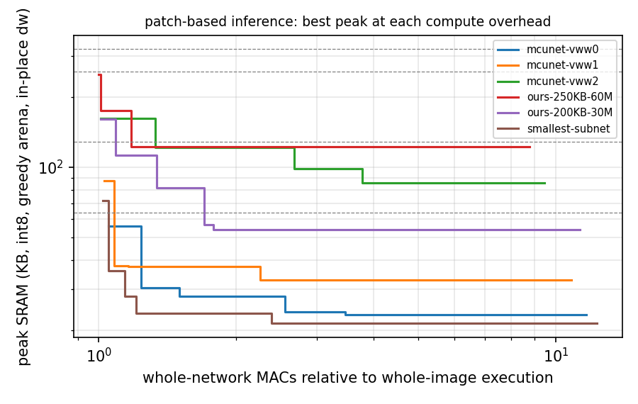
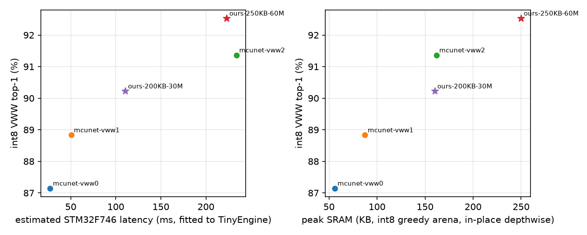

# project-mcu-e2e：MIT 6.5940 期末项目，从 NAS 子网到 int8 部署的 MLPerf Tiny 四列

把 [Lab 3](../lab3-nas/README.md) 搜出的两个 VWW 子网和 MCUNet 发布的三个 VWW 模型（`mcunet-vww0/1/2`，即 `mcunet-10fps_vww`、`mcunet-5fps_vww`、`mcunet-320kb-1mb_vww`）走同一条流程：BN 折叠 → ONNX → int8 训练后量化 → 在同一个验证集上量精度，再按 MLPerf Tiny 的四列（精度、延迟、Flash、峰值 SRAM）记账。报告：[英文 4 页](../../../reports/project-mcu-e2e/project_mcu_e2e_report.pdf)。

**延迟一栏是估算**：没有开发板。MCU 延迟用 MCUNet 公布的 TinyEngine 在 STM32F746 上的三个点（6.0M → 27 ms、11.6M → 51 ms、55.8M → 234 ms）拟合一条直线，按卷积 MACs 外推；另外报 x86 单线程的实测。

## 一句话结论

| 模型 | 分辨率 | 卷积 MACs | fp32 | int8（ORT） | 官方 .tflite | Flash | SRAM（arena） | SRAM（patch） | MCU 延迟（估） | x86 int8 |
| --- | ---: | ---: | ---: | ---: | ---: | ---: | ---: | ---: | ---: | ---: |
| mcunet-vww0 | 64 | 5.96M | 87.30% | 87.15% | 87.22% | 390 KB | 56 KB | 30 KB（1.24×） | 27 ms | 0.20 ms |
| mcunet-vww1 | 80 | 11.58M | 89.03% | 88.83% | 88.86% | 459 KB | 88 KB | 38 KB（1.16×） | 51 ms | 0.31 ms |
| mcunet-vww2 | 144 | 55.77M | 91.49% | 91.37% | 91.29% | 678 KB | 162 KB | 162 KB | 234 ms | 1.17 ms |
| **ours 200 KB / 30M** | 128 | 26.05M | 90.37% | **90.22%** | — | 573 KB | 160 KB | 112 KB（1.09×） | **111 ms** | 0.72 ms |
| **ours 250 KB / 60M** | 160 | 53.14M | 92.56% | **92.53%** | — | 868 KB | 250 KB | 122 KB（1.18×） | **223 ms** | 1.42 ms |

- **同样的 MCU 时间，精度高 1.2 个点**：250 KB / 60M 子网比 vww2 少 5% 的卷积 MACs，int8 精度 92.53% 对 91.37%；代价是 Flash 多 190 KB（868 KB，仍在 STM32F746 的 1 MB 内）、整图 SRAM 多 88 KB（250 对 162 KB，都在 F746 的 320 KB 内）。200 KB / 30M 子网落在 vww1 与 vww2 之间。
- **int8 几乎不掉点**：逐通道 MinMax、uint8 激活，五个模型比 fp32 低 0.03–0.20 个点；我的 ORT int8 与官方 .tflite 相差 ≤ 0.08 个点。逐张量权重比 fp32 掉 0.6–2.6 个点（vww2 最多）。
- **ORT 默认的 Entropy 校准就是 MinMax**：直方图 128 个 bin、量化 bin 也是 128 个，KL 搜索只剩全范围一个候选，五个模型的产物与 MinMax **逐字节相同**。把 bin 调到 2048 让 KL 真正生效后，精度掉 0.7–5.2 个点，与 [lab2](../lab2-quantization/README.md) 里 KL 在 ReLU6 网络上过度裁剪的结论一致。
- **patch 推理对谁有用取决于峰值在哪**：vww0/1、两个子网和最小子网的峰值在前几个 stage，切 2×2 或 3×3 用 8–24% 的 MACs 换 30–67% 的 SRAM；vww2 的峰值（原地 depthwise 之后）在后段，1.3 倍 MACs 以内 patch 一点也省不下，要切到第 5 个模块、1.33 倍才降到 121.5 KB。最小子网 72 → **23.7 KB**（MACs 1.21×），所以 Lab 3 Q10 的"64 KB 不可行"只对整图执行成立。
- **延迟模型本身很准，但只是三点拟合**：4.15 ms / M MACs + 2.45 ms，对三个公布点最大相对误差 1.3%；过原点的拟合误差 6.6%。外推到我的子网时，假设它们的层形状在 TinyEngine 上的吞吐与 MCUNet 的相同，这一点没有验证。

## 怎么跑

```bash
cd solutions/mit6.5940/project-mcu-e2e
python -m pytest -q tests                        # CPU，约 3 秒
export MCUNET_ROOT=/path/to/mcunetv2-dev-main VWW_ROOT=/path/to/vww-s256/val
export ZOO_ROOT=/path/to/zoo                     # https://hanlab18.mit.edu/projects/tinyml/mcunet/release/mcunet-*_vww.{json,pth,tflite}
export LITERT_PATH=/path/to/site-with-ai_edge_litert   # 可选，评估官方 .tflite
python scripts/run_experiments.py --stage prepare accuracy memory   # 约 5 分钟，int8 变体在进程池里并行
python scripts/run_experiments.py --stage latency table             # 绑单核，单独跑
```

输入的两个子网来自 Lab 3 的 `final` 阶段（`lab3-nas/artifacts/work/subnet_*_pred.pt`，BN 已在 holdout 上重估）。

## 结果

### 四列怎么算

- **精度**：课程 VWW 验证集 split 0 的 4,030 张，预处理 `Resize((r, r))` + `Normalize(0.5, 0.5)`（MCUNet 的 `eval_torch.py` 对 VWW 用同一套）。官方 .tflite 按发布仓库 `eval_tflite.py` 的做法，输入是 `uint8 像素 − 128` 的 int8。
- **延迟**：MCU 一栏是上面的拟合直线 × 卷积 MACs。卷积 MACs 用钩子数 conv / linear 的乘加，三个 MCUNet 模型得 5.958 / 11.579 / 55.771M，与公布的 6.0 / 11.6 / 55.8M 一致，所以拟合的横轴口径是对的。x86 一栏是 AutoDL 服务器（2 × Xeon Platinum 8470Q）绑一个核、batch 1、1 线程，300 次取中位数。
- **Flash**：int8 权重 + int32 bias（BN 折叠后每个 conv 都有）+ 每输出通道一个 fp32 scale。不含运行时代码。
- **峰值 SRAM**：tinyengine-memory 的规划器在折叠后的网络上追踪张量寿命，贪心按大小放置（每个模型都等于存活下界），再做 TinyEngine 式原地 depthwise；patch 一栏在 MACs 开销 ≤ 1.3 倍的切法里取峰值最小的。库的"每层输入 + 输出"规则与贪心 arena 在这五个模型上完全相同。

### 量化方案

| 方案 | vww0 | vww1 | vww2 | ours 30M | ours 60M |
| --- | ---: | ---: | ---: | ---: | ---: |
| fp32（PyTorch） | 87.30 | 89.03 | 91.49 | 90.37 | 92.56 |
| fp32（ORT） | 87.30 | 89.01 | 91.46 | 90.37 | 92.56 |
| MinMax，逐通道，uint8 激活（部署） | 87.15 | 88.83 | 91.37 | 90.22 | 92.53 |
| MinMax，逐张量 | 86.25 | 87.30 | 88.93 | 89.75 | 91.96 |
| Entropy（ORT 默认 128 bin） | 87.15 | 88.83 | 91.37 | 90.22 | 92.53 |
| Entropy，2048 bin | 86.40 | 84.62 | 86.30 | 85.96 | 87.37 |
| Percentile 99.999 | 87.15 | 88.69 | 91.37 | 90.22 | 92.41 |
| MinMax，逐通道，对称 int8 激活 | 87.25 | 88.59 | 91.24 | 90.07 | 92.51 |
| 官方 .tflite（MCUNet 发布） | 87.22 | 88.86 | 91.29 | — | — |

校准用 holdout（split 1）的前 512 张，与评估集不相交。

### patch 推理



横轴是整网 MACs 相对整图执行的倍数，纵轴是该开销下能达到的最小峰值（原地 depthwise）。最小子网切在第 4 个模块后、3×3：输入 tile 39×39，峰值 23.7 KB，MACs 1.21×；2×2 时 27.9 KB、1.14×。vww2 在 1.33× 处一步降到 121.5 KB，之后要 2.7× 以上才继续下降。

### 精度对延迟与 SRAM



### x86 单线程（参考，不代表 MCU）

ORT int8 比 ORT fp32 快 1.14–1.53 倍，比折叠后的 PyTorch eager 快 3.5–13 倍。官方 .tflite 交给 LiteRT 2.3（XNNPACK）反而是 3.3–15.8 ms，比 ORT int8 慢一个数量级。没有逐算子核实原因（推测是这些较早的转换器产物没有走 XNNPACK 的 int8 快路径）；这一点只说明 x86 上的运行时，不说明 MCU。

## 和原课程的差异

- 课程期末项目的形式是开放的；这里选的是"把 Lab 3 的子网真的部署下去"，并用同一套流程处理 MCUNet 发布的模型作为基线。
- 没有在开发板上跑 TinyEngine，MCU 延迟是估算；SRAM 是规划器给出的 arena，不是 TinyEngine 生成代码的实测。

## 这些数字不能推出什么

- 我的子网是在这个验证集的另一半（holdout）上重估 BN、在同一个超网里选出来的；MCUNet 的模型是在 VWW 训练集上训练的，这个验证集与它们的训练数据是否有重叠没有核实。比较的是同一批图上的数，不是论文里的成绩。
- 验证集 4,030 张，0.4 个点以内的差别不显著。
- MCU 延迟只对"TinyEngine 对这类层的吞吐与 MCUNet 的模型相同"成立；SE 模块、7×7 depthwise 的比例不同都可能让它偏。
- Flash 不含代码与运行时，SRAM 不含输入缓冲以外的 I/O、栈与 im2col 之类的工作区。

## 文件

| 路径 | 内容 |
| --- | --- |
| `code/mcue2e/fold.py` | 对 `conv` → `bn` 成对的模块做 BN 折叠 |
| `code/mcue2e/quant.py` | ONNX 导出、ORT 静态 QDQ 量化（含 2048 bin 的 Entropy）、批量评估 |
| `code/mcue2e/costs.py` | Flash 字节、卷积 MACs、TinyEngine 延迟拟合 |
| `scripts/run_experiments.py` | `prepare`、`accuracy`、`memory`、`latency`、`table` |
| `artifacts/raw/` | `summary.json`、`final_table.csv`、`accuracy.csv`、`memory.csv`、`patch.csv`、`latency.csv`、`runs_*.jsonl` |
