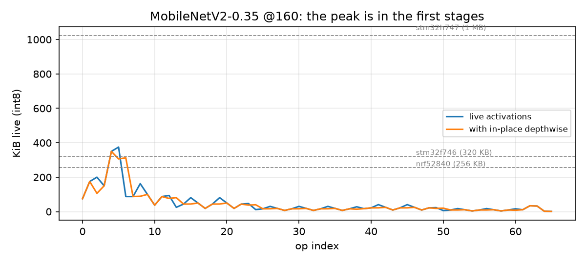
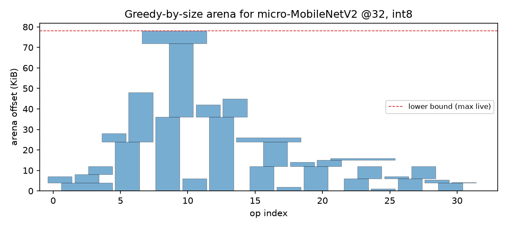
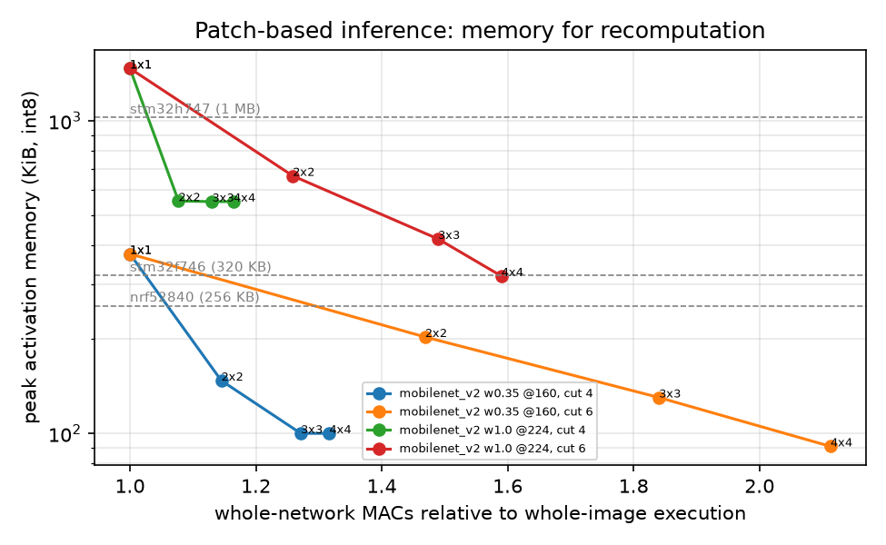

# tinyengine-memory：激活峰值下界、arena 规划、原地 depthwise、按 patch 推理

对应笔记 [M04 静态内存规划](../../../notes/module-04-static-memory-planning.md)。MIT 6.5940 的 TinyEngine 与 MCUNetV2 解决的是「激活放不进几百 KB 的 SRAM」；
这里在 PyTorch 模型上 trace 出张量存活期（`code/memplan/graph.py`），比较四种规划器与理论下界，再实现原地 depthwise 和按 patch 推理的峰值 / 重算权衡。
纯 Python，秒级完成，不需要硬件。

GPU 训练侧的同一问题（激活重算、显存规划）见 mlsys-infra [M14](https://gitee.com/liu-xingyan04/mlsys-infra/blob/main/notes/module-14-memory-optimization.md)。

## 一句话结论

- **按大小降序贪心（TFLM `GreedyMemoryPlanner`）在全部 11 个配置上正好等于存活下界**；按出生顺序 first-fit 在 torchvision MobileNetV2 上多 13.3%，每个张量独占内存则是下界的 3.6–4.7 倍。
- **原地 depthwise**：torchvision MobileNetV2 峰值再降 6.7%（1.0@224：1,505,280 → 1,404,928 B），本仓库的 micro 网络降 30.8%。
- **按 patch 推理**：MBv2-0.35@160 前 4 个 block 切 3×3 patch，峰值 384,000 → 102,400 B（3.75 倍），整网 MACs 多 27%；1.0@224 切 2×2，1,505,280 → 566,784 B，MACs 只多 7.7%。
- **切得越深、越细，重算越贵**：0.35@160 切 8 个 block、4×4 patch 时 MACs 是原来的 4.2 倍，峰值却只降到 177,360 B——halo 随层深线性外扩，重算随切分数平方增长。

## 怎么跑

```bash
cd solutions/mit6.5940/tinyengine-memory
python -m pytest -q tests
python scripts/run_experiments.py     # planners、profile、patch 三步，约 10 s
```

## 结果

### 规划器与下界（int8 激活，batch 1）

| 模型 | 下界 B | 每块独占 | first-fit | 按大小贪心 | + 原地 dw |
| --- | ---: | ---: | ---: | ---: | ---: |
| micro-mbv2（本仓库）@32 | 79,872 | 3.59× | +0% | +0% | 55,296（−30.8%） |
| MBv2-0.35@96 | 138,240 | 4.13× | +13.3% | +0% | 129,024（−6.7%） |
| MBv2-0.35@160 | 384,000 | 4.12× | +13.3% | +0% | 358,400（−6.7%） |
| MBv2-1.0@128 | 491,520 | 4.68× | +13.3% | +0% | 458,752（−6.7%） |
| MBv2-1.0@224 | 1,505,280 | 4.68× | +13.3% | +0% | 1,404,928（−6.7%） |

完整 11 行见 `planners.csv`。first-fit 的 13.3% 来自 MobileNetV2 前几层：一个大张量先放在低地址，之后同样大小的张量只能放在它上面。
micro 网络是线性链、没有这种交错，所以 first-fit 也是最优；它的 depthwise 占峰值比例高，原地执行收益更大。



MBv2-0.35@160 的逐步存活字节（`profile_mbv2_w035_160.csv`）：峰值在第 4 步，原地 depthwise 把第 2 步从 204,800 压到 108,800，但整网峰值只降到第二高点 358,400。



### 放得进哪块板子（原地 dw 后的峰值，只算激活）

| 模型 | nRF52840 256 KB | STM32F746 320 KB | STM32H747 1 MB |
| --- | --- | --- | --- |
| MBv2-0.35@128 | 是 | 是 | 是 |
| MBv2-0.35@160 | 否 | 否 | 是 |
| MBv2-1.0@96 | 是 | 是 | 是 |
| MBv2-1.0@224 | 否 | 否 | 否 |

权重另算 Flash：MBv2-0.35 int8 权重 1.72 MB，MBv2-1.0 3.61 MB，都放不进 nRF52840 的 1 MB Flash；这正是 MCUNet 要联合搜索网络结构的原因。

### 按 patch 推理



`patch.csv`：`cut` 是前几个 block 按 patch 执行，`patches` 是每边切几块，开销是整网 MACs 比值。

| 配置 | cut | p×p | 峰值 B | 整网 MACs |
| --- | ---: | ---: | ---: | ---: |
| MBv2-0.35@160 | 4 | 2×2 | 151,040 | 1.15× |
| MBv2-0.35@160 | 4 | 3×3 | 102,400 | 1.27× |
| MBv2-0.35@160 | 6 | 4×4 | 93,040 | 2.11× |
| MBv2-0.35@160 | 8 | 4×4 | 177,360 | 4.21× |
| MBv2-1.0@224 | 4 | 2×2 | 566,784 | 1.08× |
| MBv2-1.0@224 | 6 | 4×4 | 326,144 | 1.59× |

切 2 个 block 时峰值不变：峰值不在 patch 段里，在后面的层。切到 4 个 block、3×3 之后，峰值由「其余层」决定（102,400），再细分只增加重算。
MCUNetV2 的做法是用 receptive field 重新设计前几层，减小 halo；这里没有改网络。

## 和原课程的差异

- TinyEngine 生成 C 代码并在 MCU 上实测；这里只做规划与字节账，不生成代码，不测延迟。
- 存活期由 `torch.fx` trace 加一次 shape 传播得来，BN、ReLU 融合后视为别名（不分配新内存），残差的输入一直存活到相加（`test_trace_fuses_bn_relu_and_keeps_residual_input_alive`）。

## 这些数字不能推出什么

- 只算激活，没有算 TFLM 的 interpreter 开销、im2col 临时缓冲、栈；真实 arena 会更大。
- MAC 开销不等于延迟开销：patch 执行时每个 tile 都更小，cache 行为与调用开销都会变。

## 文件

| 路径 | 内容 |
| --- | --- |
| `code/memplan/graph.py` | `torch.fx` trace 张量生死时刻，处理融合与残差；`inplace_depthwise` |
| `code/memplan/planners.py` | 下界、每块独占、first-fit、按大小贪心、`validate` |
| `code/memplan/patch.py` | receptive field 回推、`patch_plan` 峰值与重算 |
| `scripts/run_experiments.py` | `step_planners`、`step_profile`、`step_patch` |
| `tests/test_memplan.py` | 下界、碎片反例、重叠检测、patch 权衡 |
