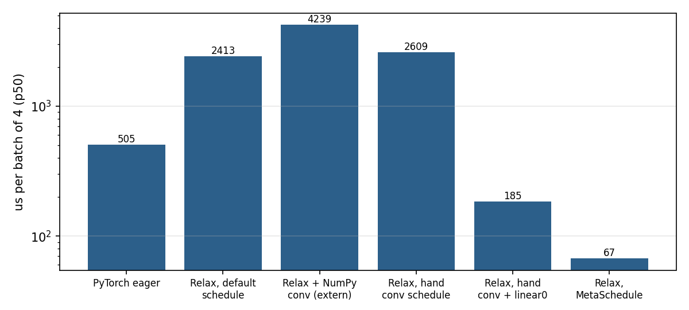

# e2e-relax：MLC 作业 1，用 TVM 0.27 的 Relax 端到端跑一张 CNN

陈天奇 MLC 课程作业 1：把 Fashion-MNIST 上训练好的 CNN（conv 3×3 1→32、ReLU、2×2 max pool、linear 5408→100、ReLU、linear 100→10、softmax）用 `BlockBuilder.emit_te` 搭成 Relax IRModule，再把卷积换成外部库调用，最后给卷积写调度。
课程用的是 2022 年的 TVM（`relax.vm.build`、`tir.Schedule`），这里迁移到 TVM 0.27；额外跑了 MetaSchedule，并把端到端时间拆到每一层。
权重是课程的 `fasionmnist_mlp_assignment_params.pkl`，测试集是 Fashion-MNIST 全部 10,000 张，batch 4。

## 一句话结论

- **五种写法数值一致**：PyTorch、`emit_te`、外部卷积、手写调度、MetaSchedule 的准确率都是 83.88%，与 PyTorch 的最大绝对误差 ≤ 4.2e-6，argmax 100% 一致。
- **默认编译慢在 linear0，不在卷积**：不调优的 Relax 每 batch 2375 µs，其中 linear0（4 × 100 × 5408）一层占 2344 µs；卷积只有 24 µs。只调卷积改变不了端到端。
- **卷积和 linear0 都手写调度后 157 µs，MetaSchedule 44 µs**，PyTorch eager 505 µs。MetaSchedule 640 次试验调了 604 s。
- **MetaSchedule 的数据库很容易静默失效**：`tune_relax` 不融合，`compile_relax` 先融合再查表，两边的 PrimFunc 对不上，所有算子退回默认调度、不报错。第一次跑出来调优后 2475 µs，和不调优一样；修法写在下面第 1 条。

## 怎么跑

```bash
cd solutions/mlc/e2e-relax
python -m pytest -q tests        # NumPy/PyTorch 三条；装了 TVM 再多三条
MLC_WEIGHTS=.../fasionmnist_mlp_assignment_params.pkl MLC_FMNIST_RAW=.../FashionMNIST/raw \
  TVM_NUM_THREADS=8 TVM_BIND_THREADS=0 taskset -c 0-7 python scripts/run_experiments.py
```

环境是单独的 venv：`apache-tvm==0.27.0.post1`，MetaSchedule 另需 `cloudpickle`、`tornado`、`psutil` 和 `xgboost`（`--no-deps` 装，避开它拉的 NCCL）。没装 TVM 时 `tests/test_relax.py` 整个跳过。
`MLC_MS_TRIALS=0` 跳过 MetaSchedule；`MLC_MS_REUSE=1` 复用 `artifacts/work/ms` 里已有的数据库，不重新调。

## 结果

主机 Intel Xeon Platinum 8470Q，`taskset` 限 8 核，target `llvm -mcpu=sapphirerapids -num-cores=8`，TVM 0.27.0.post1，PyTorch 2.8（1 线程）。
时间是 batch 4 一次调用的中位数：「VM 内」是 `time_evaluator`，「Python 调用」包括 NumPy → TVM tensor 和 `.numpy()` 回拷。

| 写法 | 准确率 | 与 PyTorch 最大误差 | VM 内 µs | Python 调用 µs |
| --- | ---: | ---: | ---: | ---: |
| PyTorch eager | 83.88% | — | — | 505 |
| Relax，默认编译 | 83.88% | 4.2e-6 | 2375 | 2413 |
| Relax + 外部卷积（NumPy） | 83.88% | 3.7e-6 | 4187 | 4239 |
| Relax，手写卷积调度 | 83.88% | 4.2e-6 | 2578 | 2609 |
| Relax，手写卷积 + linear0 调度 | 83.88% | 2.0e-6 | 157 | 185 |
| Relax，MetaSchedule | 83.88% | 4.2e-6 | **44** | **67** |



默认编译按层累加的时间（每行是「网络前 \(k\) 层」单独编译后的 VM 时间）：

| 到这一层为止 | conv | +bias | +ReLU | +pool | +flatten | +linear0 | +ReLU | +linear1 | +softmax |
| --- | ---: | ---: | ---: | ---: | ---: | ---: | ---: | ---: | ---: |
| µs | 24 | 53 | 87 | 102 | 98 | 2442 | 2441 | 2379 | 2418 |

「手写卷积调度」一行比默认编译还慢 200 µs，是 linear0 那 2.3 ms 的波动：上一轮同样两种写法是 2417 对 2449 µs，卷积本身只占 1%。
单独计时卷积 kernel（VM 外）：朴素 21.4 µs，手写调度 8.9 µs。MetaSchedule 选出的六个融合 kernel 合计 32.9 µs，其中卷积 + bias + ReLU 5.0 µs、linear0 + ReLU 19.1 µs。

## 做法

- **`emit_te`**（`code/mlce2e/relax_model.py`）：每个算子手写一个 TE compute（`te_conv2d`、`te_add_channel_bias`、`te_relu`、`te_maxpool2x2`、`te_flatten`、`te_linear`、`te_softmax`），权重以 `relax.const` 嵌进模块。
- **外部库**：`tvm.register_global_func("env.conv2d")` 注册一个 NumPy 卷积，用 `relax.call_dps_packed` 调；输出 buffer 由 Relax 分配、函数写进去（destination-passing style）。
- **卷积调度**（`schedule_conv2d`）：输出通道按 4 切，`(n, f/4, y)` 融合并行（832 个任务），`rc ry rx` 在中间，`f%4` 展开，`x`（26）向量化；先标注再 `decompose_reduction`。
- **linear0 调度**（`schedule_linear`）：\(k\) 按 16 切后 `rfactor`，每条 lane 一个部分和，输出 \(j\) 并行、lane 向量化。浮点归约不能原地向量化（会改变加法顺序），`rfactor` 把它改写成先 16 路各自累加、最后合并。
- **MetaSchedule**：`tune_relax` 640 次试验、每批 32 个候选，builder 进程数取 `taskset` 的核数。

## 踩过的坑

1. **调优数据库对不上就静默退回默认调度。** `compile_relax` 先跑 `LegalizeOps → AnnotateTIROpPattern → FuseOps → FuseTIR` 再查数据库，`tune_relax` 不跑这一步。直接调未融合的模块，记录的是 9 个单算子，编译时要查的是 6 个融合后的函数，一个都查不到。反过来把融合后的模块交给 `compile_relax` 也不行：第二次 `AnnotateTIROpPattern` 给融合函数加了 `op_pattern` 属性，结构哈希变了。可用的组合是「调 `fuse(mod)`，编译 `mod`」；`tests/test_relax.py` 把这个约束固定了下来。
2. **TVM 线程池无视 `taskset`。** 默认 `TVM_BIND_THREADS=1` 时工作线程按物理编号绑到 CPU 0–7，进程即使被 `taskset` 限在 8–15 也一样；和别的任务抢核时，同一个并行 kernel 的时间在 8 µs 到 620 µs 之间跳。设 `TVM_BIND_THREADS=0` 后稳定。
3. **小卷积并行切得太粗会比朴素版慢。** 第一版调度把 \(n, f, y, x\) 都切成 2–4 的小块、外层并行，每个任务只有十几次乘加，单独计时 53–60 µs，比朴素版（LLVM 自动向量化内层）的 21 µs 慢；改成「一行 26 个输出 × 4 个通道」一个任务后 8.9 µs。
4. **builder 进程数。** `LocalBuilder` 默认按 `os.cpu_count()`（这台 208）开进程，8 核里每个进程都超时，640 次试验全记成 build error；改成 `len(os.sched_getaffinity(0))`、超时 120 s。

## 和原课程的差异

- TVM 0.27 的 API 改名：`relax.TensorType` 取代 `R.Tensor` 的 StructInfo 写法，`tvm.tirx` 取代 `tir`，调度在 `tvm.s_tir.Schedule`（`get_sblock`），`relax.vm.build` 改为 `tvm.compile`，`tvm.nd.array` 改为 `tvm.runtime.tensor`。
- 课程的外部库是 PyTorch 卷积；这里用 NumPy，因为 TVM 0.27 的 FFI 与 PyTorch 2.8 的 DLPack 扩展冲突（需要 `TVM_FFI_DISABLE_TORCH_C_DLPACK=1`）。外部卷积每次调用要过一次 Python，所以最慢。
- 课程只要求给卷积写调度；linear0 的调度和 MetaSchedule 是额外的，用来说明端到端瓶颈在哪。

## 这些数字不能推出什么

- batch 4、单张 28 × 28 的小网络，8 核里线程启动的固定开销占了相当比例；换大 batch 或大模型，各写法的比值会变。
- PyTorch 是 1 线程 eager，TVM 是 8 线程；这里比的是「编译器把这张网调到什么程度」，不是框架之间的公平对比。公平对比见 [runtime-compare](../../edge-runtime/runtime-compare/)。

## 文件

| 路径 | 内容 |
| --- | --- |
| `code/mlce2e/reference.py` | 权重载入、Fashion-MNIST idx 读取、PyTorch 模型、NumPy 前向 |
| `code/mlce2e/relax_model.py` | TE 算子、`emit_te` 与外部卷积两版模块、`schedule_conv2d`、`schedule_linear`、`fuse` |
| `scripts/run_experiments.py` | 六种写法的准确率与计时、逐层拆分、MetaSchedule，写 `summary.json`、`runs.jsonl`、图 |
| `tests/test_e2e.py` | 参数名映射、NumPy 卷积与前向对 PyTorch |
| `tests/test_relax.py` | 四个 Relax 模块对 NumPy、融合键空间约束、调度原语都在 |
