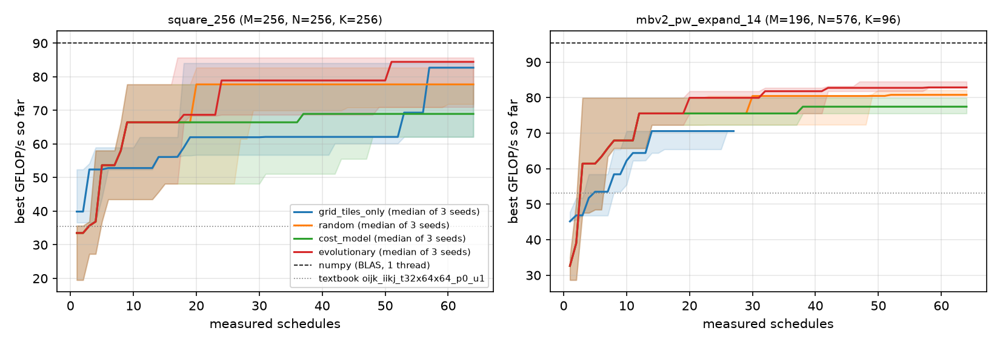

# tensor-program-tuning：在 4 核 CPU 上做一遍 AutoTVM

对应笔记 [M06 调度搜索](../../../notes/module-06-schedule-search.md)。MLC 课程讲张量程序抽象和自动优化，TVM 的 AutoTVM / Ansor / MetaSchedule 把它做成产品；
这里不依赖 TVM，自己实现整个闭环：调度空间 → 生成 C++ → 并行编译 → 顺序实测 → 四种搜索策略 → 代价模型 → 复测与向量宽度对照。
问题是 fp32 GEMM：256³ 方阵，以及 MobileNetV2 的 pw_expand_14（196×576×96，pointwise 卷积就是 GEMM）。

mlsys-infra 里同一个搜索跑在 H100 单 SM 的解析代价模型上，见 [compiler-compression](https://gitee.com/liu-xingyan04/mlsys-infra/blob/main/solutions/cmu15849/compiler-compression/README.md) 与 [M10](https://gitee.com/liu-xingyan04/mlsys-infra/blob/main/notes/module-10-ml-compilers.md)；那边没有测量噪声，这边每个点都是实测。

## 一句话结论

- **搜索比教科书快 2.4 / 1.6 倍**：进化搜索 3 个种子的中位最优 84.5 / 82.9 GFLOP/s，教科书分块 35.4 / 53.1，单线程 numpy 90.1 / 95.4。
- **好调度是寄存器块**：最内层是 2–4 行的 i 块（例如 `ojki_ikji_t2x64x64`），编译出 32 条 ymm FMA 的循环体；矩阵本身在 L2 里，L1 分块不是关键。
- **代价模型排不准**：岭回归的留出 Spearman 0.47 / 0.53，64 次预算下中位数（69.0 / 77.4）不如随机（77.7 / 80.8）。
- **噪声与差距同量级**：前 8 名复测平均低 3%–6%，单个调度 −9%～+5%；搜索报告的第一名 85.7 复测是 80.1。
- **512 位向量更慢**：`-mprefer-vector-width=512` 让 16 个候选里 13 个变慢，中位数低 12%–22%。

## 怎么跑

```bash
cd solutions/mlc/tensor-program-tuning
python -m pytest -q tests
python scripts/run_experiments.py               # 两个问题 × 四种策略 × 3 个种子 + 复测，机器空闲；编译缓存命中时约 3 分钟
python scripts/run_experiments.py --seeds 1     # 快速版
```

需要 g++（MinGW 或 Linux 均可）。编译 4 路并行，运行严格顺序；二进制按「源码 + 编译参数」的哈希缓存在 `cpp/bin/`（不入库）。

## 结果

### 搜索曲线



实线是 3 个种子的「到目前为止最好」的中位数，阴影是最小–最大。

| 问题 | 空间 | 教科书 | numpy 1 线程 | grid | random | cost_model | evolutionary | 全局最优 |
| --- | ---: | ---: | ---: | ---: | ---: | ---: | ---: | ---: |
| square_256 | 30,240 | 35.4 | 90.1 | 82.7（62.1–84.1） | 77.7（71.9–82.7） | 69.0（62.1–77.7） | **84.5**（71.0–85.7） | 85.7 |
| pw_expand_14 | 3,888 | 53.1 | 95.4 | 70.6（全部 27 点） | 80.8（80.5–82.1） | 77.4（75.5–79.9） | **82.9**（82.7–84.5） | 84.5 |

括号里是三个种子的范围。达到全局最优 90% 所需的实测次数（每个种子一个数，— 表示 64 次内没达到）：

| 问题 | grid | random | cost_model | evolutionary |
| --- | --- | --- | --- | --- |
| square_256 | 57、—、18 | 20、9、— | —、9、— | 24、9、— |
| pw_expand_14 | —、—、— | 49、30、3 | 38、—、3 | 20、42、3 |

### 什么样的调度快

`search_history.csv`，256³ 上 611 个不同调度按最内层循环与 ti 分组的中位 GFLOP/s：

| 最内层 | ti ≤ 4 | ti > 4 |
| --- | ---: | ---: |
| i | 52.9 | 10.9 |
| j | 39.3 | 38.6 |
| k | 21.8 | 11.7 |

最内层 i 且 ti 很小时，ti 行共享每个 B 向量，形成 ti × tj/8 个 ymm 累加器的寄存器块；ti 大时沿列访问 C，无法向量化。
教科书顺序（最内层 j）只换分块也能到 84.1（t16×32×8），默认的 32×64×64 只有 35.4。

### 复测与向量宽度

`vector_width.csv`：全部实测里的前 8 名重新编译，各测一次默认（256 位）和 `-mprefer-vector-width=512`。

| 问题 | 搜索时前 8 平均 | 256 位复测平均 | 256 位中位 | 512 位中位 | 512 位更快 |
| --- | ---: | ---: | ---: | ---: | ---: |
| square_256 | 83.3 | 80.6 | 79.1 | 69.5 | 1 / 8 |
| pw_expand_14 | 82.4 | 77.8 | 77.7 | 60.5 | 2 / 8 |

`ojki_ikji_t2x64x64_p1_u4` 用 512 位编译后循环体从 32 条 ymm FMA 变成 16 条 zmm FMA，却从 80.1 掉到 55.7 GFLOP/s。
AVX-512 降频（zmm 峰值对应 2.42 GHz，系统报告最高 2.8 GHz）最多解释 14%，其余没有定位：虚拟机里没有性能计数器。

### 服务器复现：同一搜索，512 位反过来赢 1.5 倍

Xeon 8470Q 上重跑全部 4 种搜索 × 3 个种子（`artifacts/raw/xeon8470q/`）：

| 问题 | 最优 GFLOP/s 本地 → 服务器 | NumPy 1 线程 | random 到 90% 的试验数（种子 0） | 代价模型 Spearman | 前 8 名 256 位最优 | 前 8 名 512 位最优 |
| --- | ---: | ---: | ---: | ---: | ---: | ---: |
| square_256 | 85.7 → 114.7 | 90.1 → 160.6 | 20 → 13 | 0.47 → 0.54 | 115.1 | **173.1** |
| pw_expand_14 | 84.5 → 112.4 | 95.4 → 166.1 | 49 → 14 | 0.53 → 0.56 | 111.1 | **156.5** |

- **向量宽度的结论随微架构翻转。** 本地 Ice Lake 上 512 位只有 1/8 的调度更快、中位数反而慢 12%；服务器 Sapphire Rapids 上 8 个调度全部更快，最优 173 对 115。
  SPR 的 AVX-512 降频档位比 Ice Lake 温和得多，且有两个完整的 512 位 FMA 端口；所以「要不要开 `-mprefer-vector-width=512`」本身就是一个需要按目标机器搜索的旋钮。
- **最优调度不可迁移**：本地前 8 名多是 `ikji` / `ijki` 内层顺序、64 宽的 tile（如 `ojki_ikji_t2x64x64`），服务器前 8 名有 7 个是 `iikj` 内层、32×8 tile。
  同一个模板、同一个编译器族，换一台机器最优点就换了位置——这就是 AutoTVM/Ansor 要在目标设备上测量、并为每种硬件单独保存调优日志的原因。
- 搜索器最优（115）仍低于 NumPy/OpenBLAS（161）：模板没有打包 B、没有 K 方向的寄存器分块。

## 和原课程的差异

- MLC 用 TVM 的 TensorIR 与 MetaSchedule；这里用 Python 生成 C++、交给 g++ 向量化，空间相当于一个固定模板（AutoTVM 风格），没有 Ansor 的 sketch 生成。
- 代价模型是 25 维手写特征上的岭回归，AutoTVM 用 XGBoost、MetaSchedule 用 MLP；这里的目的是展示「特征决定上限」，不是追求最好的模型。
- 只搜单线程；多线程并行与 cache 分块的多级结构没有放进空间。

## 这些数字不能推出什么

- 单次实测有 −9%～+5% 的波动，前几名之间的名次没有意义；策略之间几个百分点的差距在 3 个种子、64 次预算下也不显著。
- 「512 位更慢」只对这些 g++ 自动向量化出来的内核成立；手写的 AVX-512 微内核（例如 OpenBLAS / oneDNN）可以用满 zmm。
- numpy 的 90 GFLOP/s 是它自带的 BLAS，本仓库没有核对它用的指令集。

## 文件

| 路径 | 内容 |
| --- | --- |
| `code/tuner/schedule.py` | `Problem`、`Schedule`（七个旋钮、`key` / `from_key`）、`Space`、`render`、`footprint_bytes` |
| `code/tuner/runner.py` | `compile_batch`（并行 g++，按哈希缓存，`flags` 进哈希）、`measure`（顺序运行、校验误差） |
| `code/tuner/search.py` | `grid`、`random_search`、`model_guided`、`evolutionary`、`features`、`Ridge` |
| `scripts/run_experiments.py` | 多种子搜索、留出 Spearman、前 8 复测与向量宽度、画图 |
| `tests/test_tuner.py` | 空间整除、渲染、key 往返、岭回归、预算、空间小于候选池时终止、编译内核正确性、512 位编译 |
